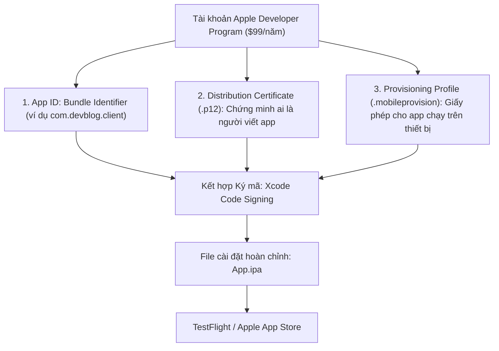
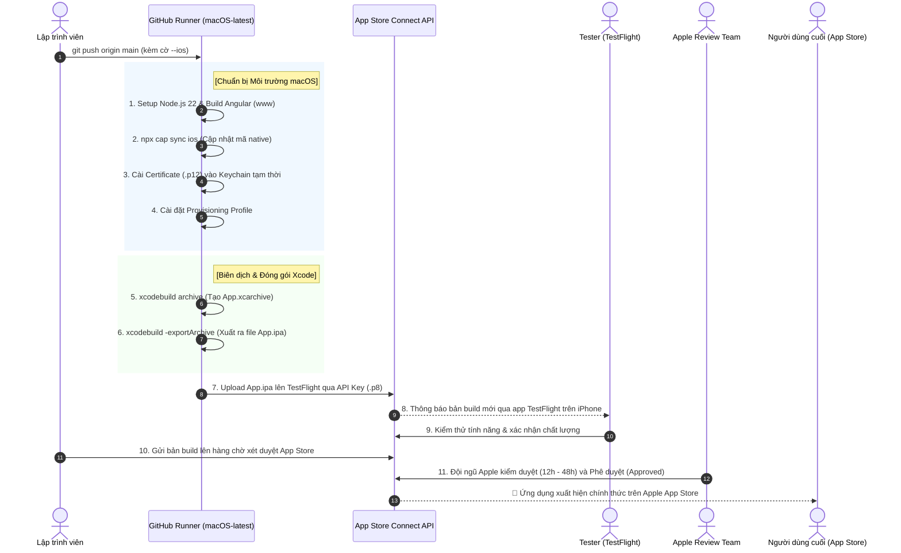
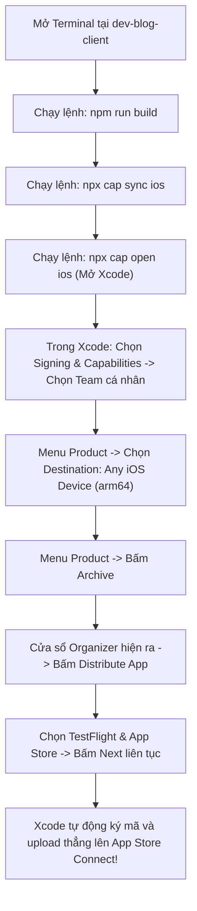

# 🍎 Hướng Dẫn Tự Động Build IPA & Upload Lên Apple App Store / TestFlight (iOS)

---

## 📌 Mục Lục
1. [Khái niệm cốt lõi về Hệ Thống Chứng Chỉ iOS (Apple Code Signing)](#1-khái-niệm-cốt-lõi-về-hệ-thống-chứng-chỉ-ios-apple-code-signing)
2. [Sơ đồ quy trình phát hành iOS (Workflow Diagram)](#2-sơ-đồ-quy-trình-phát-hành-ios-workflow-diagram)
3. [Bước 1: Chuẩn bị trên Apple Developer Portal & App Store Connect](#bước-1-chuẩn-bị-trên-apple-developer-portal--app-store-connect)
4. [Bước 2: Xuất Chứng chỉ (`.p12`) & Provisioning Profile](#bước-2-xuất-chứng-chỉ-p12--provisioning-profile)
5. [Bước 3: Tạo App Store Connect API Key (Để CI/CD tự động đăng nhập)](#bước-3-tạo-app-store-connect-api-key-để-cicd-tự-động-đăng-nhập)
6. [Bước 4: Cài đặt Bí mật trên GitHub (GitHub Secrets)](#bước-4-cài-đặt-bí-mật-trên-github-github-secrets)
7. [Bước 5: File Workflow mẫu hoàn chỉnh (`ios-app-store.yml`)](#bước-5-file-workflow-mẫu-hoàn-chỉnh-ios-app-storeyml)
8. [Tự Động Hóa Build IPA & TestFlight Bằng Fastlane (Khuyên dùng)](#8-tự-động-hóa-build-ipa--testflight-bằng-fastlane-khuyên-dùng)
9. [Phương án thay thế: Build thủ công bằng Xcode trên máy Mac cá nhân](#phương-án-thay-thế-build-thủ-công-bằng-xcode-trên-máy-mac-cá-nhân)
10. [Những lỗi kinh điển khi phát hành iOS & Cách khắc phục](#những-lỗi-kinh-điển-khi-phát-hành-ios--cách-khắc-phục)

---

## 1. Khái niệm cốt lõi về Hệ Thống Chứng Chỉ iOS (Apple Code Signing)

Khác với Android (chỉ cần 1 file keystore tự tạo bằng lệnh), Apple kiểm soát bảo mật hệ sinh thái iOS cực kỳ nghiêm ngặt:



| Thành phần | Định dạng | Mục đích |
| :--- | :---: | :--- |
| **Bundle ID** | Chuỗi (Reverse domain) | Tên định danh độc nhất của app (ví dụ: `com.devblog.client` hoặc `io.ionic.starter`). |
| **Distribution Certificate** | `.cer` ➡️ `.p12` | Chứng chỉ định danh nhà phát hành thương mại của Apple cấp cho công ty/cá nhân bạn. |
| **Provisioning Profile** | `.mobileprovision` | Hồ sơ liên kết giữa: **App ID + Certificate + Quyền truy cập App Store**. |
| **App Store Connect API Key** | `.p8` | Chìa khóa cấp quyền cho GitHub Actions tự động upload file `.ipa` mà không bị hỏi mã xác thực 2 bước 2FA. |

---

## 2. Sơ đồ quy trình phát hành iOS (Workflow Diagram)



---

## 3. Bước 1: Chuẩn bị trên Apple Developer Portal & App Store Connect

### 3.1. Đăng ký tài khoản
Bắt buộc phải có tài khoản **Apple Developer Program** (chi phí $99/năm) tại [developer.apple.com](https://developer.apple.com/).

### 3.2. Đăng ký App ID (Identifiers)
1. Vào [Certificates, Identifiers & Profiles](https://developer.apple.com/account/resources/identifiers/list).
2. Bấm dấu **+** ➡️ Chọn **App IDs** ➡️ Bấm **Continue**.
3. Description: `Dev Blog Client`.
4. Bundle ID: Chọn **Explicit** và nhập chính xác Bundle Identifier của bạn (ví dụ: `com.devblog.client`).
5. Bấm **Register**.

### 3.3. Tạo ứng dụng trên App Store Connect
1. Truy cập [appstoreconnect.apple.com](https://appstoreconnect.apple.com/).
2. Vào **Apps** ➡️ Bấm dấu **+** ➡️ **New App**.
3. Chọn nền tảng: **iOS**.
4. Chọn đúng **Bundle ID** vừa đăng ký ở bước 3.2.
5. SKU: Nhập mã định danh nội bộ (ví dụ: `devblog-client-01`).
6. Nhấn **Create**.

---

## 4. Bước 2: Xuất Chứng chỉ (`.p12`) & Provisioning Profile

### 4.1. Tạo Distribution Certificate
1. Mở ứng dụng **Keychain Access** (Truy cập chuỗi khóa) trên máy Mac của bạn.
2. Trên thanh menu, chọn: **Keychain Access** ➡️ **Certificate Assistant** ➡️ **Request a Certificate from a Certificate Authority...**.
3. Nhập email của bạn, chọn **Saved to disk** (Lưu vào đĩa) ➡️ Bấm Continue để lưu file `CertificateSigningRequest.certSigningRequest`.
4. Mở [Apple Developer Certificates](https://developer.apple.com/account/resources/certificates/list) ➡️ Bấm dấu **+** ➡️ Chọn **Apple Distribution** ➡️ Upload file `.certSigningRequest` vừa tạo lên.
5. Tải file `.cer` về máy và nhấp đúp chuột để nạp vào Keychain máy Mac.

### 4.2. Xuất Certificate thành file `.p12`
1. Trong **Keychain Access**, chuyển sang mục **My Certificates**.
2. Tìm chứng chỉ vừa thêm (dạng: `Apple Distribution: Tên Bạn (Team ID)`).
3. Bấm chuột phải ➡️ Chọn **Export "Apple Distribution..."**.
4. Lưu dưới định dạng **Personal Information Exchange (.p12)**.
5. Nhập mật khẩu bảo vệ cho file `.p12` (Ví dụ: `MyP12SecretPass123`).

### 4.3. Tạo Provisioning Profile cho App Store
1. Vào [Profiles trên Apple Developer Portal](https://developer.apple.com/account/resources/profiles/list).
2. Bấm dấu **+** ➡️ Tại mục **Distribution**, chọn **App Store** ➡️ Bấm Continue.
3. Chọn đúng **App ID** (`com.devblog.client`).
4. Chọn đúng **Distribution Certificate** vừa tạo ở bước 4.1.
5. Đặt tên profile: `DevBlog_AppStore_Profile` ➡️ Bấm **Generate**.
6. Tải file `DevBlog_AppStore_Profile.mobileprovision` về máy.

---

## 5. Bước 3: Tạo App Store Connect API Key (Để CI/CD tự động đăng nhập)

Apple hỗ trợ API Key để các công cụ tự động hóa đẩy bản build lên mà không cần mật khẩu Apple ID:

1. Vào [App Store Connect ➡️ Users and Access](https://appstoreconnect.apple.com/access/integrations/api).
2. Chọn tab **Integrations** ➡️ Mục **App Store Connect API**.
3. Bấm dấu **+** để tạo Key mới:
   - Name: `GitHub Actions CI`
   - Access: **App Manager** (hoặc Admin).
4. Ghi lại các thông tin:
   - **Issuer ID**: Chuỗi UUID hiển thị ở đầu trang (ví dụ: `69a6de70-xxxx-xxxx-xxxx-xxxxxxxxxxxx`).
   - **Key ID**: Mã định danh của key (ví dụ: `2X9R4274HS`).
   - Bấm **Download API Key**: Tải file private key định dạng `.p8` (chỉ được tải duy nhất 1 lần, hãy cất giữ cẩn thận).

---

## 6. Bước 4: Cài đặt Bí mật trên GitHub (GitHub Secrets)

Chuyển đổi các file nhị phân thành chuỗi Base64 bằng Terminal trên máy Mac:
```bash
# 1. Base64 cho file Certificate .p12
base64 -i distribution.p12 | pbcopy

# 2. Base64 cho file Provisioning Profile .mobileprovision
base64 -i DevBlog_AppStore_Profile.mobileprovision | pbcopy

# 3. Nội dung file AuthKey .p8
cat AuthKey_2X9R4274HS.p8 | pbcopy
```

Vào repository GitHub ➡️ **Settings** ➡️ **Secrets and variables** ➡️ **Actions** ➡️ Thêm các secret sau:

| Tên Secret | Giá trị |
| :--- | :--- |
| `APP_STORE_CONNECT_API_KEY` | Nội dung văn bản bên trong file `AuthKey_xxx.p8`. |
| `APP_STORE_CONNECT_KEY_ID` | Key ID (ví dụ: `2X9R4274HS`). |
| `APP_STORE_CONNECT_ISSUER_ID`| Issuer ID (ví dụ: `69a6de70-xxxx-...`). |
| `IOS_CERTIFICATE_BASE64` | Chuỗi Base64 của file `.p12`. |
| `IOS_CERTIFICATE_PASSWORD` | Mật khẩu giải nén file `.p12` đã đặt ở Bước 4.2. |
| `IOS_PROVISION_PROFILE_BASE64`| Chuỗi Base64 của file `.mobileprovision`. |

---

## 7. Bước 5: File Workflow mẫu hoàn chỉnh (`ios-app-store.yml`)

Tạo file mới tại `.github/workflows/ios-app-store.yml`:

```yaml
name: Build & Publish iOS IPA to TestFlight / App Store

on:
  push:
    branches: [ main ]
  workflow_dispatch:
    inputs:
      custom_version:
        description: 'Tùy chọn: Nhập version mới (ví dụ 1.0.0)'
        required: false
        default: ''

jobs:
  build-ios:
    name: Build & Upload to TestFlight
    if: contains(github.event.head_commit.message, '--ios') || github.event_name == 'workflow_dispatch'
    runs-on: macos-14 # Sử dụng máy ảo Mac Apple Silicon M1 của GitHub

    defaults:
      run:
        working-directory: ./dev-blog-client

    steps:
      - name: 1. Checkout mã nguồn
        uses: actions/checkout@v4

      - name: 2. Cài đặt Node.js 22
        uses: actions/setup-node@v4
        with:
          node-version: 22
          cache: 'npm'
          cache-dependency-path: './dev-blog-client/package-lock.json'

      - name: 3. Cài đặt chứng chỉ ký mã (Apple Certificate)
        env:
          BUILD_CERTIFICATE_BASE64: ${{ secrets.IOS_CERTIFICATE_BASE64 }}
          P12_PASSWORD: ${{ secrets.IOS_CERTIFICATE_PASSWORD }}
          KEYCHAIN_PASSWORD: "temporary-keychain-pass"
        run: |
          # Tạo keychain tạm thời trên máy ảo Mac
          KEYCHAIN_PATH=$RUNNER_TEMP/build.keychain-db
          security create-keychain -p "$KEYCHAIN_PASSWORD" $KEYCHAIN_PATH
          security set-keychain-settings -lut 21600 $KEYCHAIN_PATH
          security unlock-keychain -p "$KEYCHAIN_PASSWORD" $KEYCHAIN_PATH

          # Giải mã và nhập chứng chỉ .p12
          echo "$BUILD_CERTIFICATE_BASE64" | base64 --decode > $RUNNER_TEMP/certificate.p12
          security import $RUNNER_TEMP/certificate.p12 -P "$P12_PASSWORD" -A -t cert -f pkcs12 -k $KEYCHAIN_PATH
          security set-key-partition-list -S apple-tool:,apple: -s -k "$KEYCHAIN_PASSWORD" $KEYCHAIN_PATH
          security list-keychain -d user -s $KEYCHAIN_PATH

      - name: 4. Cài đặt Provisioning Profile
        env:
          BUILD_PROVISION_PROFILE_BASE64: ${{ secrets.IOS_PROVISION_PROFILE_BASE64 }}
        run: |
          mkdir -p ~/Library/MobileDevice/Provisioning\ Profiles
          echo "$BUILD_PROVISION_PROFILE_BASE64" | base64 --decode > ~/Library/MobileDevice/Provisioning\ Profiles/profile.mobileprovision

      - name: 5. Cài đặt dependencies (NPM)
        run: npm ci --legacy-peer-deps

      - name: 6. Build mã nguồn Web (Angular www)
        run: npm run build

      - name: 7. Đồng bộ sang iOS Native (Capacitor Sync)
        run: npx cap sync ios

      - name: 8. Biên dịch ứng dụng iOS (Xcode Archive)
        run: |
          cd ios/App
          xcodebuild -workspace App.xcworkspace \
            -scheme App \
            -configuration Release \
            -archivePath $RUNNER_TEMP/App.xcarchive \
            archive \
            CURRENT_PROJECT_VERSION=${{ github.run_number }} \
            MARKETING_VERSION=${{ inputs.custom_version || '1.0.0' }}

      - name: 9. Đóng gói file App.ipa
        run: |
          cd ios/App
          # Tạo file ExportOptions.plist
          cat <<EOF > $RUNNER_TEMP/ExportOptions.plist
          <?xml version="1.0" encoding="UTF-8"?>
          <!DOCTYPE plist PUBLIC "-//Apple//DTD PLIST 1.0//EN" "http://www.apple.com/DTDs/PropertyList-1.0.dtd">
          <plist version="1.0">
          <dict>
              <key>method</key>
              <string>app-store</string>
              <key>teamID</key>
              <string>${{ secrets.APPLE_TEAM_ID }}</string>
              <key>uploadBitcode</key>
              <false/>
              <key>compileBitcode</key>
              <false/>
          </dict>
          </plist>
          EOF

          xcodebuild -exportArchive \
            -archivePath $RUNNER_TEMP/App.xcarchive \
            -exportOptionsPlist $RUNNER_TEMP/ExportOptions.plist \
            -exportPath $RUNNER_TEMP/build

      - name: 10. Upload file IPA lên TestFlight / App Store Connect
        env:
          APP_STORE_CONNECT_API_KEY: ${{ secrets.APP_STORE_CONNECT_API_KEY }}
          KEY_ID: ${{ secrets.APP_STORE_CONNECT_KEY_ID }}
          ISSUER_ID: ${{ secrets.APP_STORE_CONNECT_ISSUER_ID }}
        run: |
          mkdir -p ~/.appstoreconnect/private_keys
          echo "$APP_STORE_CONNECT_API_KEY" > ~/.appstoreconnect/private_keys/AuthKey_$KEY_ID.p8
          
          # Dùng công cụ chuẩn xcrun altool của Xcode để upload IPA
          xcrun altool --upload-app \
            -f $RUNNER_TEMP/build/App.ipa \
            -t ios \
            --apiKey $KEY_ID \
            --apiIssuer $ISSUER_ID
```

---

## 8. Tự Động Hóa Build IPA & TestFlight Bằng Fastlane (Khuyên dùng)

**Fastlane** là công cụ chuẩn công nghiệp số 1 thế giới để tự động hóa build, ký mã và phân phối ứng dụng iOS mà không cần mở giao diện Xcode.

### 8.1. Cấu trúc thư mục Fastlane trong dự án

Dự án đã được tích hợp Fastlane tại thư mục `ios/App/fastlane`:
- [Appfile](file:///Users/congphu2210/Desktop/Phu/dev-blog-client-2.0/dev-blog-client/ios/App/fastlane/Appfile): Chứa `app_identifier` (`io.ionic.starter` hoặc đọc từ `ENV['APP_IDENTIFIER']`), Apple ID và Team ID.
- [Fastfile](file:///Users/congphu2210/Desktop/Phu/dev-blog-client-2.0/dev-blog-client/ios/App/fastlane/Fastfile): Định nghĩa các luồng công việc (lanes) tự động hóa.

```
dev-blog-client/
├── ios/App/
│   ├── fastlane/
│   │   ├── Appfile       # Cấu hình Bundle ID & Apple Team
│   │   └── Fastfile      # Các lane build_dev, build_adhoc, build_appstore, beta
│   ├── App.xcworkspace
│   └── Podfile
└── release/
    └── ios/              # Thư mục xuất file .ipa sau khi build
```

---

### 8.2. Danh sách các lệnh Build nhanh (NPM Scripts)

Bạn chỉ cần đứng tại thư mục gốc của dự án và chạy 1 lệnh duy nhất:

| Lệnh NPM | Lệnh Fastlane tương đương | Mục đích sử dụng | File xuất ra |
| :--- | :--- | :--- | :--- |
| `npm run fastlane:dev` | `fastlane build_dev` | Build file IPA dạng **Development** để cài test trực tiếp trên máy Mac / iPhone nhà phát triển. | `release/ios/dev-blog-client-dev.ipa` |
| `npm run fastlane:adhoc` | `fastlane build_adhoc` | Build file IPA dạng **Ad-Hoc** để upload lên Diawi, Firebase App Distribution cho tester cài đặt. | `release/ios/dev-blog-client-adhoc.ipa` |
| `npm run fastlane:appstore` | `fastlane build_appstore` | Build file IPA chuẩn **App Store / TestFlight** đã tối ưu hóa và ký mã Production. | `release/ios/dev-blog-client-appstore.ipa` |
| `npm run fastlane:beta` | `fastlane beta` | Tự động build App Store IPA và đẩy thẳng lên **TestFlight** trên App Store Connect. | TestFlight Build |

> [!TIP]
> Mỗi lệnh trên đều **tự động chạy** quy trình:
> 1. `npm run build` (Biên dịch Angular Web sang `www/`)
> 2. `npx cap sync ios` (Đồng bộ web build và native plugins vào thư mục `ios/App`)
> 3. Tự động biên dịch & đóng gói file `.ipa` thông qua `gym` (`build_app`).

---

### 8.3. Chạy Fastlane trực tiếp từ Terminal

Nếu bạn muốn chạy trực tiếp bằng lệnh Fastlane và truyền tham số:

```bash
cd ios/App

# 1. Kiểm tra danh sách các lane có sẵn
fastlane lanes

# 2. Build Development IPA (Bỏ qua bước sync web nếu đã sync trước đó)
fastlane build_dev skip_sync:true

# 3. Build Ad-Hoc IPA
fastlane build_adhoc

# 4. Build App Store IPA
fastlane build_appstore
```

---

### 8.4. Cấu hình Signing (Ký mã chứng chỉ) cho Fastlane

Fastlane hỗ trợ cờ `-allowProvisioningUpdates`. Khi máy Mac của bạn đã đăng nhập Apple ID trong Xcode:
1. Mở Xcode một lần: `npx cap open ios`
2. Vào thẻ **Signing & Capabilities** -> Chọn Team của bạn và tích chọn **Automatically manage signing**.
3. Sau đó, Fastlane sẽ tự động tải hoặc cập nhật Provisioning Profile hợp lệ tương ứng với từng kiểu export (`development`, `ad-hoc`, `app-store`) mà không cần làm thủ công.

Nếu cần chỉ định Team ID hoặc Apple ID thông qua biến môi trường:
```bash
export APP_IDENTIFIER="io.ionic.starter"
export APPLE_ID="your-email@example.com"
export FASTLANE_TEAM_ID="YOUR_TEAM_ID"
npm run fastlane:dev
```

---

## 9. Phương án thay thế: Build thủ công bằng Xcode trên máy Mac cá nhân

Nếu bạn chưa sẵn sàng thiết lập toàn bộ chứng chỉ lên CI/CD của GitHub, bạn có thể build và upload trực tiếp từ máy tính Mac của mình trong **5 phút**:



---

## 10. Những lỗi kinh điển khi phát hành iOS & Cách khắc phục

### ❌ Lỗi 1: `Provisioning profile doesn't match the entitlement...`
- **Nguyên nhân**: Bundle Identifier trong file cấu hình `project.pbxproj` của Xcode khác với Bundle ID đã đăng ký trên trang Apple Developer.
- **Cách khắc phục**: Mở `capacitor.config.ts`, kiểm tra lại `appId` đảm bảo trùng khớp từng ký tự với Apple Developer Portal (ví dụ `com.devblog.client`).

### ❌ Lỗi 2: `Missing purpose string in Info.plist (NSCameraUsageDescription...)`
- **Nguyên nhân**: App có dùng plugin máy ảnh hoặc định vị, nhưng chưa khai báo câu giải thích xin quyền cho người dùng.
- **Cách khắc phục**: Mở file `ios/App/App/Info.plist` và bổ sung các cặp thẻ string giải thích rõ lý do cần quyền (ví dụ: "Ứng dụng cần camera để chụp ảnh avatar").

### ❌ Lỗi 3: `Asset validation failed: Invalid Bundle Version (CFBundleVersion)`
- **Nguyên nhân**: Bản build mới có số build number (`CURRENT_PROJECT_VERSION`) trùng lặp với bản đã upload trước đó.
- **Cách khắc phục**: Mỗi lần upload bản mới, hãy tăng biến `CURRENT_PROJECT_VERSION` (trong CI/CD chúng ta dùng `${{ github.run_number }}` tự tăng).

---
*Tài liệu chuẩn hóa phát hành Apple iOS & TestFlight dành cho dự án `dev-blog-client-2.0`.*
