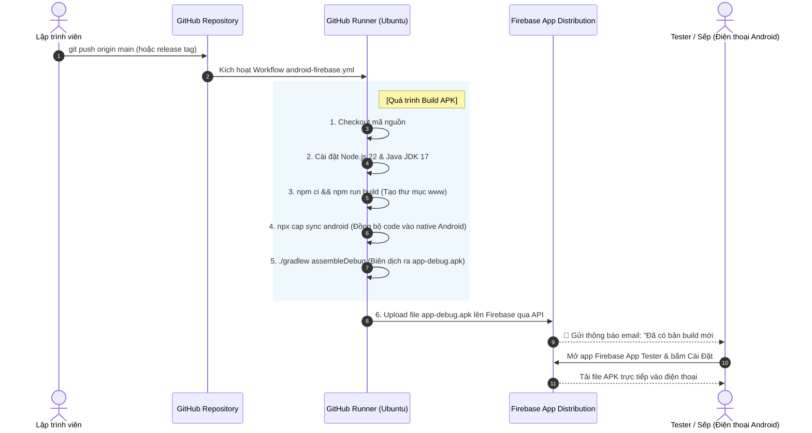

# 📱 Hướng Dẫn Tự Động Build APK & Phân Phối / Lưu Trữ Lên Firebase Bằng CI/CD

---

## 📌 Mục Lục
1. [Tại sao dùng Firebase để lưu APK? (Firebase App Distribution)](#1-tại-sao-dùng-firebase-để-lưu-apk)
2. [Sơ đồ quy trình hoạt động (Workflow Diagram)](#2-sơ-đồ-quy-trình-hoạt-động-workflow-diagram)
3. [Bước 1: Chuẩn bị trên Firebase Console](#bước-1-chuẩn-bị-trên-firebase-console)
4. [Bước 2: Cài đặt Bí mật (GitHub Secrets)](#bước-2-cài-đặt-bí-mật-github-secrets)
5. [Bước 3: Tạo File Workflow GitHub Actions (`android-firebase.yml`)](#bước-3-tạo-file-workflow-github-actions-android-firebaseyml)
6. [Mổ xẻ chi tiết TỪNG DÒNG code trong file Workflow](#mổ-xẻ-chi-tiết-từng-dòng-code-trong-file-workflow)
7. [Cách Tester và Lập Trình Viên nhận & cài đặt file APK](#cách-tester-và-lập-trình-viên-nhận--cài-đặt-file-apk)
8. [Phương án phụ: Lưu APK trực tiếp vào Firebase Cloud Storage (Direct Link)](#phương-án-phụ-lưu-apk-trực-tiếp-vào-firebase-cloud-storage)

---

## 1. Tại sao dùng Firebase để lưu APK?

Trong phát triển ứng dụng di động (Ionic / Capacitor / Angular), để đưa file APK cho sếp, đồng nghiệp hoặc Tester cài thử nghiệm, chúng ta **không nên** gửi file `.apk` qua Zalo hay Google Drive thủ công vì:
- Dễ nhầm lẫn phiên bản cũ / mới.
- Mỗi lần sửa code lại phải mở máy tính build bằng tay mất 10-15 phút.

### 🏆 Giải pháp số 1 thế giới: **Firebase App Distribution**
* **Miễn phí 100%**: Không tốn chi phí.
* **Tự động lưu trữ lịch sử**: Mỗi commit / lần push sẽ lưu 1 version APK riêng biệt (kèm mã commit, ghi chú release notes).
* **Phân phối thông minh**: Tự động gửi email thông báo cho danh sách Tester kèm nút **Tải xuống cài đặt** ngay trên điện thoại.
* **Không cần qua Google Play Store**: Không phải chờ Google xét duyệt 2-3 ngày, đẩy lên là có thể cài ngay lập tức.

---

## 2. Sơ đồ quy trình hoạt động (Workflow Diagram)



---

## Bước 1: Chuẩn bị trên Firebase Console

### 1.1. Tạo Project Firebase
1. Truy cập [Firebase Console](https://console.firebase.google.com/).
2. Bấm **Add project** (Thêm dự án) -> Đặt tên dự án (ví dụ: `dev-blog-mobile`).

### 1.2. Thêm ứng dụng Android
1. Tại trang chủ Project, bấm vào biểu tượng **Android** (con robot).
2. Điền thông tin Package Name:
   - **Android package name**: Xem trong file `capacitor.config.ts`, ví dụ: `io.ionic.starter`
   - Bấm **Register app** (Đăng ký ứng dụng).
3. Bấm Next qua các bước tiếp theo (không cần tải file `google-services.json` nếu chưa dùng Firebase Push Notification).

### 1.3. Bật tính năng App Distribution
1. Ở menu bên trái, tìm mục **Release & Monitor** -> Chọn **App Distribution**.
2. Nhấn nút **Get started** (Bắt đầu).
3. Chuyển sang tab **Testers & Groups**:
   - Bấm **Add group** (ví dụ đặt tên nhóm: `dev-team`).
   - Nhập email của bạn và những người cần nhận file APK để test.

### 1.4. Lấy Firebase App ID
1. Bấm vào biểu tượng bánh răng ⚙️ (Project settings) ở góc trên bên trái.
2. Cuộn xuống mục **Your apps**, chọn app Android vừa tạo.
3. Copy mã **App ID** (có định dạng tương tự: `1:102938475612:android:9a8b7c6d5e4f3a2b`).

### 1.5. Lấy Firebase Token / Service Account
Để GitHub Actions có quyền đẩy file lên Firebase mà không cần đăng nhập bằng tay:

*Cách đơn giản nhất (Dùng Firebase CLI Token):*
1. Trên máy tính của bạn, mở terminal gõ:
   ```bash
   npx firebase-tools login:ci
   ```
2. Trình duyệt mở ra -> Đăng nhập tài khoản Google của bạn -> Bấm Cho phép.
3. Quay lại terminal, bạn sẽ thấy 1 đoạn mã token dài (ví dụ: `1//04X...ABC`). Hãy copy đoạn token này.

---

## Bước 2: Cài đặt Bí mật (GitHub Secrets)

Để bảo mật token và App ID, lưu chúng vào GitHub:
1. Vào repository GitHub của bạn (`dev-blog-client-2.0`).
2. Chọn **Settings** -> **Secrets and variables** -> **Actions**.
3. Bấm **New repository secret**:
   - Secret 1:
     - Name: `FIREBASE_APP_ID`
     - Secret: Dán mã App ID ở bước 1.4 (ví dụ `1:102938475612:android:...`).
   - Secret 2:
     - Name: `FIREBASE_TOKEN`
     - Secret: Dán đoạn token CI ở bước 1.5.

---

## Bước 3: Tạo File Workflow GitHub Actions (`android-firebase.yml`)

Tạo file mới tại đường dẫn: `.github/workflows/android-firebase.yml` trong repo của bạn:

```yaml
name: Build & Distribute Android APK to Firebase

on:
  push:
    branches: [ main ]
  workflow_dispatch: # Cho phép bấm nút "Run workflow" bằng tay trên web GitHub

jobs:
  build-and-distribute:
    name: Build APK & Upload Firebase
    runs-on: ubuntu-latest

    defaults:
      run:
        working-directory: ./dev-blog-client

    steps:
      - name: 1. Checkout mã nguồn
        uses: actions/checkout@v4

      - name: 2. Cài đặt Node.js 22
        uses: actions/setup-node@v4
        with:
          node-version: 22
          cache: 'npm'
          cache-dependency-path: './dev-blog-client/package-lock.json'

      - name: 3. Cài đặt Java JDK 17
        uses: actions/setup-java@v4
        with:
          distribution: 'zulu'
          java-version: '17'

      - name: 4. Cài đặt dependencies (NPM)
        run: npm ci --legacy-peer-deps

      - name: 5. Build mã nguồn Web (Angular www)
        run: npm run build

      - name: 6. Đồng bộ sang Android Native (Capacitor Sync)
        run: npx cap sync android

      - name: 7. Cấp quyền thực thi cho Gradle Wrapper
        run: chmod +x android/gradlew

      - name: 8. Biên dịch Android Debug APK
        run: |
          cd android
          ./gradlew assembleDebug --no-daemon

      - name: 9. Lưu trữ Artifact APK lên GitHub Actions (Tải dự phòng)
        uses: actions/upload-artifact@v4
        with:
          name: app-debug-apk
          path: ./dev-blog-client/android/app/build/outputs/apk/debug/app-debug.apk
          retention-days: 14

      - name: 10. Phân phối APK lên Firebase App Distribution
        uses: wzieba/Firebase-Distribution-Github-Action@v1
        with:
          appId: ${{ secrets.FIREBASE_APP_ID }}
          token: ${{ secrets.FIREBASE_TOKEN }}
          groups: dev-team
          file: ./dev-blog-client/android/app/build/outputs/apk/debug/app-debug.apk
          releaseNotes: |
            Commit: ${{ github.sha }}
            Message: ${{ github.event.head_commit.message }}
            Branch: ${{ github.ref_name }}
```

---

## Mổ xẻ chi tiết TỪNG DÒNG code trong file Workflow

| Dòng code | Ý nghĩa thực tế | Tại sao bắt buộc phải có? |
| :--- | :--- | :--- |
| `workflow_dispatch:` | Bật chế độ chạy thủ công. | Rất tiện: Khi muốn build gấp 1 bản APK gửi khách hàng mà không muốn sửa code để push, chỉ cần vào tab Actions bấm nút **Run workflow**. |
| `actions/setup-java@v4`<br>`java-version: '17'` | Cài đặt máy ảo Java (JDK 17). | **Android Gradle bắt buộc cần Java**. Nếu thiếu Java, lệnh `./gradlew` sẽ sập ngay lập tức vì không có môi trường chạy compiler của Android SDK. |
| `npx cap sync android` | Lệnh của Capacitor. | Sau khi Angular build xong thư mục `www`, lệnh này sẽ copy toàn bộ HTML/JS/CSS và các plugin Capacitor vào trong thư mục `android/app/src/main/assets/public`. Nếu thiếu bước này, app Android sẽ chỉ chạy phiên bản code cũ rích! |
| `chmod +x android/gradlew` | Cấp quyền chạy file thực thi (`execute permission`) cho file `gradlew`. | Git trên môi trường Linux thường làm mất quyền execute của file `gradlew`. Nếu không có lệnh `chmod +x`, máy ảo sẽ báo lỗi `Permission denied: ./gradlew`. |
| `./gradlew assembleDebug` | Biên dịch project Android thành file `.apk`. | Lệnh này gọi hệ thống Gradle của Android để đóng gói code Java/Kotlin, mã web, assets thành file APK debug hoàn chỉnh. |
| `actions/upload-artifact@v4` | Đính kèm file APK vào trang kết quả của GitHub Actions. | Dự phòng: Bạn và team có thể vào trực tiếp tab Actions của commit đó tải thẳng file `app-debug.apk` về máy tính bất cứ lúc nào (lưu trữ 14 ngày). |
| `wzieba/Firebase-Distribution...` | Action đẩy APK lên Firebase. | Tự động kết nối với API Firebase App Distribution, upload file APK lên cloud, đính kèm ghi chú commit message và tự gửi email mời cài đặt tới nhóm `dev-team`. |

---

## Cách Tester và Lập Trình Viên nhận & cài đặt file APK

Khi workflow chạy xong thành công (màu xanh ✅):
1. **Qua Email**: 
   - Những ai có email nằm trong group `dev-team` trên Firebase sẽ nhận được 1 email: *"congphu invited you to test dev-blog-client"*.
   - Nhấn **Get Started** từ điện thoại -> Tải app **App Distribution** (hoặc mở trực tiếp trên trình duyệt di động) -> Bấm **Download** để cài file APK.
2. **Khi có bản cập nhật mới**:
   - Khi bạn push commit mới, ứng dụng trên máy tester sẽ hiển thị thông báo: *"Đã có phiên bản mới, bạn có muốn cập nhật không?"* mà không cần gỡ ra cài lại từ đầu!

---

## Phương án phụ: Lưu APK trực tiếp vào Firebase Cloud Storage

Nếu bạn **không** muốn dùng tính năng App Distribution (quản lý tester), mà chỉ muốn lưu file `app-debug.apk` vào **Firebase Storage Bucket** (giống như Google Drive) để lấy 1 đường link trực tiếp cho mọi người bấm vào tải về:

```yaml
      - name: Cài đặt Firebase Tools
        run: npm install -g firebase-tools

      - name: Upload APK trực tiếp vào Firebase Storage Bucket
        run: |
          npx @google-cloud/storage ...
          # Hoặc dùng action: GoogleCloudPlatform/github-actions/upload-cloud-storage
```
> 💡 **Khuyên dùng:** Đối với ứng dụng di động, **Firebase App Distribution** là giải pháp vượt trội hơn Storage thông thường gấp 10 lần vì có hệ thống quản lý version, thông báo cập nhật, theo dõi crash, và phân quyền cài đặt an toàn.
