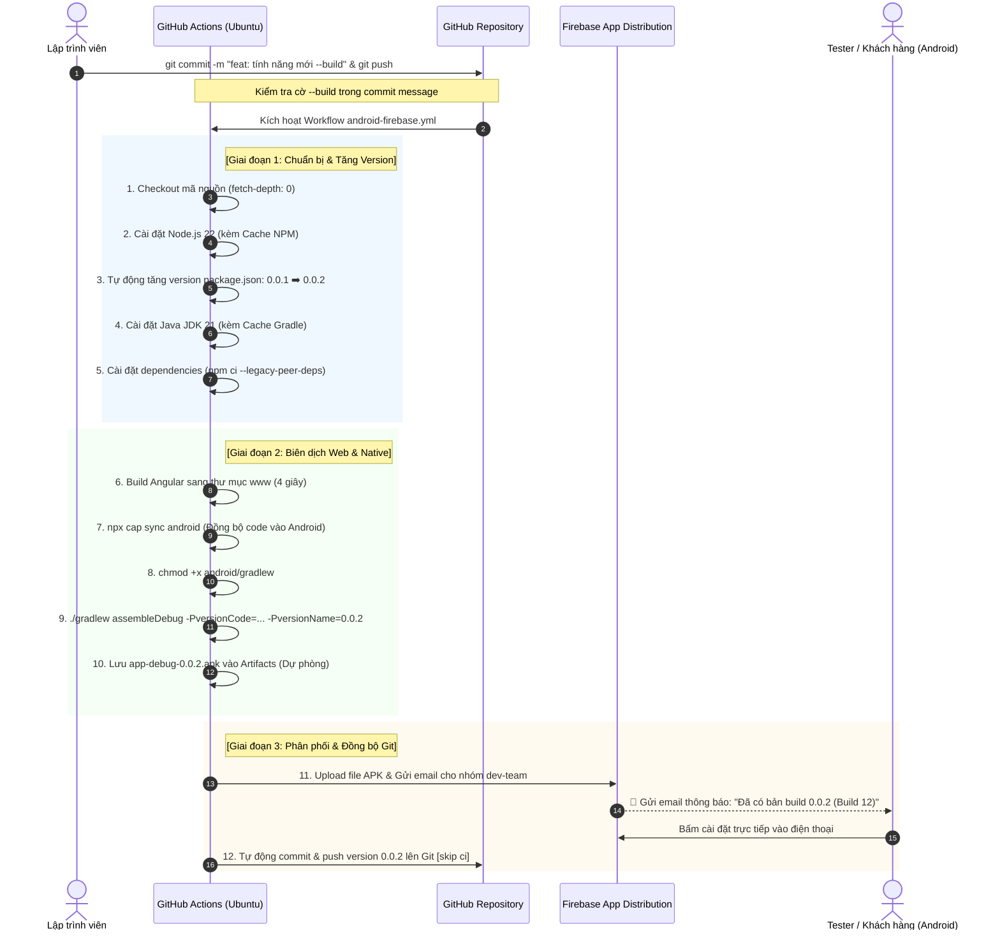
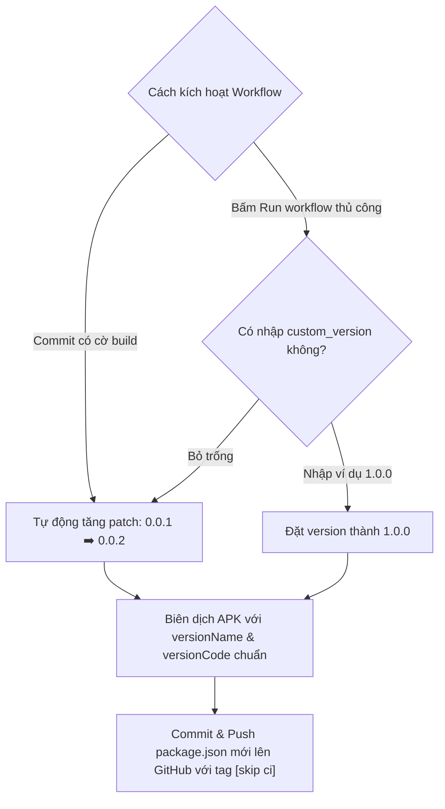
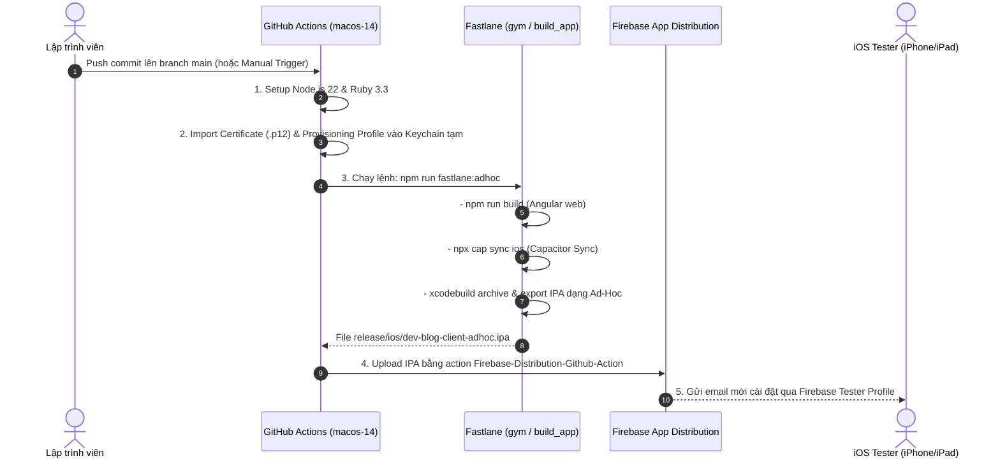

# 📱 Hướng Dẫn Tự Động Build APK & Phân Phối Firebase App Distribution Bằng CI/CD

> 📚 **Tài liệu liên quan trong hệ thống CI/CD:**
> - [🌐 CI/CD Web (Deploy GitHub Pages)](CI_CD_GITHUB_ACTIONS.md)
> - [🤖 Build AAB & Xuất bản lên Google Play Console (CH Play)](CI_CD_GOOGLE_PLAY.md)
> - [🍎 Build IPA & Xuất bản lên Apple App Store / TestFlight](CI_CD_APP_STORE.md)

---

## 📌 Mục Lục
1. [Tại sao dùng Firebase App Distribution để phân phối APK?](#1-tại-sao-dùng-firebase-app-distribution-để-phân-phối-apk)
2. [Sơ đồ quy trình hoạt động (Workflow Diagram)](#2-sơ-đồ-quy-trình-hoạt-động-workflow-diagram)
3. [Cơ chế tự động tăng Version & Cờ kích hoạt `--build`](#3-cơ-chế-tự-động-tăng-version--cờ-kích-hoạt---build)
4. [Bước 1: Chuẩn bị trên Firebase Console (Tránh lỗi 404 nhóm tester)](#bước-1-chuẩn-bị-trên-firebase-console-tránh-lỗi-404-nhóm-tester)
5. [Bước 2: Cài đặt Bí mật trên GitHub (GitHub Secrets)](#bước-2-cài-đặt-bí-mật-trên-github-github-secrets)
6. [Bước 3: Mổ xẻ chi tiết TỪNG DÒNG file `android-firebase.yml`](#bước-3-mổ-xẻ-chi-tiết-từng-dòng-file-android-firebaseyml)
7. [Các lỗi thực tế kinh điển & Cách giải quyết triệt để](#các-lỗi-thực-tế-kinh-điển--cách-giải-quyết-triệt-để)
8. [Hướng dẫn Tester & Lập trình viên nhận và cài đặt app](#hướng-dẫn-tester--lập-trình-viên-nhận-và-cài-đặt-app)
9. [Phân phối file iOS IPA lên Firebase bằng GitHub Actions & Fastlane](#9-phân-phối-file-ios-ipa-lên-firebase-bằng-github-actions--fastlane)

---

## 1. Tại sao dùng Firebase App Distribution để phân phối APK?

Trong phát triển ứng dụng di động (Ionic / Capacitor / Angular), việc gửi file `.apk` thủ công qua Zalo, Telegram hay Google Drive thường gặp nhiều bất cập:
- Dễ nhầm lẫn giữa các bản build cũ và mới.
- Mỗi lần sửa code lại phải mở máy tính build bằng tay mất 10-15 phút.
- Tester cài đặt đè bản mới thường gặp xung đột phiên bản.

### 🏆 Giải pháp số 1 thế giới: **Firebase App Distribution**
* **Miễn phí 100%**: Không mất phí duy trì tài khoản.
* **Tự động lưu trữ lịch sử**: Mỗi lần build sẽ tạo một bản release riêng kèm mã commit, ghi chú thay đổi (release notes) và số version rõ ràng.
* **Tự động gửi thông báo**: Gửi email thông báo tức thì cho nhóm tester kèm link cài đặt trực tiếp.
* **Không cần xét duyệt**: Cài đặt thử nghiệm ngay mà không cần chờ 2-3 ngày kiểm duyệt của Google Play Store.

---

## 2. Sơ đồ quy trình hoạt động (Workflow Diagram)

Dưới đây là sơ đồ toàn diện mô tả cách thức mã nguồn được đóng gói thành file APK và chuyển tới tay người dùng:



---

## 3. Cơ chế tự động tăng Version & Cờ kích hoạt `--build`

### 🔄 1. Quy tắc tự động tăng Version trong `package.json`
Mỗi lần kích hoạt workflow:
- Hệ thống chạy lệnh `npm version patch --no-git-tag-version`:
  `0.0.1` ➡️ `0.0.2` ➡️ `0.0.3` ➡️ `0.0.4`...
- **Đồng bộ sang Android Native**:
  - `versionName`: Lấy đúng chuỗi version từ `package.json` (ví dụ `0.0.2`).
  - `versionCode`: Lấy số thứ tự lần chạy của GitHub Actions (`${{ github.run_number }}`) để đảm bảo luôn là số nguyên tăng dần (yêu cầu bắt buộc của Android và Google Play).
- **Lưu ngược lại GitHub**: Sau khi build thành công, GitHub Actions dùng tài khoản bot tự động commit file `package.json` mới lên nhánh `main` với tiền tố `[skip ci]` (để không bị lặp vô tận).

### 🎯 2. Tùy chọn truyền Version thủ công (Run Workflow)
Khi cần phát hành một bản cập nhật lớn (Major/Minor version):
1. Vào tab **Actions** trên GitHub.
2. Chọn workflow **Build & Distribute Android APK to Firebase**.
3. Bấm **Run workflow**:
   - Ô **`custom_version`**: Nhập số version mong muốn (ví dụ `1.0.0` hoặc `2.0.0`).
   - Nếu để trống, hệ thống sẽ tự động tăng +1 patch như bình thường.



---

## 4. Bước 1: Chuẩn bị trên Firebase Console (Tránh lỗi 404 nhóm tester)

> [!IMPORTANT]
> Bước này bắt buộc phải thực hiện để tránh lỗi:
> `Error: failed to distribute to testers/groups: HTTP Error: 404, Requested entity was not found.`

### 4.1. Kích hoạt Firebase App Distribution
1. Mở [Firebase Console](https://console.firebase.google.com/) và chọn dự án của bạn (ví dụ: `blog-dev-33836`).
2. Ở thanh menu bên trái, tìm mục **Release & Monitor** ➡️ Chọn **App Distribution**.
3. Nhấn nút **Get Started** (Bắt đầu).

### 4.2. Tạo nhóm Tester `dev-team`
1. Tại màn hình App Distribution, chuyển sang tab **Testers & Groups** (Người kiểm thử & Nhóm).
2. Chuyển sang mục con **Groups** (Nhóm) ➡️ Bấm **Add group** (Thêm nhóm).
3. Đặt tên nhóm chính xác là:
   ```text
   dev-team
   ```
4. Thêm các địa chỉ email của bạn và những người cần nhận file APK vào nhóm này.
5. Nhấn **Save** (Lưu).

---

## 5. Bước 2: Cài đặt Bí mật trên GitHub (GitHub Secrets)

Để GitHub Actions có quyền tải APK lên Firebase, cần cung cấp 2 thông số bảo mật:

### 5.1. Lấy Firebase App ID
1. Trên Firebase Console, bấm vào biểu tượng bánh răng ⚙️ (**Project settings**).
2. Tại tab **General**, cuộn xuống mục **Your apps**, chọn ứng dụng Android của bạn (`io.ionic.starter`).
3. Copy chuỗi **App ID** (ví dụ: `1:885936311589:android:1234567890abcdef`).

### 5.2. Lấy Firebase CLI Token
Mở Terminal trên máy tính của bạn và chạy lệnh:
```bash
npx firebase-tools login:ci
```
- Trình duyệt sẽ mở ra ➡️ Đăng nhập tài khoản Google quản lý Firebase ➡️ Bấm **Cho phép (Allow)**.
- Quay lại Terminal, copy chuỗi token dài xuất hiện trên màn hình (dạng `1//04X...`).

### 5.3. Lưu vào GitHub Secrets
1. Vào repository GitHub (`dev-blog-client-2.0`).
2. Vào **Settings** ➡️ **Secrets and variables** ➡️ **Actions**.
3. Bấm **New repository secret** và thêm lần lượt:
   - Tên: `FIREBASE_APP_ID` | Giá trị: *Dán App ID lấy ở mục 5.1*.
   - Tên: `FIREBASE_TOKEN` | Giá trị: *Dán token lấy ở mục 5.2*.

---

## 6. Bước 3: Mổ xẻ chi tiết TỪNG DÒNG file `android-firebase.yml`

File này nằm tại: `.github/workflows/android-firebase.yml`

```yaml
name: Build & Distribute Android APK to Firebase

on:
  push:
    branches: [ main ]
  workflow_dispatch:
    inputs:
      custom_version:
        description: 'Tùy chọn: Nhập version (ví dụ 0.0.2 hoặc 1.0.0, để trống sẽ tự động tăng +1)'
        required: false
        default: ''

permissions:
  contents: write

jobs:
  build-and-distribute:
    name: Build APK & Upload Firebase
    if: contains(github.event.head_commit.message, '--build') || github.event_name == 'workflow_dispatch'
    runs-on: ubuntu-latest

    defaults:
      run:
        working-directory: ./dev-blog-client

    steps:
      - name: 1. Checkout mã nguồn
        uses: actions/checkout@v4
        with:
          fetch-depth: 0

      - name: 2. Cài đặt Node.js 22
        uses: actions/setup-node@v4
        with:
          node-version: 22
          cache: 'npm'
          cache-dependency-path: './dev-blog-client/package-lock.json'

      - name: 3. Tăng version ứng dụng (package.json)
        id: bump_version
        run: |
          if [ -n "${{ inputs.custom_version }}" ]; then
            npm version ${{ inputs.custom_version }} --no-git-tag-version
          else
            npm version patch --no-git-tag-version
          fi
          NEW_VERSION=$(node -p "require('./package.json').version")
          echo "NEW_VERSION=$NEW_VERSION" >> $GITHUB_ENV
          echo "✅ Đã cập nhật version lên: $NEW_VERSION"

      - name: 4. Cài đặt Java JDK 21
        uses: actions/setup-java@v4
        with:
          distribution: 'zulu'
          java-version: '21'
          cache: 'gradle'

      - name: 5. Cài đặt dependencies (NPM)
        run: npm ci --legacy-peer-deps

      - name: 6. Build mã nguồn Web (Angular www)
        run: npm run build

      - name: 7. Đồng bộ sang Android Native (Capacitor Sync)
        run: npx cap sync android

      - name: 8. Cấp quyền thực thi cho Gradle Wrapper
        run: chmod +x android/gradlew

      - name: 9. Biên dịch Android Debug APK
        run: |
          cd android
          ./gradlew assembleDebug -PversionCode=${{ github.run_number }} -PversionName=${{ env.NEW_VERSION }} --no-daemon

      - name: 10. Lưu trữ Artifact APK lên GitHub Actions (Tải dự phòng)
        uses: actions/upload-artifact@v4
        with:
          name: app-debug-${{ env.NEW_VERSION }}
          path: ./dev-blog-client/android/app/build/outputs/apk/debug/app-debug.apk
          retention-days: 14

      - name: 11. Phân phối APK lên Firebase App Distribution
        uses: wzieba/Firebase-Distribution-Github-Action@v1
        continue-on-error: true
        with:
          appId: ${{ secrets.FIREBASE_APP_ID }}
          token: ${{ secrets.FIREBASE_TOKEN }}
          groups: dev-team
          file: ./dev-blog-client/android/app/build/outputs/apk/debug/app-debug.apk
          releaseNotes: |
            Phiên bản: ${{ env.NEW_VERSION }} (Build ${{ github.run_number }})
            Commit: ${{ github.sha }}
            Message: ${{ github.event.head_commit.message }}
            Branch: ${{ github.ref_name }}

      - name: 12. Lưu và đẩy version mới lên GitHub
        if: success()
        run: |
          git config user.name "github-actions[bot]"
          git config user.email "github-actions[bot]@users.noreply.github.com"
          git add package.json package-lock.json
          git commit -m "chore(release): bump version to ${{ env.NEW_VERSION }} [skip ci]" || echo "No changes to commit"
          git push origin main
```

### 📖 Bảng giải thích chi tiết từng bước:
| Bước | Tên bước | Mục đích & Ý nghĩa kỹ thuật |
| :---: | :--- | :--- |
| **-** | `permissions: contents: write` | Cấp quyền cho GitHub Actions có thể `git push` file `package.json` đã tăng version ngược lại repository. |
| **1** | `Checkout mã nguồn` | Kéo toàn bộ code về máy ảo. `fetch-depth: 0` giúp lấy toàn bộ lịch sử commit để phục vụ push Git. |
| **2** | `Cài đặt Node.js 22` | Thiết lập Node 22 và bật bộ nhớ đệm NPM Cache để rút ngắn thời gian cài gói. |
| **3** | `Tăng version package.json` | Đọc tham số `custom_version` hoặc tự tăng `patch +1`. Lưu số version mới vào biến môi trường toàn cục `NEW_VERSION`. |
| **4** | `Cài đặt Java JDK 21` | **Bắt buộc cho Capacitor 7**. Bật thêm `cache: 'gradle'` giúp các lần build APK sau nhanh hơn 2 - 3 lần. |
| **5** | `Cài đặt dependencies` | Cài đặt toàn bộ thư viện npm chính xác theo lockfile bằng `npm ci --legacy-peer-deps`. |
| **6** | `Build mã nguồn Web` | Biên dịch Angular sang thư mục `./dev-blog-client/www`. |
| **7** | `Capacitor Sync` | Sao chép HTML/JS/CSS từ `www` sang thư mục native `android/app/src/main/assets/public`. |
| **8** | `chmod +x gradlew` | Cấp quyền thực thi cho file chạy Gradle trên Linux runner. |
| **9** | `Biên dịch Android Debug APK` | Chạy lệnh `./gradlew assembleDebug` kèm 2 tham số: `-PversionCode` (số lần build) và `-PversionName` (số version mới). |
| **10** | `Lưu trữ Artifact APK` | Lưu trữ file APK trực tiếp trên trang GitHub Actions trong 14 ngày để bạn có thể tải về máy tính bất cứ lúc nào. |
| **11** | `Phân phối Firebase` | Đẩy APK lên Firebase App Distribution, tự gửi email thông báo và link tải cho nhóm `dev-team`. `continue-on-error: true` giúp pipeline không bị tạch kể cả khi Firebase tạm thời lỗi mạng hoặc nhóm tester chưa tạo xong. |
| **12** | `Đẩy version mới lên GitHub` | Dùng bot GitHub tự động commit file `package.json` mới lên nhánh `main` với cờ `[skip ci]`. |

---

## 7. Các lỗi thực tế kinh điển & Cách giải quyết triệt để

### ❌ Lỗi 1: `Unable to resolve action wzieba/firebase-app-distribution-github-action, repository not found`
* **Nguyên nhân**: Thừa chữ `-App-` trong tên repository của Action.
* **Cách khắc phục**: Sửa thành tên repository chuẩn:
  ```yaml
  uses: wzieba/Firebase-Distribution-Github-Action@v1
  ```

### ❌ Lỗi 2: `Capacitor could not find the web assets directory` hoặc không thấy Gradle
* **Nguyên nhân**: Thư mục native `dev-blog-client/android/` bị liệt kê nhầm trong file [.gitignore](file:///Users/congphu2210/Desktop/Phu/dev-blog-client-2.0/.gitignore) nên GitHub không có mã nguồn Android để build.
* **Cách khắc phục**: Xóa dòng `dev-blog-client/android/` trong `.gitignore` và commit toàn bộ source code Android lên Git.

### ❌ Lỗi 3: `error: invalid source release: 21` khi chạy Gradle
* **Nguyên nhân**: Capacitor 7 bắt buộc dùng **Java JDK 21** (`sourceCompatibility = JavaVersion.VERSION_21`), nhưng workflow lại cài đặt Java JDK 17.
* **Cách khắc phục**: Đổi `java-version: '17'` thành `java-version: '21'` trong bước `setup-java`.

### ❌ Lỗi 4: `Error: failed to distribute to testers/groups: HTTP Error: 404, Requested entity was not found`
* **Nguyên nhân**: Trong workflow có khai báo `groups: dev-team`, nhưng trên Firebase Console chưa tạo nhóm có tên `dev-team`.
* **Cách khắc phục**: Vào Firebase Console ➡️ App Distribution ➡️ Tab **Testers & Groups** ➡️ Tạo nhóm tên **`dev-team`**.

---

## 8. Hướng dẫn Tester & Lập trình viên nhận và cài đặt app

Khi pipeline chạy thành công:

### Cách 1: Tải trực tiếp từ Email / App Tester của Firebase (Khuyên dùng)
1. Mở email được gửi từ Firebase trên điện thoại Android.
2. Bấm **Get Started** ➡️ Tải ứng dụng **App Distribution Tester** về máy.
3. Bấm **Download** để cài file APK. Khi có phiên bản mới trong tương lai, ứng dụng sẽ tự hiện thông báo cập nhật!

### Cách 2: Tải file APK trực tiếp từ GitHub Actions
1. Vào mục **Actions** trên GitHub repository.
2. Bấm vào lượt build mới nhất của commit.
3. Cuộn xuống cuối trang mục **Artifacts** ➡️ Bấm tải file **`app-debug-0.0.2`** về máy tính và cài vào điện thoại hoặc máy ảo Android Studio.

---

## 9. Phân phối file iOS IPA lên Firebase bằng GitHub Actions & Fastlane

Bên cạnh Android APK, dự án đã hỗ trợ đóng gói và phân phối file iOS `.ipa` lên Firebase App Distribution thông qua sự kết hợp giữa **GitHub Actions (macOS runner)** và **Fastlane**.

### 9.1. Sơ đồ kiến trúc CI/CD iOS + Fastlane + Firebase



---

### 9.2. Các GitHub Secrets cần chuẩn bị cho iOS

Để GitHub Actions runner tự động ký mã iOS và phân phối lên Firebase, hãy thêm các secret sau vào **Repository Settings ➡️ Secrets and variables ➡️ Actions**:

| Tên Secret | Ý nghĩa | Cách lấy |
| :--- | :--- | :--- |
| `FIREBASE_IOS_APP_ID` | App ID của ứng dụng iOS trên Firebase | Vào **Firebase Console** ➡️ **Project Settings** ➡️ Chọn app iOS (định dạng `1:xxx:ios:xxx`). |
| `FIREBASE_TOKEN` | Token CLI chứng thực quyền đẩy bản build | Chạy lệnh `npx firebase login:ci` trên máy cá nhân để lấy token. |
| `BUILD_CERTIFICATE_BASE64` | File chứng chỉ `.p12` đã mã hóa Base64 | Xuất từ Keychain Access máy Mac (Certificate Distribution/Development) rồi chạy lệnh `base64 -i cert.p12 \| pbcopy`. |
| `P12_PASSWORD` | Mật khẩu bảo vệ file `.p12` khi xuất ra | Mật khẩu bạn đặt lúc export `.p12` từ Keychain Access. |
| `BUILD_PROVISION_PROFILE_BASE64` | Provisioning Profile (`.mobileprovision`) dạng Ad-Hoc đã mã hóa Base64 | Tải profile Ad-Hoc từ Apple Developer Portal rồi chạy lệnh `base64 -i profile.mobileprovision \| pbcopy`. |
| `FIREBASE_TESTER_GROUPS` | Tên nhóm tester trên Firebase (Tùy chọn) | Ví dụ: `dev-team` (mặc định nếu không set). |

---

### 9.3. File Workflow hoàn chỉnh: `.github/workflows/ios-firebase.yml`

File workflow nằm tại [.github/workflows/ios-firebase.yml](file://.github/workflows/ios-firebase.yml).
Quy trình tự động thực hiện:
1. Tải source code và cài đặt Node.js, Ruby, CocoaPods, Fastlane.
2. Giải mã và import chứng chỉ vào Keychain tạm thời của GitHub runner.
3. Kích hoạt Fastlane đóng gói file `.ipa` dạng Ad-Hoc ra thư mục `release/ios/dev-blog-client-adhoc.ipa`.
4. Đẩy file `.ipa` lên Firebase App Distribution và gửi thông báo tới nhóm testers.
5. Dọn dẹp Keychain an toàn sau khi hoàn tất.

---

### 9.4. Chạy trực tiếp từ máy Mac cá nhân (Local Fastlane)

Nếu bạn muốn build và đẩy thẳng lên Firebase từ máy Mac của mình mà không cần chờ GitHub Actions:

```bash
# 1. Đặt biến môi trường Firebase App ID và Token (hoặc đăng nhập npx firebase login)
export FIREBASE_IOS_APP_ID="1:YOUR_APP_ID:ios:YOUR_HASH"
export FIREBASE_TOKEN="YOUR_FIREBASE_TOKEN"

# 2. Chạy 1 lệnh duy nhất (tự động build web + sync + đóng gói .ipa + upload Firebase)
npm run fastlane:firebase
```

> [!IMPORTANT]
> **Lưu ý đối với iOS Tester khi cài đặt qua Firebase:**
> Apple yêu cầu thiết bị của tester (iPhone/iPad) phải có mã **UDID** được đăng ký trong **Ad-Hoc Provisioning Profile** của tài khoản Apple Developer. Tester khi nhận email từ Firebase chỉ cần mở link trên Safari để cài đặt cấu hình thiết bị (Device Profile) nếu cần đăng ký UDID.

---
*Tài liệu chuẩn hóa dành riêng cho dự án `dev-blog-client-2.0` (Capacitor 7 + Ionic 8 + Firebase App Distribution).*

