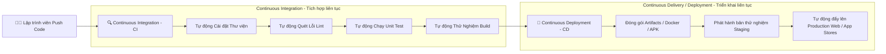
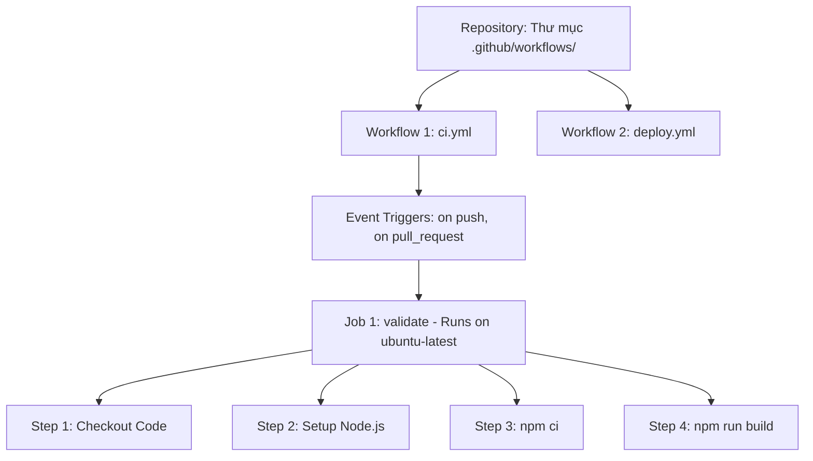
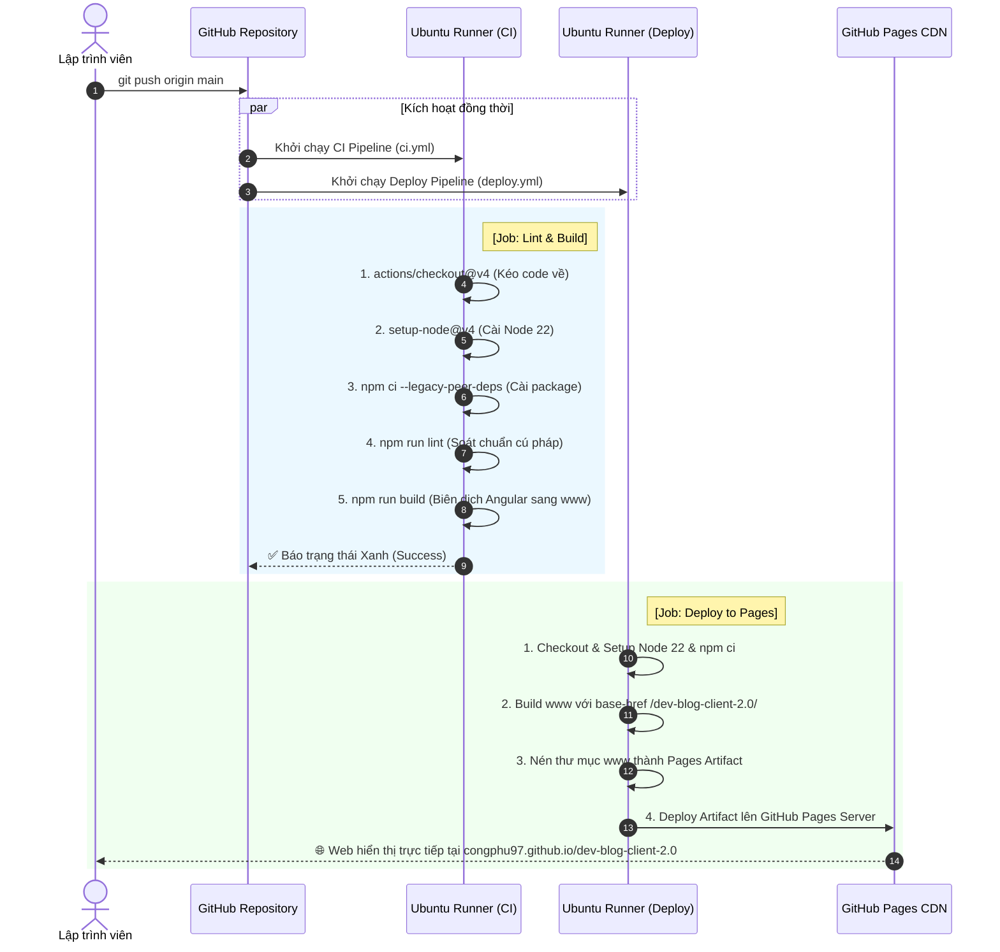

# 🚀 Cẩm Nang Toàn Tập Về CI/CD Với GitHub Actions (Dành Cho Người Mới Bắt Đầu)

---

## 📌 Mục Lục
1. [CI/CD là gì? Tại sao phải dùng?](#1-cicd-là-gì-tại-sao-phải-dùng)
2. [GitHub Actions là gì? Kiến trúc cốt lõi](#2-github-actions-là-gì-kiến-trúc-cốt-lõi)
3. [Mô hình trực quan chu trình CI/CD](#3-mô-hình-trực-quan-chu-trình-cicd)
4. [Mổ xẻ chi tiết TỪNG DÒNG: File `ci.yml` (Pipeline kiểm tra mã nguồn)](#4-mổ-xẻ-chi-tiết-từng-dòng-file-ciyml)
5. [Mổ xẻ chi tiết TỪNG DÒNG: File `deploy.yml` (Pipeline tự động hóa Deploy)](#5-mổ-xẻ-chi-tiết-từng-dòng-file-deployyml)
6. [Các khái niệm nâng cao thường gặp trong thực tế](#6-các-khái-niệm-nâng-cao-thường-gặp-trong-thực-tế)
7. [Những lỗi kinh điển và cách xử lý (Troubleshooting)](#7-những-lỗi-kinh-điển-và-cách-xử-lý-troubleshooting)
8. [Tóm tắt ghi nhớ nhanh (Cheat Sheet)](#8-tóm-tắt-ghi-nhớ-nhanh-cheat-sheet)

---

## 1. CI/CD là gì? Tại sao phải dùng?

Trước khi có CI/CD, quy trình làm phần mềm thủ công thường gặp thảm họa:
- **Developer A** code xong, tự chạy trên máy mình thấy chạy được (`It works on my machine!`).
- **Developer A** nén file `.zip` hoặc gửi file build qua Zalo/Drive cho sếp hoặc tự FTP/SSH lên server đè file.
- **Hậu quả**: Server sập vì máy local dùng Node 20 nhưng server chạy Node 16; hoặc code merge đụng độ với Developer B mà không ai test trước.

### 🧩 Phân định CI vs CD:



| Thuật ngữ | Tên đầy đủ | Ý nghĩa thực tế |
| :--- | :--- | :--- |
| **CI** | **Continuous Integration** *(Tích hợp liên tục)* | Mỗi khi có code mới được `git push` hoặc tạo `Pull Request`, hệ thống tự động tải code về, cài dependencies, chạy lint, chạy test, build thử. Nếu có bất kỳ lỗi nào, hệ thống **báo động đỏ (Fail)** ngay lập tức để lập trình viên sửa trước khi merge vào nhánh chính. |
| **CD** | **Continuous Delivery / Deployment** *(Phát hành & Triển khai liên tục)* | Sau khi CI vượt qua thành công, hệ thống tự động đóng gói ứng dụng (HTML/CSS/JS, Docker Container, file APK, v.v.) và đẩy thẳng lên môi trường chạy thực tế (GitHub Pages, AWS, Vercel, Server công ty) mà **không cần con người can thiệp bằng tay**. |

---

## 2. GitHub Actions là gì? Kiến trúc cốt lõi

**GitHub Actions** là công cụ CI/CD tích hợp sẵn 100% bên trong GitHub. Bạn không cần cài server riêng (như Jenkins hay GitLab Runner), GitHub cung cấp sẵn máy ảo trên mây (Ubuntu, Windows, macOS) hoàn toàn miễn phí cho các repository public.

### 🏛️ Phân cấp các thành phần trong GitHub Actions:



1. **Workflow (Quy trình)**: Là 1 file định dạng `.yml` hoặc `.yaml` nằm trong thư mục `.github/workflows/`. Bạn có thể tạo nhiều workflow (ví dụ: 1 file để test, 1 file để deploy web, 1 file để build app di động).
2. **Event (Sự kiện kích hoạt)**: Điều kiện để workflow tự động khởi chạy. Ví dụ: khi ai đó `git push`, khi tạo `pull_request`, hoặc hẹn giờ chạy theo lịch `cron`.
3. **Runner (Máy chủ thực thi)**: Máy tính ảo trên cloud của GitHub (thường là `ubuntu-latest`, `macos-latest`, hoặc `windows-latest`). Mỗi lần workflow kích hoạt, GitHub cấp phát 1 máy ảo hoàn toàn mới tinh, sạch sẽ (chưa có code gì).
4. **Job (Nhiệm vụ)**: Tập hợp các bước (steps) chạy trên cùng một Runner. Các Job mặc định chạy **song song** (parallel) trừ khi bạn cấu hình phụ thuộc (`needs`).
5. **Step (Bước)**: Từng mệnh lệnh tuần tự bên trong Job. Nếu một step bị lỗi (exit code khác 0), toàn bộ job sẽ dừng lại và đánh dấu thất bại.
6. **Action**: Một đoạn script hoặc công cụ dựng sẵn do cộng đồng hoặc chính GitHub viết để tái sử dụng (ví dụ: `actions/checkout@v4` để clone code, `actions/setup-node@v4` để cài Node.js).

---

## 3. Mô hình trực quan chu trình CI/CD dự án `dev-blog-client-2.0`

Dưới đây là sơ đồ toàn cảnh cách dự án của bạn hoạt động khi bạn đẩy code lên GitHub:



---

## 4. Mổ xẻ chi tiết TỪNG DÒNG: File `ci.yml`

File này chịu trách nhiệm: **Kiểm tra sức khỏe mã nguồn mỗi khi có người push hoặc tạo Pull Request.**

```yaml
name: CI Pipeline

on:
  push:
    branches: [ main, develop ]
  pull_request:
    branches: [ main, develop ]

defaults:
  run:
    working-directory: ./dev-blog-client

jobs:
  validate:
    name: Lint & Build
    runs-on: ubuntu-latest

    steps:
      - name: Checkout mã nguồn dev-blog-client
        uses: actions/checkout@v4

      - name: Thiết lập Node.js
        uses: actions/setup-node@v4
        with:
          node-version: 22

      - name: Cài đặt dependencies dev-blog-client
        run: npm ci --legacy-peer-deps

      - name: Kiểm tra Lint
        run: npm run lint
        continue-on-error: true

      - name: Build ứng dụng (www)
        run: npm run build
```

### 📖 Giải Thích Chi Tiết Từng Dòng:

| Dòng code | Mục đích | Tại sao phải viết như vậy? |
| :--- | :--- | :--- |
| `name: CI Pipeline` | Đặt tên hiển thị cho Workflow. | Tên này xuất hiện ở tab **Actions** trên GitHub để bạn dễ nhận biết đây là quy trình kiểm tra chất lượng. |
| `on:` | Khai báo các sự kiện kích hoạt (Event triggers). | Báo cho GitHub biết: "Khi nào thì mày chạy file này?". |
| `push:`<br>` branches: [ main, develop ]` | Chạy khi có lệnh `git push` vào nhánh `main` hoặc `develop`. | Đảm bảo bất cứ commit nào nạp vào 2 nhánh quan trọng này đều được kiểm định tự động. |
| `pull_request:`<br>` branches: [ main, develop ]` | Chạy khi ai đó tạo một Pull Request hướng về `main` hoặc `develop`. | **Cực kỳ quan trọng**: Giúp bạn xem code của đồng nghiệp có pass test/build không **trước khi nhấn nút Merge**. |
| `defaults:`<br>` run:`<br>` working-directory: ./dev-blog-client` | Cấu hình thư mục làm việc mặc định cho tất cả các lệnh `run`. | **Tại sao cần?** Trong repo monorepo hoặc repo có thư mục con, file `package.json` nằm trong `./dev-blog-client`. Nếu không có dòng này, lệnh `npm ci` sẽ chạy ở thư mục gốc và báo lỗi `ENOENT: no such file package.json`. |
| `jobs:` | Bắt đầu danh sách các công việc cần làm. | Một file workflow có thể chứa nhiều job. |
| `validate:` | ID định danh của Job (viết liền, không dấu). | Dùng trong nội bộ YAML để tham chiếu hoặc đặt tên logic. |
| `name: Lint & Build` | Tên hiển thị thân thiện của Job. | Sẽ hiện biểu tượng chiếc vòng tròn xanh/đỏ kèm chữ "Lint & Build" trên giao diện GitHub. |
| `runs-on: ubuntu-latest` | Chọn hệ điều hành cho máy ảo chạy job này. | GitHub sẽ thuê 1 máy Linux Ubuntu bản mới nhất. Ubuntu chạy nhanh nhất, nhẹ nhất và tốn ít phút free của GitHub nhất. |
| `steps:` | Chuỗi các bước thực hiện tuần tự từ trên xuống dưới. | Bước trước thành công thì bước sau mới được chạy. |
| `- name: Checkout mã nguồn...`<br>` uses: actions/checkout@v4` | Clone mã nguồn từ repository vào máy ảo. | Máy ảo ban đầu trống rỗng 100%. Nếu không có bước này, máy ảo không hề có code của bạn để mà build! Phiên bản `@v4` là chuẩn bảo mật và tốc độ mới nhất của GitHub. |
| `- name: Thiết lập Node.js`<br>` uses: actions/setup-node@v4`<br>` with:`<br>` node-version: 22` | Tải và cài đặt Node.js phiên bản 22 vào máy ảo. | Dự án Angular 22 và các dependency hiện đại yêu cầu Node 22. Khai báo rõ ràng giúp tránh tình trạng máy GitHub ngẫu nhiên dùng Node 18 hay 20 gây lỗi cú pháp. |
| `- name: Cài đặt dependencies...`<br>` run: npm ci --legacy-peer-deps` | Cài đặt toàn bộ thư viện từ `package-lock.json`. | **Tại sao dùng `npm ci` mà không dùng `npm i`?**<br>- `npm install` có thể tự ý nâng cấp phiên bản `^` hoặc `~`, làm môi trường CI khác với local.<br>- `npm ci` (Clean Install) xóa sạch `node_modules` cũ và cài chuẩn xác 100% theo file `package-lock.json`, tốc độ nhanh hơn và đảm bảo tính nhất quán.<br>- `--legacy-peer-deps`: Bỏ qua xung đột phiên bản phụ thuộc giữa các thư viện cũ/mới (rất cần thiết trong hệ sinh thái Angular/Ionic). |
| `- name: Kiểm tra Lint`<br>` run: npm run lint`<br>` continue-on-error: true` | Quét xem code có vi phạm chuẩn format (ESLint) không. | - `npm run lint`: Thực thi lệnh lint trong `package.json`.<br>- `continue-on-error: true`: **Dù có lỗi format code nhỏ (warning) thì vẫn cho phép workflow chạy tiếp** xuống bước build, không chặn đứng pipeline. |
| `- name: Build ứng dụng (www)`<br>` run: npm run build` | Biên dịch toàn bộ source code TypeScript/SCSS sang mã HTML/JS thuần (thư mục `www`). | Bước chốt chặn: Nếu ai đó viết sai TypeScript, thiếu import, hoặc hỏng component, lệnh này sẽ trả về mã lỗi (`exit code 1`), Job sẽ **Fail đỏ**. Bạn sẽ biết ngay code đang hỏng mà không cần deploy lên server. |

---

## 5. Mổ xẻ chi tiết TỪNG DÒNG: File `deploy.yml`

File này chịu trách nhiệm: **Tự động build và đưa trang web trực tiếp lên GitHub Pages mỗi khi code merge vào nhánh `main`.**

```yaml
name: Deploy Web to GitHub Pages

on:
  push:
    branches: [ main ]

permissions:
  contents: read
  pages: write
  id-token: write

concurrency:
  group: 'pages'
  cancel-in-progress: true

defaults:
  run:
    working-directory: ./dev-blog-client

jobs:
  deploy:
    environment:
      name: github-pages
      url: ${{ steps.deployment.outputs.page_url }}
    runs-on: ubuntu-latest
    steps:
      - name: Checkout code
        uses: actions/checkout@v4

      - name: Setup Node.js
        uses: actions/setup-node@v4
        with:
          node-version: 22

      - name: Install dependencies
        run: npm ci --legacy-peer-deps

      - name: Build Web Production
        run: npm run build -- --base-href /${{ github.event.repository.name }}/

      - name: Setup Pages
        uses: actions/configure-pages@v4

      - name: Upload artifact
        uses: actions/upload-pages-artifact@v3
        with:
          path: './dev-blog-client/www'

      - name: Deploy to GitHub Pages
        id: deployment
        uses: actions/deploy-pages@v4
```

### 📖 Giải Thích Chi Tiết Từng Dòng:

| Dòng code | Mục đích | Tại sao phải viết như vậy? |
| :--- | :--- | :--- |
| `on:`<br>` push:`<br>` branches: [ main ]` | Chỉ chạy khi code được đẩy lên nhánh `main`. | Nhánh `develop` đang làm dở thì không được deploy lên production. Chỉ khi code đã hoàn thiện và vào `main` mới tiến hành deploy. |
| `permissions:`<br>` contents: read`<br>` pages: write`<br>` id-token: write` | Cấp quyền cho GitHub Token tự động. | **Bắt buộc đối với GitHub Pages hiện đại:**<br>- `contents: read`: Cho phép đọc code repo.<br>- `pages: write`: Cho phép ghi đè nội dung lên GitHub Pages hosting.<br>- `id-token: write`: Tạo token OIDC bảo mật để xác thực danh tính deploy, tránh bị hacker lợi dụng. |
| `concurrency:`<br>` group: 'pages'`<br>` cancel-in-progress: true` | Kiểm soát việc chạy trùng lặp khi push liên tục. | **Nếu bạn push 3 commit liên tiếp trong 1 phút**: Thay vì chạy 3 con máy ảo tốn thời gian, `cancel-in-progress: true` sẽ lập tức hủy bỏ các bản build cũ đang chạy dở và chỉ tập trung build commit mới nhất. Tiết kiệm tài nguyên và chống xung đột dữ liệu. |
| `environment:`<br>` name: github-pages`<br>` url: ${{ steps.deployment.outputs.page_url }}` | Gắn nhãn môi trường Deploy trên GitHub. | Giúp tạo nút bấm `View deployment` trực tiếp trên trang chủ repo GitHub dẫn thẳng tới link web thật sau khi deploy xong. |
| `run: npm run build -- --base-href /${{ github.event.repository.name }}/` | Build web kèm tiền tố đường dẫn repo. | **Cực kỳ quan trọng đối với GitHub Pages:**<br>Mặc định GitHub Pages có URL dạng: `username.github.io/dev-blog-client-2.0/`<br>Nếu không thêm `--base-href`, trình duyệt sẽ tìm file `runtime.js`, `styles.css` tại `username.github.io/styles.css` (thư mục gốc của domain) dẫn đến **lỗi 404 trắng trang**. Biến `${{ github.event.repository.name }}` tự động lấy tên repo (không sợ bị sai khi đổi tên repo). |
| `uses: actions/configure-pages@v4` | Cấu hình máy chủ GitHub Pages. | Tự động kích hoạt các thiết lập DNS, nén Gzip, cấu hình baseUrl phù hợp cho Pages. |
| `uses: actions/upload-pages-artifact@v3`<br>`with:`<br>` path: './dev-blog-client/www'` | Đóng gói thư mục build thành gói Artifact chuẩn. | Chỉ định cho GitHub biết: **Thư mục chứa sản phẩm cuối cùng cần đưa lên mạng là `./dev-blog-client/www`** (nơi Angular xuất ra các file index.html, js, css). |
| `id: deployment`<br>`uses: actions/deploy-pages@v4` | Đẩy gói Artifact lên CDN GitHub Pages. | Thực hiện công đoạn cuối cùng: bung nén các file và công khai ra toàn thế giới. Thuộc tính `id: deployment` để lấy ra biến output `steps.deployment.outputs.page_url` ở phía trên. |

---

## 6. Các khái niệm nâng cao thường gặp trong thực tế

### 🔐 1. Quản lý biến môi trường bí mật (Secrets & Environments)
Khi ứng dụng cần gọi API key, Firebase Secret, AWS Token, bạn **tuyệt đối không bao giờ được commit các key này vào Git**.
1. Vào GitHub repo -> **Settings** -> **Secrets and variables** -> **Actions** -> **New repository secret**.
2. Đặt tên, ví dụ: `API_BACKEND_URL`.
3. Trong file yaml gọi qua cú pháp:
```yaml
- name: Build ứng dụng
  env:
    BACKEND_URL: ${{ secrets.API_BACKEND_URL }}
  run: npm run build
```

### ⚡ 2. Tăng tốc độ Build bằng Cache (Tiết kiệm thời gian)
Mỗi lần chạy, `npm ci` phải tải lại hàng trăm MB từ npmjs. Bạn có thể bật cache tích hợp sẵn trong `setup-node`:
```yaml
- name: Setup Node.js
  uses: actions/setup-node@v4
  with:
    node-version: 22
    cache: 'npm'
    cache-dependency-path: './dev-blog-client/package-lock.json'
```
*Kết quả: Thời gian cài đặt giảm từ 2-3 phút xuống chỉ còn 10-15 giây!*

### 🔄 3. Chạy các Job phụ thuộc nhau (`needs`)
Nếu bạn muốn: **Chỉ khi nào Job Test chạy xong và thành công 100% thì Job Deploy mới được phép chạy:**
```yaml
jobs:
  test:
    runs-on: ubuntu-latest
    steps: ...

  deploy:
    needs: test   # <-- Bắt buộc job 'test' phải PASS trước!
    runs-on: ubuntu-latest
    steps: ...
```

---

## 7. Những lỗi kinh điển và cách xử lý (Troubleshooting)

### ❌ Lỗi 1: `ENOENT: no such file or directory, open 'package.json'`
- **Nguyên nhân**: File `package.json` nằm trong thư mục con (ví dụ `dev-blog-client/package.json`), nhưng câu lệnh `npm run build` lại đứng ở thư mục gốc repo.
- **Cách khắc phục**: Thêm cấu hình `defaults.run.working-directory`:
  ```yaml
  defaults:
    run:
      working-directory: ./dev-blog-client
  ```

### ❌ Lỗi 2: Deploy lên GitHub Pages thành công nhưng F5 bị lỗi 404
- **Nguyên nhân**: Ứng dụng Single Page Application (Angular/React/Vue) sử dụng HTML5 Path Routing (`/blog/detail/1`), khi người dùng tải lại trang, GitHub Pages không tìm thấy file `/blog/detail/1/index.html` vật lý.
- **Cách khắc phục**: Tạo bản sao của file `index.html` thành file `404.html` trong thư mục `www` trước khi deploy:
  ```yaml
  - name: Copy 404 for SPA routing
    run: cp www/browser/index.html www/browser/404.html || cp www/index.html www/404.html
  ```

### ❌ Lỗi 3: `Resource not accessible by integration` hoặc `Permission denied` ở step deploy
- **Nguyên nhân**: Repository chưa bật quyền ghi hoặc chưa kích hoạt GitHub Pages theo chuẩn GitHub Actions.
- **Cách khắc phục**:
  1. Vào Settings của Repo -> **Pages** -> Tại mục **Build and deployment / Source**, chọn **GitHub Actions** (thay vì "Deploy from a branch").
  2. Đảm bảo file YAML có khối khai báo `permissions`:
     ```yaml
     permissions:
       contents: read
       pages: write
       id-token: write
     ```

### ❌ Lỗi 4: Lỗi xung đột version package (`ERESOLVE could not resolve peer dependency`)
- **Nguyên nhân**: Thư viện bên thứ ba chưa kịp tương thích hoàn toàn với bản Angular/React mới nhất.
- **Cách khắc phục**: Sử dụng cờ `--legacy-peer-deps`:
  ```yaml
  run: npm ci --legacy-peer-deps
  ```

---

## 8. Tóm tắt ghi nhớ nhanh (Cheat Sheet)

```
📁 .github/
└── 📁 workflows/
    ├── 📄 ci.yml      <-- Kiểm tra tự động (Checkout -> Cài Node -> Test -> Build thử)
    └── 📄 deploy.yml  <-- Đưa lên mạng (Chỉ chạy ở nhánh main -> Đóng gói -> Đẩy lên hosting)
```

1. **Workflow**: Kịch bản tự động hóa (file `.yml`).
2. **On**: Khi nào chạy? (`push`, `pull_request`, `workflow_dispatch`).
3. **Runs-on**: Chạy ở đâu? (`ubuntu-latest`).
4. **Uses**: Mượn action có sẵn của người khác (`actions/checkout@v4`).
5. **Run**: Tự gõ lệnh bash shell (`npm ci`, `npm run build`).
6. **Green Check (✅)**: Mọi thứ hoàn hảo, an tâm merge/deploy.
7. **Red Cross (❌)**: Code bị lỗi cú pháp, compile fail hoặc test fail, bấm vào xem log dòng bị đỏ để fix ngay tại máy local.

---
*Tài liệu được biên soạn riêng cho dự án `dev-blog-client-2.0` (Angular 22 + Ionic + Capacitor).*
