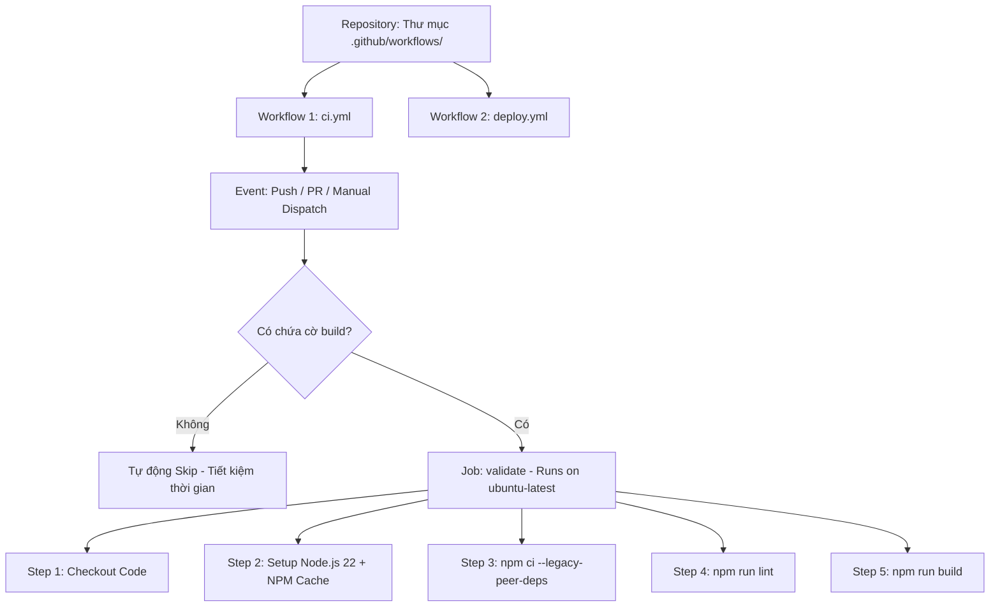
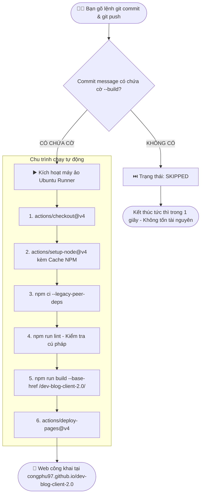
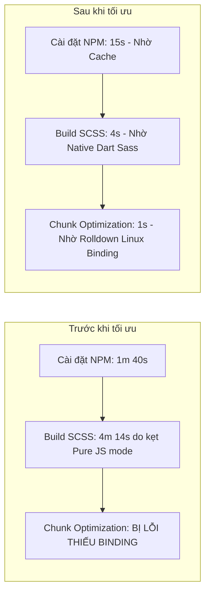

# 🚀 Cẩm Nang Toàn Tập Về CI/CD Web Với GitHub Actions (Angular 22 + Ionic)

> 📚 **Tài liệu liên quan trong hệ thống CI/CD:**
> - [📱 Build APK & Phân phối lên Firebase App Distribution](CI_CD_FIREBASE_APK.md)
> - [🤖 Build AAB & Xuất bản lên Google Play Console (CH Play)](CI_CD_GOOGLE_PLAY.md)
> - [🍎 Build IPA & Xuất bản lên Apple App Store / TestFlight](CI_CD_APP_STORE.md)

---

## 📌 Mục Lục
1. [CI/CD là gì? Tại sao phải dùng?](#1-cicd-là-gì-tại-sao-phải-dùng)
2. [GitHub Actions là gì? Kiến trúc cốt lõi](#2-github-actions-là-gì-kiến-trúc-cốt-lõi)
3. [Sơ đồ quy trình hoạt động & Cơ chế cờ `--build`](#3-sơ-đồ-quy-trình-hoạt-động--cơ-chế-cờ---build)
4. [Mổ xẻ chi tiết TỪNG DÒNG: File `ci.yml` (Kiểm tra chất lượng mã nguồn)](#4-mổ-xẻ-chi-tiết-từng-dòng-file-ciyml)
5. [Mổ xẻ chi tiết TỪNG DÒNG: File `deploy.yml` (Triển khai lên GitHub Pages)](#5-mổ-xẻ-chi-tiết-từng-dòng-file-deployyml)
6. [Tối ưu hóa hiệu năng đỉnh cao (Caching & Native Linux Bindings)](#6-tối-ưu-hóa-hiệu-năng-đỉnh-cao-caching--native-linux-bindings)
7. [Các lỗi kinh điển thực tế & Cách xử lý (Troubleshooting)](#7-các-lỗi-kinh-điển-thực-tế--cách-xử-lý-troubleshooting)
8. [Tóm tắt ghi nhớ nhanh (Cheat Sheet)](#8-tóm-tắt-ghi-nhớ-nhanh-cheat-sheet)

---

## 1. CI/CD là gì? Tại sao phải dùng?

Trước khi có CI/CD, quy trình làm phần mềm thủ công thường gặp thảm họa:
- **Developer** code xong, tự chạy trên máy mình thấy chạy được (`It works on my machine!`).
- **Developer** nén file `.zip` hoặc gửi file build qua Zalo/Drive cho sếp hoặc tự FTP/SSH lên server đè file.
- **Hậu quả**: Server sập vì môi trường máy local khác với server production; hoặc code merge đụng độ mà không ai test trước.

### 🧩 Phân định CI vs CD:

```mermaid
flowchart LR
    A[🧑‍💻 Lập trình viên Push Code] --> B[🔍 Continuous Integration - CI]
    subgraph CI [Continuous Integration - Tích hợp liên tục]
        B --> C[Tự động Khôi phục Cache]
        C --> D[Cài đặt Thư viện npm ci]
        D --> E[Quét Lỗi Lint ESLint]
        E --> F[Thử Nghiệm Build Angular]
    end
    F --> G[🚀 Continuous Deployment - CD]
    subgraph CD [Continuous Deployment - Triển khai liên tục]
        G --> H[Build Production với Base-Href]
        H --> I[Đóng gói Pages Artifact]
        I --> J[Tự động đẩy lên GitHub Pages CDN]
    end
```



| Thuật ngữ | Tên đầy đủ | Ý nghĩa thực tế |
| :--- | :--- | :--- |
| **CI** | **Continuous Integration** *(Tích hợp liên tục)* | Mỗi khi có code mới được `git push` hoặc tạo `Pull Request`, hệ thống tự động tải code về, cài dependencies, chạy lint, build thử. Nếu có bất kỳ lỗi nào, hệ thống **báo động đỏ (Fail)** ngay lập tức để lập trình viên sửa trước khi merge vào nhánh chính. |
| **CD** | **Continuous Deployment** *(Triển khai liên tục)* | Sau khi CI vượt qua thành công, hệ thống tự động đóng gói ứng dụng (HTML/CSS/JS) và đẩy thẳng lên môi trường chạy thực tế (GitHub Pages) mà **không cần con người can thiệp bằng tay**. |

---

## 2. GitHub Actions là gì? Kiến trúc cốt lõi

**GitHub Actions** là công cụ CI/CD tích hợp sẵn 100% bên trong GitHub. Bạn không cần cài server riêng (như Jenkins hay GitLab Runner), GitHub cung cấp sẵn máy ảo trên mây (Ubuntu, Windows, macOS) hoàn toàn miễn phí cho các repository public.

### 🏛️ Phân cấp các thành phần trong GitHub Actions:



1. **Workflow (Quy trình)**: Là 1 file định dạng `.yml` nằm trong thư mục `.github/workflows/`.
2. **Event (Sự kiện kích hoạt)**: Điều kiện để workflow tự động khởi chạy (`push`, `pull_request`, `workflow_dispatch`).
3. **Runner (Máy chủ thực thi)**: Máy tính ảo trên cloud của GitHub (dự án dùng `ubuntu-latest`).
4. **Job (Nhiệm vụ)**: Tập hợp các bước (steps) chạy trên cùng một Runner.
5. **Step (Bước)**: Từng mệnh lệnh tuần tự bên trong Job. Nếu một step lỗi, job sẽ dừng lại.
6. **Action**: Các module dựng sẵn do cộng đồng cung cấp (`actions/checkout@v4`, `actions/setup-node@v4`, `actions/deploy-pages@v4`).

---

## 3. Sơ đồ quy trình hoạt động & Cơ chế cờ `--build`

Để tránh việc mỗi commit sửa văn bản hay sửa comment nhỏ cũng tự động kích hoạt máy ảo build tốn hàng phút, hệ thống sử dụng **Cơ chế lọc thông minh bằng cờ `--build`**:



### 💡 Ví dụ thực tế:
- **Không kích hoạt build** (chỉ lưu code):
  ```bash
  git commit -m "docs: cập nhật tài liệu hướng dẫn"
  git push
  ```
  *(Các workflow sẽ tự động chuyển sang trạng thái `skipped` sau 1 giây).*

- **Kích hoạt toàn bộ quy trình build & deploy**:
  ```bash
  git commit -m "feat: cập nhật giao diện bài viết --build"
  git push
  ```
  *(Workflow nhận diện thấy `--build` và tiến hành build, deploy ngay lập tức).*

---

## 4. Mổ xẻ chi tiết TỪNG DÒNG: File `ci.yml`

File này chịu trách nhiệm: **Kiểm tra tính toàn vẹn cú pháp và khả năng compile của Angular.**

```yaml
name: CI Pipeline

on:
  push:
    branches: [ main, develop ]
  pull_request:
    branches: [ main, develop ]
  workflow_dispatch:

defaults:
  run:
    working-directory: ./dev-blog-client

jobs:
  validate:
    name: Lint & Build
    if: contains(github.event.head_commit.message, '--build') || github.event_name == 'pull_request' || github.event_name == 'workflow_dispatch'
    runs-on: ubuntu-latest

    steps:
      - name: Checkout mã nguồn dev-blog-client
        uses: actions/checkout@v4

      - name: Thiết lập Node.js
        uses: actions/setup-node@v4
        with:
          node-version: 22
          cache: 'npm'
          cache-dependency-path: './dev-blog-client/package-lock.json'

      - name: Cài đặt dependencies dev-blog-client
        run: npm ci --legacy-peer-deps

      - name: Kiểm tra Lint
        run: npm run lint
        continue-on-error: true

      - name: Build ứng dụng (www)
        run: npm run build
```

### 📖 Phân tích kỹ thuật:
| Dòng cấu hình | Ý nghĩa & Tác dụng |
| :--- | :--- |
| `workflow_dispatch:` | Cho phép bạn vào web GitHub Actions bấm nút **Run workflow** bằng tay bất cứ lúc nào mà không cần push commit mới. |
| `if: contains(..., '--build')` | **Bộ lọc thông minh**: Chỉ kích hoạt khi commit message có `--build`, hoặc khi có người tạo Pull Request, hoặc khi bấm chạy thủ công. |
| `working-directory: ./dev-blog-client` | Định vị thư mục làm việc vào thư mục chứa mã nguồn Angular. Tránh lỗi không tìm thấy `package.json`. |
| `cache: 'npm'`<br>`cache-dependency-path: ...` | **Bật bộ nhớ đệm (Cache)**: Tự động lưu và phục hồi thư mục tải npm giữa các lần build, giảm thời gian cài từ ~2 phút xuống còn **~20 giây**. |
| `npm ci --legacy-peer-deps` | Cài đặt sạch sẽ và chính xác 100% theo file `package-lock.json`, bỏ qua các cảnh báo xung đột peer dependency không cần thiết. |
| `continue-on-error: true` ở bước lint | Cho phép các cảnh báo format (warning) không làm dừng ngang xương toàn bộ quy trình build. |
| `npm run build` | Biên dịch toàn bộ TypeScript, SCSS sang bundle tĩnh trong thư mục `www`. |

---

## 5. Mổ xẻ chi tiết TỪNG DÒNG: File `deploy.yml`

File này chịu trách nhiệm: **Đưa trang web Angular lên mạng toàn cầu (GitHub Pages) hoàn toàn tự động.**

```yaml
name: Deploy Web to GitHub Pages

on:
  push:
    branches: [ main ]
  workflow_dispatch:

permissions:
  contents: read
  pages: write
  id-token: write

concurrency:
  group: 'pages'
  cancel-in-progress: true

defaults:
  run:
    working-directory: ./dev-blog-client

jobs:
  deploy:
    if: contains(github.event.head_commit.message, '--build') || github.event_name == 'workflow_dispatch'
    environment:
      name: github-pages
      url: ${{ steps.deployment.outputs.page_url }}
    runs-on: ubuntu-latest
    steps:
      - name: Checkout code
        uses: actions/checkout@v4

      - name: Setup Node.js
        uses: actions/setup-node@v4
        with:
          node-version: 22
          cache: 'npm'
          cache-dependency-path: './dev-blog-client/package-lock.json'

      - name: Install dependencies
        run: npm ci --legacy-peer-deps

      - name: Build Web Production
        run: npm run build -- --base-href /${{ github.event.repository.name }}/

      - name: Setup Pages
        uses: actions/configure-pages@v4

      - name: Upload artifact
        uses: actions/upload-pages-artifact@v3
        with:
          path: './dev-blog-client/www'

      - name: Deploy to GitHub Pages
        id: deployment
        uses: actions/deploy-pages@v4
```

### 📖 Phân tích kỹ thuật:
| Dòng cấu hình | Ý nghĩa & Tác dụng |
| :--- | :--- |
| `permissions:` | Cấp quyền cho GitHub Token: `pages: write` để ghi đè web lên máy chủ, `id-token: write` để xác thực OIDC an toàn. |
| `concurrency: cancel-in-progress: true` | Nếu bạn push 2 commit có `--build` liên tiếp, bản build cũ sẽ tự động bị huỷ để dành tài nguyên chạy ngay bản mới nhất. |
| `--base-href /${{ github.event.repository.name }}/` | **Cực kỳ quan trọng**: Định tuyến URL trên GitHub Pages dạng `/dev-blog-client-2.0/`. Nếu thiếu cờ này, web sẽ bị **trắng trang lỗi 404** vì không nạp được file JS/CSS. |
| `upload-pages-artifact@v3` | Đóng gói thư mục sản phẩm build `./dev-blog-client/www` thành gói Artifact sẵn sàng deploy. |
| `deploy-pages@v4` | Đẩy gói Artifact lên CDN GitHub Pages và trả về đường link web chính thức. |

---

## 6. Tối ưu hóa hiệu năng đỉnh cao (Caching & Native Linux Bindings)

Trong quá trình vận hành CI/CD trên Angular 22 và Ionic 8, chúng ta đã tối ưu 2 điểm then chốt:



### 1. Khóa toàn bộ Binary Native Linux x64
Dự án được phát triển trên máy Mac (Apple Silicon), nhưng GitHub Runner chạy **Ubuntu Linux x64**. Các công cụ biên dịch hiện đại như Angular Build, Sass, Rolldown đều viết bằng Rust/C++ và cần file thực thi native tương ứng.
Chúng ta đã khóa cứng các gói sau vào `optionalDependencies` trong `package.json` & `package-lock.json`:
- `sass-embedded-linux-x64`: Binary native của Sass Compiler (giúp build SCSS trong 4 giây thay vì kẹt > 4 phút).
- `@rolldown/binding-linux-x64-gnu`: Binary native của bộ nén Chunk Rolldown.
- `@esbuild/linux-x64`: Trình biên dịch ESBuild siêu tốc.
- `@rollup/rollup-linux-x64-gnu`: Bộ nạp mô-đun Rollup.
- `lightningcss-linux-x64-gnu`: Bộ tối ưu CSS LightningCSS.
- `@oxc-parser/binding-linux-x64-gnu`: Bộ phân tích cú pháp Oxc.

---

## 7. Các lỗi kinh điển thực tế & Cách xử lý (Troubleshooting)

### ❌ Lỗi 1: Build bị đứng hình > 4 phút tại `sass-embedded is unavailable in pure JS mode`
- **Nguyên nhân**: File `package-lock.json` tạo trên Mac chỉ chứa binary cho macOS. Khi lên Linux, Sass không tìm thấy binary native nên tự lùi về chế độ chạy JavaScript thuần (chậm hơn 50 - 100 lần), gây đứng máy ảo.
- **Cách xử lý**: Cài đặt thêm binary Linux:
  ```bash
  npm i sass-embedded-linux-x64 --save-optional --legacy-peer-deps
  ```

### ❌ Lỗi 2: `Chunk optimization failed - Cannot find native binding (npm/cli#4828)`
- **Nguyên nhân**: Bug kinh điển của npm khi đồng bộ lockfile đa nền tảng, thiếu binary của Rolldown trên Linux runner.
- **Cách xử lý**: Thêm binary Rolldown vào optionalDependencies:
  ```bash
  npm i @rolldown/binding-linux-x64-gnu --save-optional --legacy-peer-deps
  ```

### ❌ Lỗi 3: Xung đột Peer Dependency (`ERESOLVE could not resolve peer dependency`)
- **Nguyên nhân**: TypeScript 6.x yêu cầu bởi Angular Build xung đột với `@typescript-eslint/eslint-plugin` (chỉ hỗ trợ `<6.0.0`).
- **Cách xử lý**:
  1. Thêm cờ `--legacy-peer-deps` trong các lệnh cài đặt trên CI.
  2. Tạo file `.npmrc` trong thư mục project với nội dung:
     ```ini
     legacy-peer-deps=true
     ```

### ❌ Lỗi 4: Deploy thành công nhưng F5 hoặc vào đường dẫn con bị 404
- **Nguyên nhân**: Ứng dụng SPA (Single Page App) dùng client-side routing.
- **Cách xử lý**: Đảm bảo lệnh build có tham số:
  `--base-href /${{ github.event.repository.name }}/`

---

## 8. Tóm tắt ghi nhớ nhanh (Cheat Sheet)

| Trường hợp | Câu lệnh Git khuyến nghị | Kết quả CI/CD |
| :--- | :--- | :--- |
| **Commit lưu code thường** | `git commit -m "update code"` | Workflow **Tự động SKIP**, không tốn thời gian. |
| **Commit muốn Build & Deploy** | `git commit -m "release new version --build"` | Workflow **Tự động CHẠY**, test, build và deploy web lên GitHub Pages. |
| **Chạy thủ công không cần commit** | Vào tab **Actions** ➡️ Chọn workflow ➡️ Bấm **Run workflow** | Tự động kích hoạt ngay lập tức. |

---
*Tài liệu chuẩn hóa dành riêng cho dự án `dev-blog-client-2.0` (Angular 22 + Ionic + GitHub Actions).*
