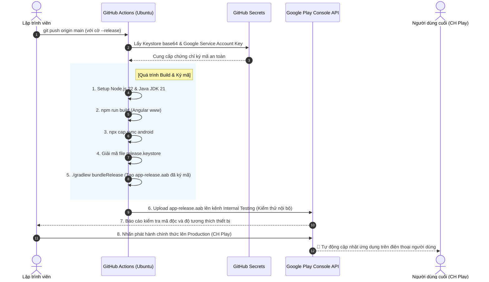
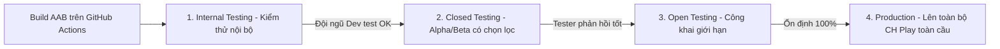

# 🤖 Hướng Dẫn Tự Động Build AAB & Upload Lên Google Play Console (CH Play)

---

## 📌 Mục Lục
1. [Sự khác biệt cốt lõi: APK vs AAB (Android App Bundle)](#1-sự-khác-biệt-cốt-lõi-apk-vs-aab-android-app-bundle)
2. [Sơ đồ quy trình tổng quan (Workflow Diagram)](#2-sơ-đồ-quy-trình-tổng-quan-workflow-diagram)
3. [Bước 1: Tạo Keystore & Chứng chỉ ký ứng dụng (App Signing)](#bước-1-tạo-keystore--chứng-chỉ-ký-ứng-dụng-app-signing)
4. [Bước 2: Cấu hình ký mã trong Gradle (`android/app/build.gradle`)](#bước-2-cấu-hình-ký-mã-trong-gradle-androidappbuildgradle)
5. [Bước 3: Thiết lập Google Play Console & Service Account API](#bước-3-thiết-lập-google-play-console--service-account-api)
6. [Bước 4: Cài đặt Bí mật trên GitHub (GitHub Secrets)](#bước-4-cài-đặt-bí-mật-trên-github-github-secrets)
7. [Bước 5: File Workflow mẫu hoàn chỉnh (`android-google-play.yml`)](#bước-5-file-workflow-mẫu-hoàn-chỉnh-android-google-playyml)
8. [Các vòng kiểm thử trên Google Play (Internal, Closed, Production)](#các-vòng-kiểm-thử-trên-google-play-internal-closed-production)
9. [Những lỗi thường gặp khi deploy Google Play & Cách xử lý](#những-lỗi-thường-gặp-khi-deploy-google-play--cách-xử-lý)

---

## 1. Sự khác biệt cốt lõi: APK vs AAB (Android App Bundle)

| Tiêu chí | File `.apk` (Application Package) | File `.aab` (Android App Bundle) |
| :--- | :--- | :--- |
| **Mục đích sử dụng** | Cài đặt trực tiếp vào điện thoại, gửi qua Firebase App Distribution, Zalo, Drive để test nội bộ. | **Bắt buộc 100%** khi xuất bản ứng dụng lên **Google Play Console (CH Play)** kể từ tháng 8/2021. |
| **Cơ chế hoạt động** | Chứa toàn bộ tài nguyên của mọi dòng máy (mọi độ phân giải màn hình, mọi kiến trúc CPU x86/arm64) nên dung lượng lớn. | Chỉ chứa mã nguồn và tài nguyên đóng gói. Khi người dùng bấm tải trên CH Play, Google sẽ tự động tách nhỏ và chỉ tạo file APK tương thích riêng cho máy đó (giảm 15% - 30% dung lượng tải). |
| **Lệnh build Gradle** | `./gradlew assembleDebug` hoặc `./gradlew assembleRelease` | `./gradlew bundleRelease` |

---

## 2. Sơ đồ quy trình tổng quan (Workflow Diagram)



---

## 3. Bước 1: Tạo Keystore & Chứng chỉ ký ứng dụng (App Signing)

Google Play yêu cầu mọi ứng dụng phải được **ký bằng chữ ký số cá nhân (Digital Signature)** trước khi upload.

Mở Terminal trên máy tính cá nhân của bạn và chạy lệnh sau:
```bash
keytool -genkey -v -keystore release-key.keystore -alias my-key-alias -keyalg RSA -keysize 2048 -validity 10000
```

Terminal sẽ hỏi bạn các thông tin:
- **Keystore password**: Mật khẩu bảo vệ (Ví dụ: `MyStrongPassword123`) - *Ghi nhớ kỹ mật khẩu này!*
- Họ và tên, Đơn vị, Thành phố, Quốc gia: Điền thông tin của bạn.
- Bấm `yes` để xác nhận.

> [!CAUTION]
> **CỰC KỲ QUAN TRỌNG:** 
> File `release-key.keystore` và mật khẩu này phải được sao lưu cẩn thận vào Google Drive hoặc nơi an toàn. **Nếu bạn làm mất keystore này, bạn sẽ vĩnh viễn không thể cập nhật ứng dụng trên Google Play được nữa!**

### Chuyển đổi Keystore thành Base64 để đưa lên GitHub Actions
Để GitHub Actions có thể đọc file keystore mà không cần commit file nhạy cảm này lên Git:
```bash
# Trên macOS:
base64 -i release-key.keystore | pbcopy
# (Nội dung chuỗi base64 đã được tự động copy vào bộ nhớ tạm)

# Trên Linux:
base64 release-key.keystore -w 0
```

---

## 4. Bước 2: Cấu hình ký mã trong Gradle (`android/app/build.gradle`)

Mở file `dev-blog-client/android/app/build.gradle` và thêm cấu hình `signingConfigs`:

```groovy
android {
    ...
    defaultConfig { ... }

    signingConfigs {
        release {
            storeFile file(System.getenv("KEYSTORE_FILE_PATH") ?: "release-key.keystore")
            storePassword System.getenv("KEYSTORE_PASSWORD")
            keyAlias System.getenv("KEY_ALIAS")
            keyPassword System.getenv("KEY_PASSWORD")
        }
    }

    buildTypes {
        release {
            minifyEnabled false
            signingConfig signingConfigs.release
            proguardFiles getDefaultProguardFile('proguard-android.txt'), 'proguard-rules.pro'
        }
    }
}
```

---

## 5. Bước 3: Thiết lập Google Play Console & Service Account API

Để CI/CD có thể tự động đẩy file lên CH Play mà không cần bạn đăng nhập thủ công:

### 5.1. Tạo Service Account trên Google Cloud Console
1. Mở [Google Cloud Console](https://console.cloud.google.com/) của dự án liên kết với tài khoản Google Play Console.
2. Vào **IAM & Admin** ➡️ **Service Accounts** ➡️ Bấm **Create Service Account**.
3. Đặt tên (ví dụ: `github-actions-publisher`) ➡️ Bấm **Create and Continue**.
4. Chọn Role: **Editor** (hoặc quyền quản lý ứng dụng).
5. Sau khi tạo xong, bấm vào Service Account vừa tạo ➡️ Chuyển sang tab **Keys** ➡️ Bấm **Add Key** ➡️ **Create new key** ➡️ Chọn định dạng **JSON** ➡️ Bấm **Create**.
6. Một file `.json` sẽ tự động tải về máy bạn (ví dụ: `api-885936311-key.json`).

### 5.2. Cấp quyền trong Google Play Console
1. Mở [Google Play Console](https://play.google.com/console/).
2. Chọn **Users & Permissions** (Người dùng và quyền) ➡️ Bấm **Invite new users** (Mời người dùng mới).
3. Dán địa chỉ email của Service Account vừa tạo ở bước 5.1 (dạng `github-actions-publisher@project-id.iam.gserviceaccount.com`).
4. Tại mục **App permissions**, chọn ứng dụng `io.ionic.starter`.
5. Cấp các quyền:
   - *Release apps to testing tracks* (Phát hành lên các kênh kiểm thử).
   - *Manage testing tracks and edit tester lists* (Quản lý kênh kiểm thử).
6. Nhấn **Send invite** (Gửi lời mời).

---

## 6. Bước 4: Cài đặt Bí mật trên GitHub (GitHub Secrets)

Vào repository GitHub ➡️ **Settings** ➡️ **Secrets and variables** ➡️ **Actions** ➡️ Bấm **New repository secret**:

| Tên Secret | Giá trị |
| :--- | :--- |
| `ANDROID_KEYSTORE_BASE64` | Chuỗi mã hóa Base64 của file `release-key.keystore` (lấy ở Bước 1). |
| `KEYSTORE_PASSWORD` | Mật khẩu keystore đã đặt khi tạo key. |
| `KEY_ALIAS` | Alias đã đặt (ví dụ: `my-key-alias`). |
| `KEY_PASSWORD` | Mật khẩu của key (thường trùng với mật khẩu keystore). |
| `PLAY_STORE_JSON_KEY` | Toàn bộ nội dung văn bản bên trong file JSON tải từ Google Cloud (Bước 5.1). |

---

## 7. Bước 5: File Workflow mẫu hoàn chỉnh (`android-google-play.yml`)

Tạo file mới tại `.github/workflows/android-google-play.yml`:

```yaml
name: Build & Publish Android AAB to Google Play

on:
  push:
    branches: [ main ]
  workflow_dispatch:
    inputs:
      track:
        description: 'Kênh phân phối (internal / alpha / beta / production)'
        required: true
        default: 'internal'
      custom_version:
        description: 'Tùy chọn: Nhập version mới (ví dụ 1.0.0)'
        required: false
        default: ''

permissions:
  contents: write

jobs:
  build-and-publish:
    name: Build AAB & Upload Google Play
    if: contains(github.event.head_commit.message, '--release') || github.event_name == 'workflow_dispatch'
    runs-on: ubuntu-latest

    defaults:
      run:
        working-directory: ./dev-blog-client

    steps:
      - name: 1. Checkout mã nguồn
        uses: actions/checkout@v4
        with:
          fetch-depth: 0

      - name: 2. Cài đặt Node.js 22
        uses: actions/setup-node@v4
        with:
          node-version: 22
          cache: 'npm'
          cache-dependency-path: './dev-blog-client/package-lock.json'

      - name: 3. Tăng version ứng dụng (package.json)
        run: |
          if [ -n "${{ inputs.custom_version }}" ]; then
            npm version ${{ inputs.custom_version }} --no-git-tag-version
          else
            npm version patch --no-git-tag-version
          fi
          NEW_VERSION=$(node -p "require('./package.json').version")
          echo "NEW_VERSION=$NEW_VERSION" >> $GITHUB_ENV

      - name: 4. Cài đặt Java JDK 21
        uses: actions/setup-java@v4
        with:
          distribution: 'zulu'
          java-version: '21'
          cache: 'gradle'

      - name: 5. Cài đặt dependencies (NPM)
        run: npm ci --legacy-peer-deps

      - name: 6. Build mã nguồn Web (Angular www)
        run: npm run build

      - name: 7. Đồng bộ sang Android Native (Capacitor Sync)
        run: npx cap sync android

      - name: 8. Giải mã Keystore ký mã
        run: |
          echo "${{ secrets.ANDROID_KEYSTORE_BASE64 }}" | base64 --decode > android/app/release-key.keystore
          echo "KEYSTORE_FILE_PATH=release-key.keystore" >> $GITHUB_ENV
        env:
          KEYSTORE_PASSWORD: ${{ secrets.KEYSTORE_PASSWORD }}
          KEY_ALIAS: ${{ secrets.KEY_ALIAS }}
          KEY_PASSWORD: ${{ secrets.KEY_PASSWORD }}

      - name: 9. Cấp quyền chạy Gradle Wrapper
        run: chmod +x android/gradlew

      - name: 10. Biên dịch Android App Bundle (.aab) Release
        run: |
          cd android
          ./gradlew bundleRelease -PversionCode=${{ github.run_number }} -PversionName=${{ env.NEW_VERSION }} --no-daemon
        env:
          KEYSTORE_PASSWORD: ${{ secrets.KEYSTORE_PASSWORD }}
          KEY_ALIAS: ${{ secrets.KEY_ALIAS }}
          KEY_PASSWORD: ${{ secrets.KEY_PASSWORD }}

      - name: 11. Lưu trữ Artifact AAB lên GitHub
        uses: actions/upload-artifact@v4
        with:
          name: app-release-${{ env.NEW_VERSION }}.aab
          path: ./dev-blog-client/android/app/build/outputs/bundle/release/app-release.aab
          retention-days: 30

      - name: 12. Upload AAB lên Google Play Console
        uses: r0adkll/upload-google-play@v1
        with:
          serviceAccountJsonPlainText: ${{ secrets.PLAY_STORE_JSON_KEY }}
          packageName: io.ionic.starter
          releaseFiles: ./dev-blog-client/android/app/build/outputs/bundle/release/app-release.aab
          track: ${{ inputs.track || 'internal' }}
          status: completed

      - name: 13. Lưu và đẩy version mới lên GitHub
        if: success()
        run: |
          git config user.name "github-actions[bot]"
          git config user.email "github-actions[bot]@users.noreply.github.com"
          git add package.json package-lock.json
          git commit -m "chore(release): bump version to ${{ env.NEW_VERSION }} [skip ci]" || echo "No changes"
          git push origin main
```

---

## 8. Các vòng kiểm thử trên Google Play (Internal, Closed, Production)

Google Play phân chia các kênh phát hành theo cấp bậc để đảm bảo an toàn tối đa:



1. **Internal Testing (Kiểm thử nội bộ - Khuyên dùng cho CI/CD)**:
   - Tối đa 100 người thử nghiệm.
   - Bản build được duyệt và khả dụng **chỉ sau 2 - 5 phút**, không cần chờ Google xét duyệt nội dung.
2. **Closed Testing (Kiểm thử đóng)**:
   - Dành cho nhóm tester lớn hơn (khách hàng thân thiết).
3. **Production Track (Chính thức)**:
   - Sau khi bản Internal Testing đã test kỹ càng, bạn chỉ cần vào Google Play Console bấm **Promote to Production** (Thăng cấp lên bản chính thức) là ứng dụng sẽ đến tay mọi người dùng trên CH Play!

---

## 9. Những lỗi thường gặp khi deploy Google Play & Cách xử lý

### ❌ Lỗi 1: `versionCode has already been used`
- **Nguyên nhân**: Bạn đang upload một bản build có `versionCode` bằng hoặc nhỏ hơn bản build đã có trên Google Play.
- **Cách khắc phục**: Dùng biến `-PversionCode=${{ github.run_number }}` của GitHub Actions để đảm bảo mỗi lần chạy số này luôn tăng tịnh tiến.

### ❌ Lỗi 2: `The current user has insufficient permissions`
- **Nguyên nhân**: Service Account JSON chưa được thêm vào mục **Users & Permissions** trên Google Play Console hoặc chưa được cấp quyền quản lý app `io.ionic.starter`.
- **Cách khắc phục**: Thực hiện lại Bước 5.2.

### ❌ Lỗi 3: `Package name io.ionic.starter does not exist on Google Play Console`
- **Nguyên nhân**: Lần đầu tiên phát hành app, bạn bắt buộc phải tạo app trên Google Play Console và **upload thủ công bản `.aab` đầu tiên bằng tay** để khởi tạo danh mục ứng dụng. Từ các lần thứ 2 trở đi mới có thể dùng CI/CD để đẩy tự động!

---
*Tài liệu chuẩn hóa phát hành Google Play dành cho dự án `dev-blog-client-2.0`.*
