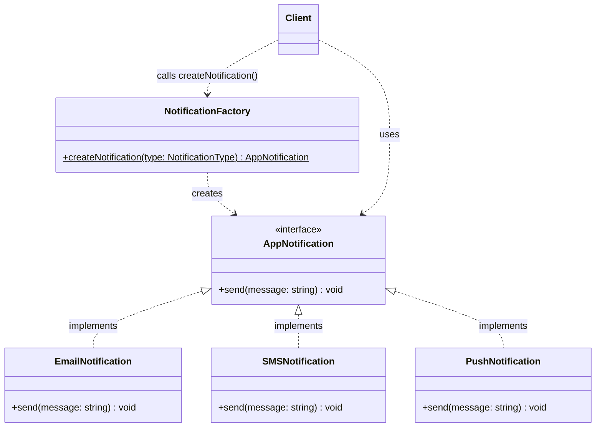
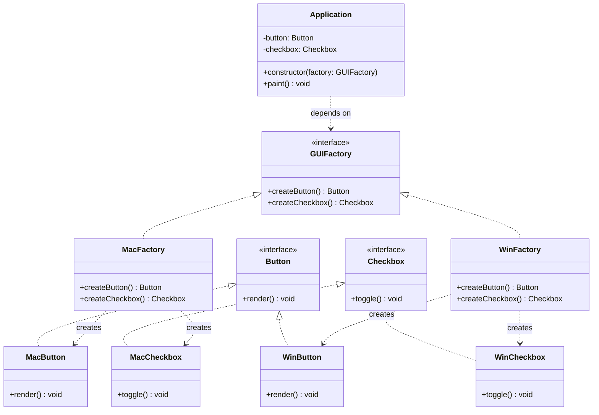
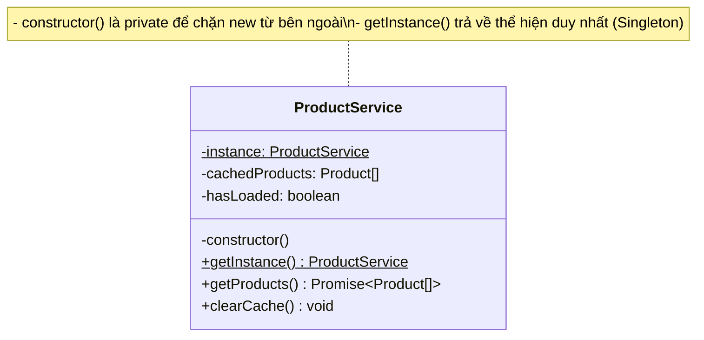
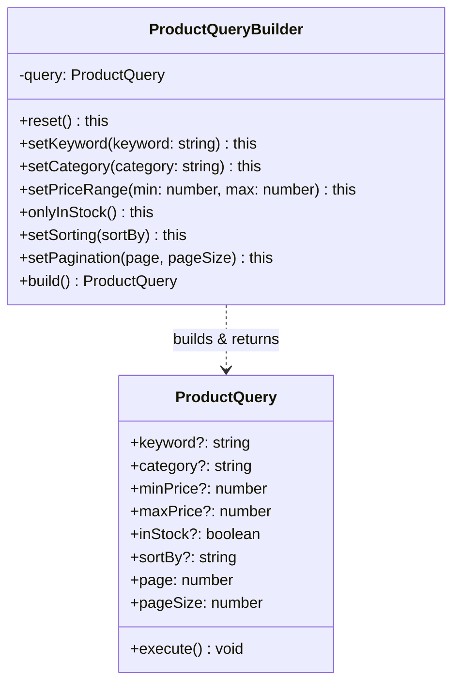
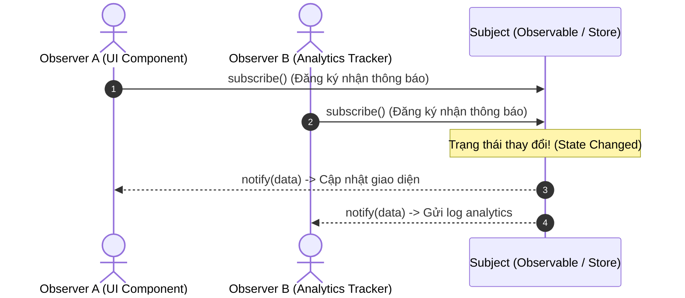
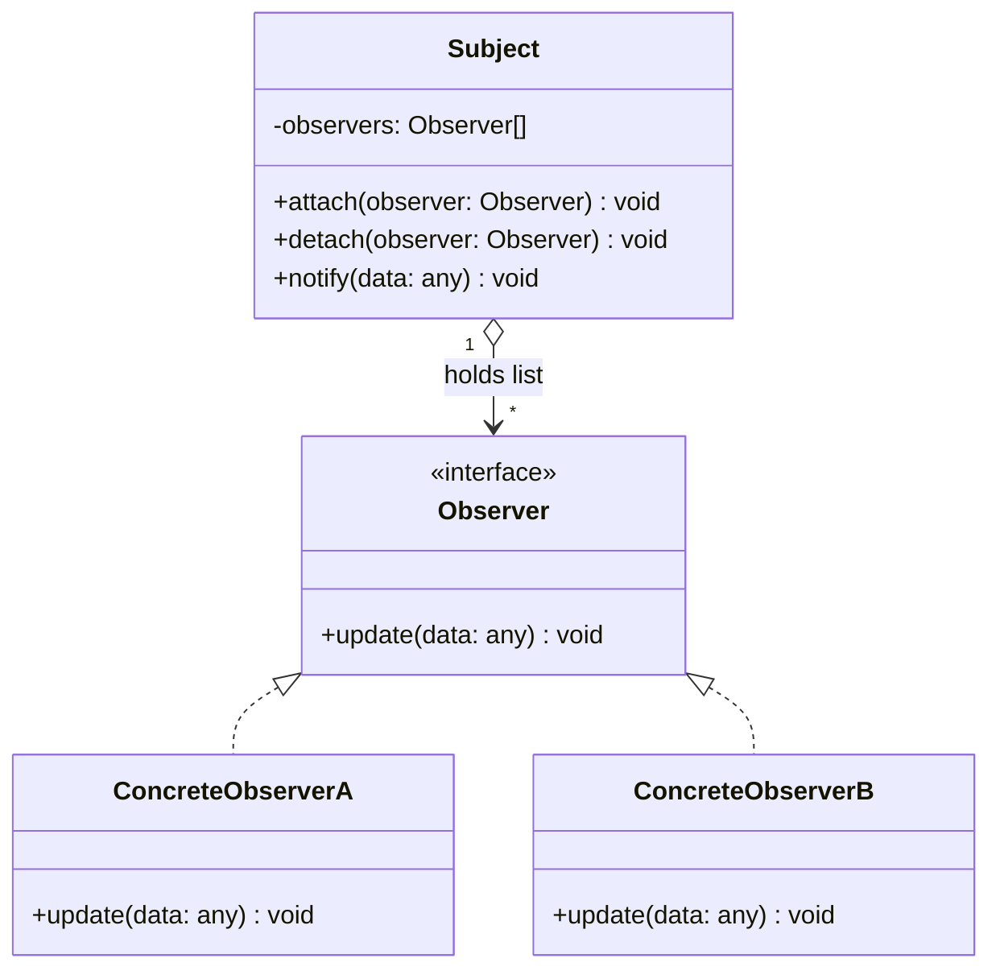
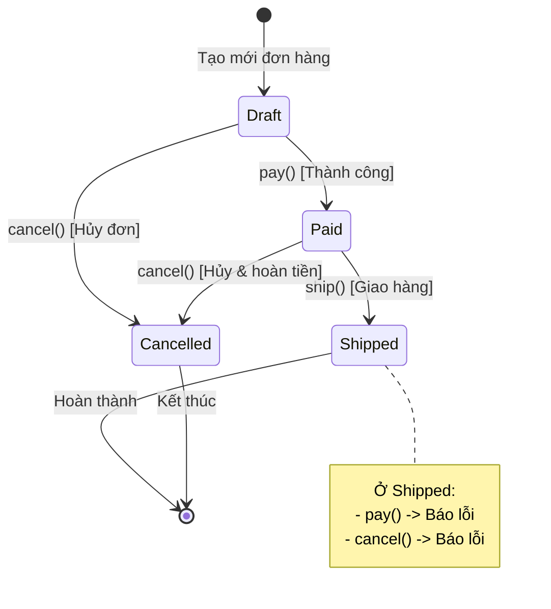
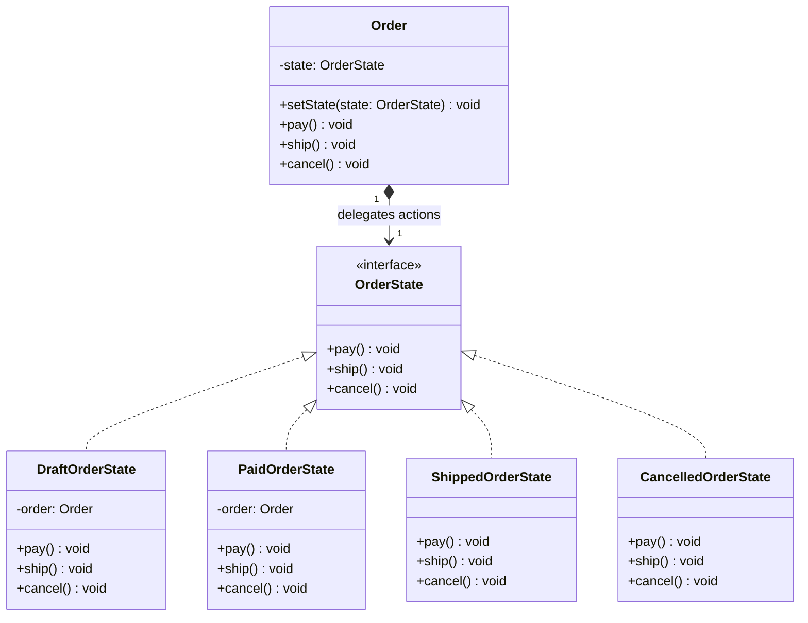
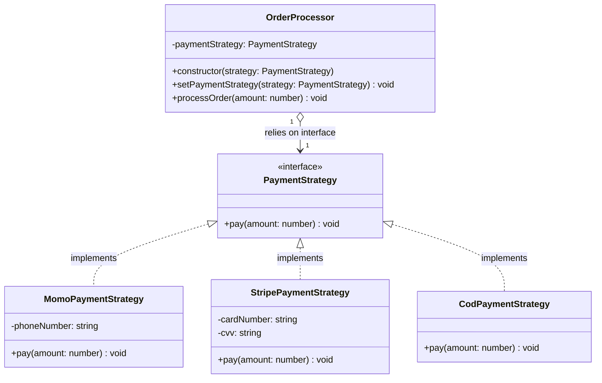
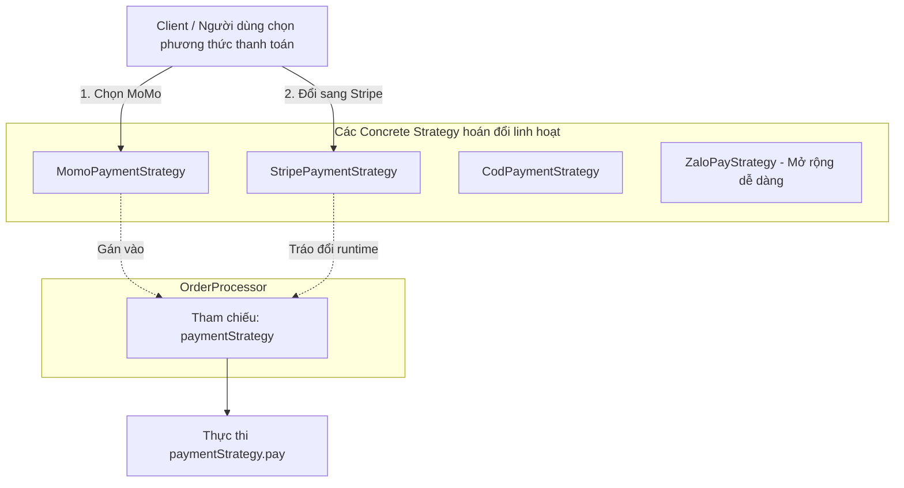

# Tài liệu Design Patterns trong TypeScript / Hệ Thống

> **Design Pattern (Mẫu thiết kế)** là một giải pháp tổng thể đã được kiểm chứng cho một vấn đề phổ biến thường gặp khi thiết kế kiến trúc và viết code phần mềm.  
> Nó đóng vai trò như một **khuôn mẫu tư duy (blueprint)** hướng dẫn cách tổ chức các class, object và mối liên kết giữa chúng để giải quyết bài toán một cách tối ưu, dễ bảo trì và dễ mở rộng.

---

## Mục lục

1. [Creational Patterns (Mẫu Khởi Tạo)](#1-creational-patterns-mẫu-khởi-tạo)
   - [1.1. Factory Pattern](#11-factory-pattern)
   - [1.2. Abstract Factory Pattern](#12-abstract-factory-pattern)
   - [1.3. Singleton Pattern](#13-singleton-pattern)
   - [1.4. Builder Pattern](#14-builder-pattern)
2. [Behavioral Patterns (Mẫu Hành Vi)](#2-behavioral-patterns-mẫu-hành-vi)
   - [2.1. Observer Pattern](#21-observer-pattern)
   - [2.2. State Pattern](#22-state-pattern)
   - [2.3. Strategy Pattern](#23-strategy-pattern)

---

## 1. Creational Patterns (Mẫu Khởi Tạo)

Nhóm Creational Patterns tập trung vào cơ chế khởi tạo đối tượng, giúp tăng tính linh hoạt và khả năng tái sử dụng code khi tạo mới instance mà không làm phụ thuộc chặt chẽ (tight coupling) vào các class cụ thể.

---

### 1.1. Factory Pattern

#### Khái niệm
Giao phó việc khởi tạo object cho một thành phần chuyên biệt (**Factory**), thay vì để client khởi tạo trực tiếp bằng từ khóa `new ConcreteClass()`.

#### Sơ đồ minh họa (UML Diagram)



#### Triển khai mẫu (TypeScript)

```typescript
// 1. Interface chung cho sản phẩm
export interface AppNotification {
  send(message: string): void;
}

// 2. Các Concrete Products
export class EmailNotification implements AppNotification {
  send(message: string): void {
    console.log(`[Email] Gửi email với nội dung: ${message}`);
  }
}

export class SMSNotification implements AppNotification {
  send(message: string): void {
    console.log(`[SMS] Gửi tin nhắn SMS: ${message}`);
  }
}

export class PushNotification implements AppNotification {
  send(message: string): void {
    console.log(`[Push] Gửi notification qua mobile app: ${message}`);
  }
}

// 3. Factory Class chịu trách nhiệm khởi tạo
export type NotificationType = 'email' | 'sms' | 'push';

export class NotificationFactory {
  public static createNotification(type: NotificationType): AppNotification {
    switch (type) {
      case 'email':
        return new EmailNotification();
      case 'sms':
        return new SMSNotification();
      case 'push':
        return new PushNotification();
      default:
        throw new Error(`Loại notification không hợp lệ: ${type}`);
    }
  }
}

// 4. Sử dụng
const notifier = NotificationFactory.createNotification('email');
notifier.send('Chào mừng bạn đến với hệ thống!');
```

---

### 1.2. Abstract Factory Pattern

#### Khái niệm
Cung cấp một interface để tạo ra **cả một họ sản phẩm liên quan hoặc phụ thuộc lẫn nhau** (*a family of related products*) mà không cần chỉ định các class cụ thể của chúng.

#### Vấn đề thực tế
Xây dựng hệ thống UI đa nền tảng (Cross-platform) hoặc hỗ trợ nhiều Theme:
- **Họ sản phẩm:** `Button`, `Checkbox`.
- **Biến thể (Families):**
  - Phong cách macOS: `MacButton`, `MacCheckbox`.
  - Phong cách Windows: `WinButton`, `WinCheckbox`.

#### Sơ đồ minh họa (UML Diagram)



#### Triển khai mẫu (TypeScript)

```typescript
// 1. Định nghĩa Interfaces cho từng loại sản phẩm
export interface Button {
  render(): void;
}

export interface Checkbox {
  toggle(): void;
}

// 2. Triển khai các biến thể cụ thể (Concrete Products)

// Họ macOS
export class MacButton implements Button {
  render(): void {
    console.log("Render Button phong cách macOS");
  }
}

export class MacCheckbox implements Checkbox {
  toggle(): void {
    console.log("Toggle Checkbox phong cách macOS");
  }
}

// Họ Windows
export class WinButton implements Button {
  render(): void {
    console.log("Render Button phong cách Windows");
  }
}

export class WinCheckbox implements Checkbox {
  toggle(): void {
    console.log("Toggle Checkbox phong cách Windows");
  }
}

// 3. Tạo Abstract Factory Interface
export interface GUIFactory {
  createButton(): Button;
  createCheckbox(): Checkbox;
}

// 4. Triển khai Concrete Factory cho từng họ
export class MacFactory implements GUIFactory {
  createButton(): Button {
    return new MacButton();
  }
  createCheckbox(): Checkbox {
    return new MacCheckbox();
  }
}

export class WinFactory implements GUIFactory {
  createButton(): Button {
    return new WinButton();
  }
  createCheckbox(): Checkbox {
    return new WinCheckbox();
  }
}

// 5. Client sử dụng
class Application {
  private button: Button;
  private checkbox: Checkbox;

  constructor(factory: GUIFactory) {
    this.button = factory.createButton();
    this.checkbox = factory.createCheckbox();
  }

  paint(): void {
    this.button.render();
    this.checkbox.toggle();
  }
}

// Lúc runtime, khởi tạo factory theo hệ điều hành hoặc cấu hình:
const os: 'mac' | 'win' = 'mac';
const factory: GUIFactory = os === 'mac' ? new MacFactory() : new WinFactory();

const app = new Application(factory);
app.paint();
```

---

### 1.3. Singleton Pattern

#### Khái niệm
- Đảm bảo một class **chỉ có duy nhất một instance** tồn tại trong toàn bộ vòng đời của ứng dụng.
- Cung cấp một **điểm truy cập toàn cục** (*global access point*) tới instance đó.
- Thường dùng cho: Database Connection, Logger, App Config, Cache, State Store.

#### Sơ đồ minh họa (UML Diagram)



#### Sơ đồ hoạt động (Flowchart)

```mermaid
flowchart TD
    Client[Client gọi ProductService.getInstance] --> Check{Instance đã tồn tại chưa?}
    Check -- Chưa có -- --> Create[Khởi tạo new ProductService và lưu vào static variable]
    Check -- Đã có sẵn -- --> Return[Trả về static instance có sẵn]
    Create --> Return
    Return --> CacheCheck{hasLoaded == true?}
    CacheCheck -- True (Cache Hit) -- --> ReturnCache[Trả về cachedProducts]
    CacheCheck -- False (Cache Miss) -- --> FetchAPI[Gọi API lấy data -> Gán vào Cache -> hasLoaded=true]
    FetchAPI --> ReturnCache
```

#### Triển khai mẫu (TypeScript)

```typescript
export interface Product {
  id: number;
  name: string;
  price: number;
}

export class ProductService {
  // 1. Biến static lưu giữ instance duy nhất
  private static instance: ProductService | null = null;

  // 2. State/Cache dùng chung trong toàn bộ app
  private cachedProducts: Product[] = [];
  private hasLoaded = false;

  // 3. Chặn gọi new trực tiếp từ bên ngoài
  private constructor() {
    console.log("Khởi tạo ProductService instance duy nhất...");
  }

  // 4. Điểm truy cập toàn cục
  public static getInstance(): ProductService {
    if (!ProductService.instance) {
      ProductService.instance = new ProductService();
    }
    return ProductService.instance;
  }

  // 5. Phương thức lấy dữ liệu kèm cache
  public async getProducts(): Promise<Product[]> {
    if (this.hasLoaded) {
      console.log("⚡ [Cache Hit] Lấy sản phẩm từ bộ nhớ của Singleton");
      return this.cachedProducts;
    }

    console.log("🌐 [Network Call] Đang gọi API lấy sản phẩm...");
    // Giả lập độ trễ mạng
    await new Promise((resolve) => setTimeout(resolve, 800));

    this.cachedProducts = [
      { id: 1, name: "Bàn phím cơ", price: 1500000 },
      { id: 2, name: "Chuột không dây", price: 800000 },
      { id: 3, name: "Màn hình 4K", price: 7500000 },
    ];
    this.hasLoaded = true;

    return this.cachedProducts;
  }

  // Xóa cache khi cần refresh
  public clearCache(): void {
    this.cachedProducts = [];
    this.hasLoaded = false;
  }
}
```

---

### 1.4. Builder Pattern

#### Khái niệm
Thay vì phải truyền hàng loạt tham số vào một constructor khổng lồ (**Anti-pattern "Telescoping Constructor"**), Builder cho phép xây dựng đối tượng **từng bước một (step-by-step)** bằng cú pháp chuỗi phương thức (*Method Chaining / Fluent API*).

#### Vấn đề thực tế (Khi chưa dùng Builder)
```typescript
// Rất khó nhớ thứ tự tham số và dễ nhầm lẫn
const query = new ProductQuery(
  'laptop',    // keyword
  'tech',      // category
  1000,        // minPrice
  5000,        // maxPrice
  true,        // inStock
  null,        // brand
  'price_asc', // sort
  1,           // page
  20           // pageSize
);
```

#### Sơ đồ minh họa (Method Chaining Workflow)

```mermaid
flowchart LR
    A[new ProductQueryBuilder] --> B[.setKeyword('laptop')]
    B --> C[.setCategory('electronics')]
    C --> D[.setPriceRange(500, 2000)]
    D --> E[.onlyInStock]
    E --> F[.build]
    F --> G[(ProductQuery Instance hoàn chỉnh)]
    
    style G fill:#2e7d32,stroke:#1b5e20,color:#fff
```

#### Sơ đồ cấu trúc lớp (Class Diagram)



#### Triển khai mẫu (TypeScript)

```typescript
// 1. Đối tượng mục tiêu cần tạo
export class ProductQuery {
  public keyword?: string;
  public category?: string;
  public minPrice?: number;
  public maxPrice?: number;
  public inStock?: boolean;
  public sortBy?: 'price_asc' | 'price_desc' | 'created_at';
  public page: number = 1;
  public pageSize: number = 10;

  public execute(): void {
    console.log("Thực thi query với params:", JSON.stringify(this, null, 2));
  }
}

// 2. Builder Class
export class ProductQueryBuilder {
  private query: ProductQuery;

  constructor() {
    this.query = new ProductQuery();
  }

  public reset(): this {
    this.query = new ProductQuery();
    return this;
  }

  public setKeyword(keyword: string): this {
    this.query.keyword = keyword;
    return this;
  }

  public setCategory(category: string): this {
    this.query.category = category;
    return this;
  }

  public setPriceRange(min: number, max: number): this {
    this.query.minPrice = min;
    this.query.maxPrice = max;
    return this;
  }

  public onlyInStock(): this {
    this.query.inStock = true;
    return this;
  }

  public setSorting(sortBy: 'price_asc' | 'price_desc' | 'created_at'): this {
    this.query.sortBy = sortBy;
    return this;
  }

  public setPagination(page: number, pageSize: number): this {
    this.query.page = page;
    this.query.pageSize = pageSize;
    return this;
  }

  // Trả về đối tượng hoàn chỉnh và reset builder
  public build(): ProductQuery {
    const result = this.query;
    this.reset();
    return result;
  }
}

// 3. Client sử dụng
const query = new ProductQueryBuilder()
  .setKeyword('laptop')
  .setCategory('electronics')
  .setPriceRange(500, 2000)
  .onlyInStock()
  .build();

query.execute();
```

---

## 2. Behavioral Patterns (Mẫu Hành Vi)

Nhóm Behavioral Patterns tập trung vào sự phân công trách nhiệm, giao tiếp và phối hợp hoạt động giữa các objects và classes.

---

### 2.1. Observer Pattern

#### Khái niệm
Định nghĩa mối quan hệ phụ thuộc một-nhiều (one-to-many) giữa các đối tượng. Khi một đối tượng (**Subject / Observable**) thay đổi trạng thái, tất cả các đối tượng phụ thuộc đã đăng ký theo dõi nó (**Observers**) sẽ được tự động thông báo và cập nhật.

#### Sơ đồ minh họa (Publish - Subscribe Flow)



#### Sơ đồ cấu trúc lớp (Class Diagram)



#### Ví dụ phổ biến trong thực tế
- **RxJS** trong Angular (`Observable`, `Subject`, `BehaviorSubject`).
- Hệ thống lắng nghe sự kiện (Event Emitter, DOM Events: `addEventListener`).
- State Management (Redux Store subscription, NgRx, MobX).

---

### 2.2. State Pattern

#### Khái niệm
- Cho phép một đối tượng thay đổi hành vi của nó khi trạng thái nội bộ thay đổi.
- **Mục đích:** Loại bỏ các khối lệnh `if/else` hoặc `switch/case` khổng lồ, phân chia logic xử lý của từng trạng thái vào các class độc lập.

#### Sơ đồ chuyển đổi trạng thái (State Machine Diagram)



#### Sơ đồ cấu trúc lớp (Class Diagram)



#### Triển khai mẫu (TypeScript)

```typescript
// 1. Định nghĩa State Interface
export interface OrderState {
  pay(): void;
  ship(): void;
  cancel(): void;
}

// 2. Định nghĩa Context (Order)
export class Order {
  private state: OrderState;

  constructor() {
    // Trạng thái ban đầu mặc định là Draft
    this.state = new DraftOrderState(this);
  }

  // Hàm chuyển đổi trạng thái (Transition)
  public setState(state: OrderState): void {
    this.state = state;
  }

  // Ủy quyền hành vi cho state hiện tại
  public pay(): void {
    this.state.pay();
  }

  public ship(): void {
    this.state.ship();
  }

  public cancel(): void {
    this.state.cancel();
  }
}

// 3. Triển khai các Concrete States

// Trạng thái: Nháp (Draft)
export class DraftOrderState implements OrderState {
  constructor(private order: Order) {}

  pay(): void {
    console.log("-> Thanh toán thành công.");
    this.order.setState(new PaidOrderState(this.order));
  }

  ship(): void {
    console.log("-> Lỗi: Đơn chưa thanh toán, không thể giao hàng.");
  }

  cancel(): void {
    console.log("-> Đã hủy đơn nháp.");
    this.order.setState(new CancelledOrderState());
  }
}

// Trạng thái: Đã thanh toán (Paid)
export class PaidOrderState implements OrderState {
  constructor(private order: Order) {}

  pay(): void {
    console.log("-> Lỗi: Đơn hàng này đã được thanh toán trước đó.");
  }

  ship(): void {
    console.log("-> Bắt đầu giao hàng.");
    this.order.setState(new ShippedOrderState());
  }

  cancel(): void {
    console.log("-> Hủy đơn đã thanh toán. Tiến hành hoàn tiền...");
    this.order.setState(new CancelledOrderState());
  }
}

// Trạng thái: Đang giao hàng (Shipped)
export class ShippedOrderState implements OrderState {
  pay(): void {
    console.log("-> Lỗi: Đơn hàng đã giao, không cần thanh toán.");
  }

  ship(): void {
    console.log("-> Lỗi: Đơn hàng đã và đang trong quá trình vận chuyển.");
  }

  cancel(): void {
    console.log("-> Lỗi: Đơn hàng đang trên đường giao, không thể hủy!");
  }
}

// Trạng thái: Đã hủy (Cancelled)
export class CancelledOrderState implements OrderState {
  pay(): void {
    console.log("-> Lỗi: Đơn đã hủy, không thể thanh toán.");
  }

  ship(): void {
    console.log("-> Lỗi: Đơn đã hủy, không thể giao.");
  }

  cancel(): void {
    console.log("-> Lỗi: Đơn hàng vốn đã bị hủy rồi.");
  }
}

// 4. Sử dụng
const order = new Order();

// Đang ở Draft:
order.ship();   // -> Lỗi: Đơn chưa thanh toán, không thể giao hàng.
order.pay();    // -> Thanh toán thành công. Chuyển sang PaidOrderState.

// Đang ở Paid:
order.pay();    // -> Lỗi: Đơn hàng này đã được thanh toán trước đó.
order.ship();   // -> Bắt đầu giao hàng. Chuyển sang ShippedOrderState.

// Đang ở Shipped:
order.cancel(); // -> Lỗi: Đơn hàng đang trên đường giao, không thể hủy!
```

---

### 2.3. Strategy Pattern

#### Khái niệm
- Định nghĩa một tập hợp các thuật toán, đóng gói từng thuật toán vào một class riêng biệt và làm cho chúng **có thể hoán đổi cho nhau linh hoạt tại runtime** mà không làm ảnh hưởng đến client sử dụng.
- **Mục tiêu cốt lõi:**
  - Thực thi nguyên lý **"Composition over Inheritance"** (Ưu tiên kết hợp hơn kế thừa).
  - Tuân thủ nguyên lý **Open/Closed Principle (OCP)**: Thêm thuật toán mới mà không cần sửa đổi code hiện có.

#### Sơ đồ minh họa cấu trúc (Class Diagram)



#### Sơ đồ luồng thay thế chiến lược tại Runtime



#### Triển khai mẫu (TypeScript)

```typescript
// 1. Định nghĩa Strategy Interface
export interface PaymentStrategy {
  pay(amount: number): void;
}

// 2. Triển khai các Concrete Strategies
export class MomoPaymentStrategy implements PaymentStrategy {
  constructor(private phoneNumber: string) {}

  pay(amount: number): void {
    console.log(`[MoMo] Gửi yêu cầu thanh toán ${amount}đ tới SĐT: ${this.phoneNumber}`);
  }
}

export class StripePaymentStrategy implements PaymentStrategy {
  constructor(private cardNumber: string, private cvv: string) {}

  pay(amount: number): void {
    console.log(`[Stripe] Thanh toán ${amount}đ bằng thẻ ...${this.cardNumber.slice(-4)}`);
  }
}

export class CodPaymentStrategy implements PaymentStrategy {
  pay(amount: number): void {
    console.log(`[COD] Ghi nhận đơn hàng thu hộ tiền mặt: ${amount}đ khi nhận hàng`);
  }
}

// 3. Định nghĩa Context (OrderProcessor)
export class OrderProcessor {
  private paymentStrategy: PaymentStrategy;

  // Nhận strategy qua constructor
  constructor(strategy: PaymentStrategy) {
    this.paymentStrategy = strategy;
  }

  // Hoặc thay đổi chiến lược linh hoạt tại runtime
  public setPaymentStrategy(strategy: PaymentStrategy): void {
    this.paymentStrategy = strategy;
  }

  public processOrder(amount: number): void {
    console.log("Đang xử lý đơn hàng...");
    this.paymentStrategy.pay(amount);
    console.log("Đơn hàng hoàn tất!\n");
  }
}

// 4. Client sử dụng
// Khách chọn MoMo
const momo = new MomoPaymentStrategy('0901234567');
const order = new OrderProcessor(momo);
order.processOrder(500000);

// Khách đổi ý, muốn quẹt thẻ quốc tế qua Stripe
const stripe = new StripePaymentStrategy('4111222233334444', '123');
order.setPaymentStrategy(stripe);
order.processOrder(500000);
```
