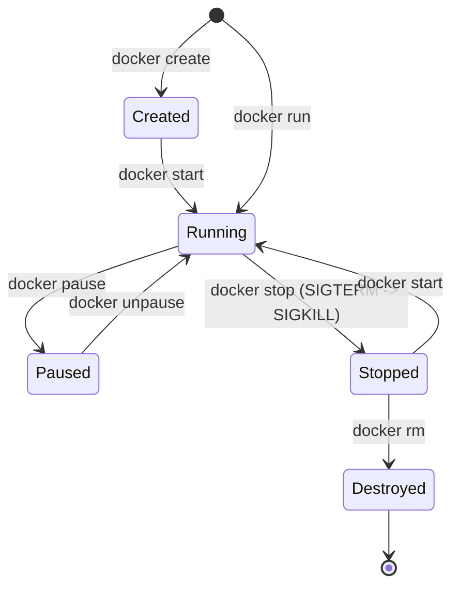

# Cẩm Nang Đóng Gói Ứng Dụng Với Docker & Nginx Tối Ưu (Multi-Stage Build Cho Angular 22 & Ionic Web)

> **Mục tiêu tài liệu:** Giúp bạn hiểu sâu từ gốc rễ bản chất của **Docker** (Container, Image, Layer, Cache, Virtual Machine vs Container), nắm vững lý do tại sao frontend cần Docker, và mổ xẻ chi tiết từng dòng lệnh trong **Dockerfile Multi-Stage Build** giúp tối ưu kích thước ứng dụng từ **1.5GB xuống chỉ còn ~25MB**.

---

## Mục lục

1. [Phần 1: Nền tảng & Các khái niệm cốt lõi trong Docker](#phần-1-nền-tảng--các-khái-niệm-cốt-lõi-trong-docker)
   - 1.1. Docker là gì?
   - 1.2. So sánh Container vs Virtual Machine (Máy ảo VM)
   - 1.3. Bộ ba trụ cột: Dockerfile, Docker Image và Docker Container
   - 1.4. Đi sâu vào Docker Image: Cấu tạo, Layers, Manifest, Digest & Tags
   - 1.5. Đi sâu vào Docker Container: Vòng đời (Lifecycle), Cơ chế cô lập (Namespaces & Cgroups), Read-Write Layer
   - 1.6. Quản trị dữ liệu bền vững: Docker Volumes, Bind Mounts & tmpfs Mounts
   - 1.7. Docker Network cơ bản: Giao tiếp giữa các Container
   - 1.8. Docker Client, Docker Daemon và Docker Registry (Docker Hub)
   - 1.9. Cơ chế Layer & Union File System (OverlayFS)
   - 1.10. Nguyên lý Docker Build Cache & Cache Invalidation
2. [Phần 2: Tại sao Frontend SPA cần Docker?](#phần-2-tại-sao-frontend-spa-cần-docker)
3. [Phần 3: Chiến lược Multi-Stage Build: Bí quyết giảm dung lượng từ 1.5GB còn 25MB](#phần-3-chiến-lược-multi-stage-build-bí-quyết-giảm-dung-lượng-từ-15gb-còn-25mb)
4. [Phần 4: Phân tích chi tiết từng bước & từng câu lệnh trong Dockerfile](#phần-4-phân-tích-chi-tiết-từng-bước--từng-câu-lệnh-trong-dockerfile)
   - 4.1. Stage 1: Build Application (Node.js Alpine)
   - 4.2. Stage 2: Production Server (Nginx Alpine)
   - 4.3. Phân biệt các lệnh dễ nhầm: `RUN` vs `CMD` vs `ENTRYPOINT`
   - 4.4. Sự thật về lệnh `EXPOSE` và cờ `-p` (Port Publishing)
   - 4.5. Tại sao Nginx bắt buộc phải chạy `daemon off;`?
5. [Phần 5: Tối ưu Build Context với `.dockerignore`](#phần-5-tối-ưu-build-context-với-dockerignore)
6. [Phần 6: Cấu hình `nginx.conf` chuẩn cho Single Page Application (SPA)](#phần-6-cấu-hình-nginxconf-chuẩn-cho-single-page-application-spa)
   - Xử lý triệt để lỗi F5 Refresh bị 404 Not Found
   - Bật nén Gzip tối đa hóa tốc độ tải trang
   - Caching Policy (Bảo đảm cập nhật code mới ngay lập tức)
   - Bổ sung Security Headers
7. [Phần 7: Quản lý & Chạy nhanh bằng `docker-compose.yml`](#phần-7-quản-lý--chạy-nhanh-bằng-docker-composeyml)
8. [Phần 8: Hướng dẫn chạy thực tế & Cheatsheet lệnh Docker](#phần-8-hướng-dẫn-chạy-thực-tế--cheatsheet-lệnh-docker)
9. [Phần 9: Bảng tổng hợp các cạm bẫy thường gặp & Best Practices](#phần-9-bảng-tổng-hợp-các-cạm-bẫy-thường-gặp--best-practices)
10. [Phần 10: Quy trình Triển khai (Deploy) Docker Image ra Production](#phần-10-quy-trình-triển-khai-deploy-docker-image-ra-production)
    - 10.1. Toàn cảnh Pipeline Triển khai (CI/CD ➔ Registry ➔ Production)
    - 10.2. Bước 1: Build & Đóng gói Image theo Version (Tagging Strategy)
    - 10.3. Bước 2: Push Image lên Container Registry (Docker Hub, GitHub ghcr.io, AWS ECR)
    - 10.4. Bước 3: Tự động hóa qua GitHub Actions CI/CD Pipeline
    - 10.5. Bước 4: Ba mô hình Deploy Production thực tế (VPS Docker Compose, Serverless Cloud Run, Kubernetes)
    - 10.6. Vấn đề "sống còn": Quản lý Environment Variables (API URLs) trong Angular khi chạy Docker

---

## Phần 1: Nền tảng & Các khái niệm cốt lõi trong Docker

Trước khi bắt tay vào viết code, bạn cần hiểu rõ bản chất cách thức Docker vận hành để không bị bỡ ngỡ khi debug hoặc tối ưu pipeline.

### 1.1. Docker là gì?
**Docker** là một nền tảng mã nguồn mở cho phép bạn tự động hóa việc triển khai ứng dụng bên trong các **Container** (thùng chứa) độc lập. Docker đóng gói toàn bộ: mã nguồn (code), môi trường thực thi (runtime), thư viện phụ thuộc (libraries) và các file cấu hình hệ thống vào một khối duy nhất có thể chạy ở bất kỳ đâu có cài Docker Engine.

### 1.2. So sánh Container vs Virtual Machine (Máy ảo VM)

| Tiêu chí | Virtual Machine (VM - VMware, VirtualBox) | Container (Docker) |
| :--- | :--- | :--- |
| **Kiến trúc** | Cần một lớp điều khiển ảo hóa **Hypervisor** và phải cài **Guest OS** riêng biệt cho từng máy ảo. | Chia sẻ trực tiếp **Kernel của Host OS** thông qua công nghệ Linux Namespaces & cgroups. |
| **Dung lượng** | Rất nặng: Từ vài GB đến hàng chục GB (do chứa cả hệ điều hành Windows/Ubuntu đầy đủ). | Cực nhẹ: Từ **5MB đến vài chục MB** (chỉ chứa ứng dụng và thư viện tối thiểu). |
| **Thời gian khởi động**| Chậm: Mất từ **vài chục giây đến vài phút** để khởi động lại hệ điều hành ảo. | Siêu nhanh: Chỉ mất **vài mili-giây đến vài giây** (như khởi động một tiến trình Process thông thường). |
| **Hiệu năng & RAM** | Tốn nhiều RAM cố định gán cho VM, CPU bị hao phí qua lớp Hypervisor. | Tiêu tốn cực ít RAM (chạy sát phần cứng của máy chủ Host). |

```text
+-------------------------+     +-------------------------+
|    Virtual Machines     |     |       Containers        |
+-------------------------+     +-------------------------+
| [App 1]     | [App 2]   |     | [App 1]     | [App 2]   |
| [Libs/Deps] | [Libs]    |     | [Libs/Deps] | [Libs]    |
| [Guest OS]  | [Guest OS]|     +-------------+-----------+
+-------------+-----------+     |      Docker Engine      |
|       Hypervisor        |     +-------------------------+
+-------------------------+     |     Host OS (Kernel)    |
|    Host OS (Kernel)     |     +-------------------------+
+-------------------------+     |    Server Hardware      |
|    Server Hardware      |     +-------------------------+
+-------------------------+
```

### 1.3. Bộ ba trụ cột: Dockerfile, Docker Image và Docker Container

Để hình dung mối quan hệ mật thiết giữa 3 thành phần này, bạn có thể liên hệ với 3 mô hình tương đồng trong đời sống và kỹ thuật:

| Góc nhìn so sánh | Dockerfile | Docker Image | Docker Container |
| :--- | :--- | :--- | :--- |
| **Lập trình Hướng đối tượng (OOP)** | Mã nguồn định nghĩa Class | **Class** (Khuôn mẫu thiết kế) | **Object Instance** (Thực thể đang hoạt động) |
| **Kỹ thuật phần mềm truyền thống** | Mã nguồn (`.ts` / `.c`) | File thực thi nhị phân tĩnh (`.exe` / `.bin`) | **Process** (Tiến trình đang chạy trên RAM & CPU) |
| **Nghệ thuật ẩm thực** | Công thức nấu ăn (Recipe) | Bánh mì đông lạnh đóng gói sẵn | Bánh mì đang được hâm nóng & thưởng thức |

- **`Dockerfile` (Kịch bản build):** Là một file văn bản thuần (plain text) chứa tập hợp các câu lệnh tuần tự (`FROM`, `WORKDIR`, `COPY`, `RUN`, `CMD`) hướng dẫn Docker Daemon cách lắp ráp nên một ứng dụng.
- **`Docker Image` (Bản thiết kế bất biến - Immutable Blueprint):** Là một gói tĩnh chỉ đọc (read-only), chứa hệ điều hành tối giản, runtime, mã nguồn, dependencies và các biến môi trường. Image **không bao giờ chạy** — nó là trạng thái "đóng băng" được lưu trên ổ đĩa hoặc chia sẻ qua Docker Hub.
- **`Docker Container` (Thực thể sống đang thực thi):** Là một môi trường thực thi độc lập được khởi sinh từ một Image. Từ **1 Image duy nhất**, bạn có thể tạo và chạy đồng thời hàng chục hay hàng trăm Container khác nhau mà không sợ chúng xung đột lẫn nhau.

---

### 1.4. Đi sâu vào Docker Image (Bản chất, Cấu tạo & Cơ chế)

Một **Docker Image** không phải là một file nén zip đơn lẻ khổng lồ, mà là một tập hợp các **lớp hệ thống tệp chỉ đọc (Read-Only File System Layers)** kết hợp với một file mô tả cấu hình (**Image Manifest / Config JSON**).

```text
               ┌────────────────────────────────────────────────────────┐
               │                  DOCKER IMAGE MANIFEST                 │
               │  - Architecture: amd64 / arm64                         │
               │  - Config: Env vars, WorkingDir, Exposed Ports, Entry  │
               │  - Layers: List of SHA256 hashes                       │
               └───────────────────────────┬────────────────────────────┘
                                           │
         ┌─────────────────────────────────┴─────────────────────────────────┐
         ▼                                 ▼                                 ▼
┌─────────────────┐               ┌─────────────────┐               ┌─────────────────┐
│ Layer 1: BaseOS │               │ Layer 2: Deps   │               │ Layer 3: Code   │
│ (Alpine Linux)  │ ────────────> │ (Node / Nginx)  │ ────────────> │ (dist/www, cfg) │
│ [Read-Only]     │               │ [Read-Only]     │               │ [Read-Only]     │
└─────────────────┘               └─────────────────┘               └─────────────────┘
```

#### Các đặc tính sống còn của Docker Image:
1. **Tính bất biến (Immutability):** Một khi Image đã được build xong, nội dung của nó **vĩnh viễn không thể thay đổi**. Nếu bạn sửa dù chỉ 1 ký tự trong code, một Image mới (hoặc Layer mới) sẽ được sinh ra.
2. **Cấu trúc định danh chuẩn quốc tế:**
   ```text
   [registry_host[:port]/][namespace/]repository[:tag]
   
   Ví dụ:
   - docker.io/library/nginx:1.27-alpine  (Official Image trên Docker Hub)
   - ghcr.io/congphu97/dev-blog:v2.0.1   (Custom Image trên GitHub Container Registry)
   ```
3. **Cạm bẫy với Tag `:latest`:**
   - Khi không chỉ định tag, Docker mặc định gán nhãn `:latest`.
   - **Tuyệt đối không dùng `:latest` trong Production!** Bởi vì `:latest` không có nghĩa là phiên bản mới nhất mãi mãi, nó chỉ là một con trỏ có thể bị ghi đè bất kỳ lúc nào. Nếu hôm nay build chạy tốt, tuần sau base image `:latest` cập nhật phiên bản gây breaking change, hệ thống CI/CD của bạn sẽ lập tức bị gãy. Luôn cố định phiên bản cụ thể (ví dụ: `node:22-alpine3.20`, `nginx:1.27-alpine`).
4. **Image Digest (Bảo mật tuyệt đối):**
   - Mỗi Image sở hữu một mã hash mật mã bất biến dạng `sha256:7b5...`. Tag có thể trỏ đi nơi khác, nhưng **Digest thì vĩnh viễn duy nhất**. Trong các hệ thống bảo mật cao, người ta kéo image qua digest để đảm bảo 100% không bị tấn công chuỗi cung ứng (Supply Chain Attack).
5. **Các lệnh Image cốt lõi:**
   ```bash
   docker images                     # Xem danh sách images trên máy
   docker pull <image>:<tag>         # Tải image từ Registry về máy
   docker history <image>            # Soi từng layer cấu thành nên image và kích thước
   docker inspect <image>            # Xem toàn bộ metadata JSON chi tiết của image
   docker rmi <image>                # Xóa image khỏi máy local
   ```

---

### 1.5. Đi sâu vào Docker Container (Vòng đời, Cơ chế cô lập & Bản chất tiến trình)

Nhiều người lầm tưởng Container là một "máy ảo thu nhỏ". Thực chất: **Container chỉ là một Tiến trình thông thường (Standard Linux Process) chạy trực tiếp trên Kernel của máy Host**, nhưng bị bao bọc bởi 2 công nghệ cốt lõi của Linux Kernel:

1. **Linux Namespaces (Cô lập tầm nhìn):**
   - **PID Namespace:** Container có bảng tiến trình riêng. Tiến trình chính của app trong container thấy mình là `PID 1`, hoàn toàn không thấy các tiến trình khác của máy chủ Host.
   - **NET Namespace:** Container sở hữu card mạng ảo (virtual eth), bảng định tuyến (routing table), địa chỉ IP riêng và dải port riêng.
   - **MNT Namespace:** Container chỉ nhìn thấy cây thư mục độc lập do Image cung cấp, không thể tự ý truy cập vào filesystem của máy chủ Host.
   - **IPC, UTS, USER Namespaces:** Cô lập bộ nhớ chia sẻ, hostname và phân quyền người dùng.
2. **Control Groups (cgroups - Giới hạn tài nguyên):**
   - Ngăn chặn tình trạng một container "ngốn" sạch tài nguyên máy chủ. Docker dùng cgroups để áp đặt hạn mức cứng: *Container này chỉ được dùng tối đa 1 CPU core và 256MB RAM* (`--cpus="1.0" --memory="256m"`).

#### Container Read-Write Layer & Tính chất Vô thường (Ephemeral Nature):
- Khi một Container được khởi chạy từ Image, Docker tạo ra một lớp cực mỏng trên đỉnh gọi là **Container Layer (Read-Write Layer)**.
- Khi ứng dụng trong container tạo file mới, ghi log, hoặc chỉnh sửa file: Docker sử dụng cơ chế **Copy-on-Write (CoW)** — copy file từ layer Read-Only bên dưới lên lớp Read-Write để chỉnh sửa.
- ⚠️ **TÍNH CHẤT EPHEMERAL (Vô thường):** Container sinh ra để hoàn thành nhiệm vụ và có thể bị tiêu hủy bất kỳ lúc nào. **Khi bạn gõ lệnh `docker rm <container>`, toàn bộ dữ liệu nằm trên lớp Read-Write Layer sẽ bốc hơi vĩnh viễn!** Đây chính là lý do chúng ta bắt buộc phải hiểu về **Docker Volume**.

#### Vòng đời của Container (Lifecycle):



- **`Created`:** Container đã được cấp phát filesystem và cấu hình nhưng chưa chạy lệnh nào.
- **`Running`:** Tiến trình chính (`PID 1`) đang hoạt động và tiêu thụ CPU/RAM.
- **`Paused`:** Tất cả các tiến trình bị đóng băng tạm thời trong RAM (dùng cgroups freezer).
- **`Stopped (Exited)`:** Tiến trình chính đã kết thúc hoặc bị tắt an toàn.
- **`Destroyed`:** Bị xóa sổ hoàn toàn khỏi hệ thống.

---

### 1.6. Quản trị dữ liệu bền vững: Docker Volumes, Bind Mounts & tmpfs Mounts

Vì Container có tính chất Ephemeral (dữ liệu biến mất khi xóa container), làm thế nào để lưu trữ dữ liệu Database (PostgreSQL, MongoDB), file upload của khách hàng, hoặc file cấu hình Nginx mà **không bao giờ bị mất** khi redeploy ứng dụng?

Docker cung cấp **3 cơ chế Mount dữ liệu**:

```text
       MÁY CHỦ HOST (HOST OS)                         CONTAINER
+------------------------------------+        +-------------------------+
|                                    |        |                         |
|  [Named Volumes]                   |        |                         |
|  /var/lib/docker/volumes/my_data   |=======>|  /var/lib/postgresql    |
|  (Docker quản lý an toàn)          | Mount  |  (Thư mục trong app)    |
|                                    |        |                         |
|  [Bind Mounts]                     |        |                         |
|  /Users/phu/project/src            |=======>|  /app/src               |
|  (Bất kỳ đường dẫn nào trên máy)   | Mount  |  (Hot reload khi dev)   |
|                                    |        |                         |
|  [tmpfs Mounts]                    |        |                         |
|  Chỉ nằm trên bộ nhớ RAM           |=======>|  /tmp/cache             |
|  (Không ghi xuống ổ cứng)          | Mount  |  (Dữ liệu nhạy cảm)     |
+------------------------------------+        +-------------------------+
```

#### So sánh chi tiết 3 loại Mount:

| Đặc điểm | 1. Named Volume (Khuyên dùng cho Prod) | 2. Bind Mount (Khuyên dùng khi Dev) | 3. tmpfs Mount |
| :--- | :--- | :--- | :--- |
| **Vị trí lưu trữ** | Thư mục riêng do Docker quản lý (`/var/lib/docker/volumes/`) | Bất kỳ vị trí nào trên ổ cứng máy Host (`/path/to/folder`) | Chỉ nằm trên **Bộ nhớ RAM** của máy Host |
| **Tính độc lập** | Hoàn toàn tách biệt khỏi vòng đời Container (Container bị xóa, Volume vẫn còn nguyên) | Tách biệt với container, gắn chặt vào cấu trúc folder máy Host | Biến mất hoàn toàn khi Container bị dừng (`docker stop`) |
| **Quyền quản lý** | Do Docker CLI quản trị an toàn (`docker volume`) | Do người dùng tự tạo và chịu trách nhiệm phân quyền | Do hệ điều hành Host quản lý trên RAM |
| **Hiệu năng I/O** | Tối ưu cao, không bị nghẽn I/O trên macOS/Windows | Có thể bị chậm I/O trên Docker Desktop (macOS/Win) | **Nhanh nhất tuyệt đối** (tốc độ đọc ghi của RAM) |
| **Mục đích sử dụng** | Lưu trữ Database, uploads, logs lâu dài, chia sẻ dữ liệu giữa nhiều Container | Gắn trực tiếp mã nguồn để **Hot-Reload** code khi lập trình frontend/backend | Lưu Secret, Password, Session, Private Key nhạy cảm |

#### Cú pháp thực hành các loại Mount:
```bash
# 1. Named Volume (Tạo volume độc lập và mount vào container)
docker volume create my_db_data
docker run -d -v my_db_data:/var/lib/postgresql/data postgres:16

# 2. Bind Mount (Gắn thư mục code từ máy thật vào container để dev)
docker run -d -p 4200:4200 -v $(pwd)/src:/app/src node:22-alpine npm start

# 3. Read-Only Bind Mount (Chỉ cho phép container đọc, cấm chỉnh sửa file host)
docker run -d -v $(pwd)/nginx.conf:/etc/nginx/conf.d/default.conf:ro nginx:alpine

# 4. tmpfs Mount (Lưu cache siêu tốc trên RAM)
docker run -d --tmpfs /app/cache:rw,size=64m my-app:latest
```

#### Các lệnh quản lý Docker Volume cần nhớ:
```bash
docker volume ls                 # Liệt kê tất cả volume đang có
docker volume inspect <vol_name> # Xem đường dẫn thực tế trên ổ cứng máy host
docker volume rm <vol_name>      # Xóa một volume (chỉ xóa được khi không có container nào gắn vào)
docker volume prune              # Dọn dẹp tất cả volume "mồ côi" không còn container nào dùng
```

---

### 1.7. Docker Network cơ bản: Giao tiếp giữa các Container

Mặc định, các container chạy hoàn toàn cô lập về mặt mạng. Để Frontend có thể gọi tới Backend API hoặc Backend gọi tới Database, Docker cung cấp các **Network Drivers**:

1. **`bridge` (Mặc định cho đơn máy):**
   - Docker tạo ra một switch mạng ảo nội bộ. Các container gắn vào cùng bridge network có thể giao tiếp với nhau bằng **Tên Container (Container Name)** nhờ hệ thống Docker Embedded DNS (ví dụ: `http://api-backend:3000`).
2. **`host`:**
   - Container xóa bỏ hoàn toàn lớp mạng ảo và dùng chung 100% stack mạng của máy chủ Host. Hiệu năng cao nhất nhưng không thể chạy 2 container cùng chiếm cổng `80`.
3. **`none`:**
   - Ngắt hoàn toàn card mạng. Container bị cô lập tuyệt đối, dùng cho các tác vụ tính toán bảo mật offline.
4. **`overlay`:**
   - Kết nối nhiều Docker Daemon nằm trên các máy chủ vật lý khác nhau (nền tảng của Docker Swarm và Kubernetes).

---

### 1.8. Docker Client, Docker Daemon và Docker Registry

Kiến trúc Docker hoạt động theo mô hình Client - Server:
- **Docker Client (`docker` CLI):** Giao diện dòng lệnh bạn gõ trên terminal (`docker build`, `docker run`). Client gửi yêu cầu REST API tới Daemon.
- **Docker Daemon (`dockerd`):** Tiến trình chạy ngầm chịu trách nhiệm tạo, quản lý images, containers, networks và volumes.
- **Docker Registry:** Kho lưu trữ chứa các Docker Image đã được build sẵn. Nổi tiếng nhất là **Docker Hub** (công khai), ngoài ra còn có AWS ECR, Google Artifact Registry, GitHub Container Registry (ghcr.io).

---

### 1.9. Cơ chế Layer & Union File System (OverlayFS)

Một Docker Image được tạo thành từ **nhiều lớp (layers) xếp chồng lên nhau**:
- Mỗi câu lệnh trong Dockerfile (`FROM`, `COPY`, `RUN`) sẽ tạo ra **một Layer mới**.
- Các Layer bên dưới là **Chỉ Đọc (Read-Only)** và bất biến.
- Khi nhiều container cùng chạy từ 1 Image, chúng dùng chung các Layer Read-Only này, chỉ có một lớp mỏng **Container Layer (Read-Write)** được gắn trên cùng để lưu thay đổi trong phiên làm việc.

```text
+------------------------------------------------------+
| [Container Layer (Read-Write)] <-- Ghi dữ liệu tạm   |
+------------------------------------------------------+
| Layer 5: CMD ["nginx", "-g", "daemon off;"] (RO)     |
+------------------------------------------------------+
| Layer 4: COPY --from=builder /app/www ...   (RO)     |
+------------------------------------------------------+
| Layer 3: COPY nginx.conf ...                (RO)     |
+------------------------------------------------------+
| Layer 2: RUN rm -rf /etc/nginx/conf.d/*     (RO)     |
+------------------------------------------------------+
| Layer 1: FROM nginx:1.27-alpine             (RO)     |
+------------------------------------------------------+
```

---

### 1.10. Nguyên lý Docker Build Cache & Cache Invalidation

Khi bạn chạy lệnh `docker build`:
- Docker sẽ duyệt qua từng dòng lệnh từ trên xuống dưới.
- Với mỗi dòng, Docker kiểm tra xem câu lệnh đó và các file đầu vào có bị thay đổi so với lần build trước không.
- Nếu **KHÔNG THAY ĐỔI**: Docker sẽ tái sử dụng lại layer đã build trước đó trong cache (`---> Using cache`), giúp việc build chỉ mất **0.5 giây**!
- Nếu **CÓ THAY ĐỔI (Cache Invalidation)**: Layer đó bị tính toán lại, và **TẤT CẢ CÁC DÒNG LỆNH PHÍA SAU NÓ ĐỀU BỊ BUỘC PHẢI CHẠY LẠI TỪ ĐẦU**, không thể dùng lại cache nữa!
> **Quy tắc vàng:** Dòng nào **ít thay đổi** (cài đặt dependencies, cấu hình môi trường) thì đặt ở **TRÊN CÙNG**. Dòng nào **thường xuyên thay đổi** (sửa mã nguồn `.ts`, `.html`) thì đặt ở **DƯỚI CÙNG**.

---

## Phần 2: Tại sao Frontend SPA cần Docker?

Nhiều bạn nghĩ: *"Frontend Angular chỉ là file HTML/CSS/JS tĩnh, deploy lên host nào chả được, cần gì Docker?"*.

Trong môi trường doanh nghiệp thực tế:
1. **Xóa bỏ vĩnh viễn câu nói "Nó chạy được trên máy tôi":** Bạn dùng Node.js v22 trên macOS M3, nhưng server staging dùng Ubuntu Node v18 gây ra lỗi biên dịch thư viện C-bindings. Docker đồng nhất 100% môi trường build từ local đến server.
2. **Sẵn sàng cho kiến trúc Kubernetes (K8s) & Cloud Native:** Các nền tảng điều phối container như K8s, AWS ECS, Google Cloud Run đều yêu cầu đóng gói dưới dạng Docker image.
3. **Toàn quyền kiểm soát Web Server Nginx:** Bạn tự cấu hình Gzip, HTTP/2, Cache-Control, Security Headers, CORS, và SPA fallback mà không phụ thuộc vào hạ tầng bên ngoài.
4. **Rollback trong chớp mắt (Zero-Downtime Rollback):** Nếu bản release mới phát sinh lỗi nghiêm trọng, bạn chỉ cần chuyển thẻ container sang image cũ (`docker run dev-blog:v1.0.0`) trong vòng **1 giây** là hệ thống hoạt động bình thường, không cần build lại code.

---

## Phần 3: Chiến lược Multi-Stage Build: Bí quyết giảm dung lượng từ 1.5GB còn 25MB

Nếu bạn tạo một Dockerfile thông thường bằng cách dùng image `node:22`, copy code vào, chạy `npm install` và serve ứng dụng bằng lệnh `npm start` hoặc `http-server`:
- Kích thước Docker Image sẽ phình to lên tới **1.2GB - 1.8GB**!
- Lý do: Toàn bộ công cụ Node runtime, npm CLI, TypeScript compiler, và hàng vạn file trong thư mục `node_modules` đều bị nhét vào image production.
- Rủi ro bảo mật: Image chứa đầy các công cụ build dev có thể bị kẻ tấn công khai thác.

**Giải pháp: Kỹ thuật Multi-Stage Build (Đa tầng)**

```text
==================================================================================
STAGE 1: BUILDER (Môi trường xưởng gia công - Nặng)
FROM node:22-alpine AS builder
- Tải package.json, chạy `npm ci`
- Biên dịch TypeScript, SCSS, tối ưu Tree-shaking, băm hash tên file
- Kết quả đầu ra: Thư mục thuần tĩnh `/app/www` (chỉ nặng khoảng 5MB - 10MB)
==================================================================================
                                    |
            CHỈ COPY THƯ MỤC /www (Bỏ lại toàn bộ Node và node_modules)
                                    v
==================================================================================
STAGE 2: RUNNER (Phòng trưng bày Production - Siêu nhẹ)
FROM nginx:1.27-alpine AS runner
- Không chứa Node.js, không có npm, không có node_modules
- Chỉ có Web Server Nginx Alpine (~20MB) và các file tĩnh trong `/usr/share/nginx/html`
==> DUNG LƯỢNG IMAGE CUỐI CÙNG: CHỈ ~25MB! GIẢM HƠN 98%!
==================================================================================
```

---

## Phần 4: Phân tích chi tiết từng bước & từng câu lệnh trong Dockerfile

Dưới đây là toàn bộ nội dung của file `Dockerfile` chuẩn Production của dự án:

```dockerfile
# ==========================================
# STAGE 1: Build Application (Node.js Alpine)
# ==========================================
FROM node:22-alpine AS builder

WORKDIR /app

# Tận dụng Docker Layer Cache
COPY package.json package-lock.json ./

# Cài đặt dependencies sạch và chính xác
RUN npm ci --legacy-peer-deps

# Copy toàn bộ mã nguồn vào container
COPY . .

# Biên dịch mã nguồn cho môi trường Production (Output đặt tại /app/www)
RUN npm run build

# ==========================================
# STAGE 2: Production Server (Nginx Alpine)
# ==========================================
FROM nginx:1.27-alpine AS runner

# Xóa các file cấu hình mặc định của Nginx
RUN rm -rf /etc/nginx/conf.d/*

# Copy cấu hình Nginx SPA đã viết ở bước trên
COPY nginx.conf /etc/nginx/conf.d/default.conf

# Copy thư mục build tĩnh từ Stage 1 sang thư mục phục vụ web của Nginx
COPY --from=builder /app/www /usr/share/nginx/html

# Mở cổng 80 cho HTTP traffic
EXPOSE 80

# Chạy Nginx foreground mode (giữ container luôn sống)
CMD ["nginx", "-g", "daemon off;"]
```

Bây giờ, chúng ta hãy mổ xẻ **từng dòng một** để hiểu tại sao lại viết như vậy:

---

### 4.1. Stage 1: Build Application (Node.js Alpine)

#### Dòng 1: `FROM node:22-alpine AS builder`
- `FROM`: Câu lệnh khởi đầu bắt buộc của mọi Dockerfile, dùng để chỉ định **Base Image**.
- `node:22-alpine`: Chúng ta chọn Node.js phiên bản 22 chạy trên nhân **Alpine Linux**. Alpine là bản phân phối Linux siêu gọn nhẹ (chỉ khoảng 5MB), không chứa các tiện ích dư thừa, giúp tải nhanh và giảm thiểu lỗ hổng bảo mật (vulnerabilities).
- `AS builder`: Đặt tên định danh cho tầng build này là `builder`. Tên gọi này sẽ được dùng ở Stage 2 để trích xuất file sang.

#### Dòng 2: `WORKDIR /app`
- Thiết lập thư mục làm việc mặc định bên trong container là `/app`.
- Mọi câu lệnh tiếp theo (`COPY`, `RUN`) nếu dùng đường dẫn tương đối sẽ được thực thi tại đây.
- *Lưu ý:* Nếu thư mục `/app` chưa tồn tại, Docker sẽ tự động tạo ra. Tránh dùng `RUN cd /app` vì mỗi lệnh `RUN` chạy trong một subshell riêng biệt, lệnh `cd` sẽ không có tác dụng cho các dòng sau!

#### Dòng 3: `COPY package.json package-lock.json ./`
- Copy 2 file khai báo dependencies từ máy tính bạn vào thư mục `/app` trong container.
- **TẠI SAO KHÔNG COPY TẤT CẢ CODE NGAY LẬP TỨC BẰNG `COPY . .`?**
  - Đây là kỹ thuật tối ưu **Docker Layer Cache** quan trọng nhất!
  - File `package.json` rất hiếm khi thay đổi (chỉ đổi khi bạn cài thêm thư viện mới). Trong khi đó mã nguồn `.ts`, `.html` lại thay đổi liên tục mỗi ngày.
  - Bằng cách chỉ copy file `package.json` trước, Docker sẽ cache lại bước `npm ci` ở dòng tiếp theo. Lần sau bạn sửa code, Docker phát hiện `package.json` không đổi nên sẽ **bỏ qua bước cài đặt npm**, tiết kiệm 3-5 phút mỗi lần build!

#### Dòng 4: `RUN npm ci --legacy-peer-deps`
- `RUN`: Thực thi một lệnh bash bên trong container trong quá trình build image và lưu kết quả thành một layer mới.
- **Tại sao dùng `npm ci` thay vì `npm install`?**
  - `npm install` có thể tự ý nâng cấp phiên bản các gói phụ thuộc (dấu `^`, `~`) và tự động ghi đè lại file `package-lock.json`. Điều này dẫn đến tình trạng máy bạn chạy phiên bản thư viện khác, máy server chạy phiên bản khác.
  - `npm ci` (Clean Install) bắt buộc phải có `package-lock.json`, xóa sạch thư mục `node_modules` cũ và cài đặt chính xác 100% từng byte phiên bản thư viện đã được khóa. Nếu lock file sai lệch, nó sẽ lập tức báo lỗi. Đây là chuẩn mực bắt buộc trong CI/CD.
- `--legacy-peer-deps`: Bỏ qua các xung đột nghiêm ngặt về peer dependency giữa Angular 22 và các thư viện UI cũ (như Ionic hoặc thư viện bên thứ ba), tránh làm đứt gãy quá trình build.

#### Dòng 5: `COPY . .`
- Copy toàn bộ mã nguồn dự án (sau khi đã lọc qua file `.dockerignore`) vào `/app`.
- Vì dòng này nằm SAU dòng cài đặt dependencies, nên khi bạn sửa bất kỳ file logic nào, Docker chỉ chạy lại từ dòng này trở xuống, không phải cài lại npm!

#### Dòng 6: `RUN npm run build`
- Thực thi lệnh build của dự án Angular (`ng build --configuration=production`).
- Trình biên dịch Angular CLI tiến hành tối ưu: Tree-shaking (gọt tỉa code chết), Minify & Uglify mã nguồn, sinh ra Source Maps (nếu cấu hình) và băm mã Hash vào tên file JS/CSS.
- Thư mục đầu ra được sinh ra tại: `/app/www`.

---

### 4.2. Stage 2: Production Server (Nginx Alpine)

#### Dòng 7: `FROM nginx:1.27-alpine AS runner`
- Khởi động **Stage 2** hoàn toàn mới với base image là `nginx:1.27-alpine`.
- **Điều gì xảy ra với Stage 1?** Toàn bộ môi trường Stage 1 (Node.js runtime, compiler, npm cache, `node_modules`) sẽ **BỊ BỎ RƠI HOÀN TOÀN**, không một file rác nào lọt được sang Image cuối cùng!
- Tầng này chỉ chứa Nginx Alpine siêu nhẹ (chỉ khoảng 20MB).

#### Dòng 8: `RUN rm -rf /etc/nginx/conf.d/*`
- Xóa sạch cấu hình mặc định sẵn có của Nginx (thường là trang chào mừng `Welcome to nginx!`) để tránh xung đột với cấu hình tùy chỉnh của chúng ta.

#### Dòng 9: `COPY nginx.conf /etc/nginx/conf.d/default.conf`
- Copy file cấu hình `nginx.conf` tối ưu riêng cho SPA từ máy chủ vào vị trí cấu hình chính thức của Nginx bên trong container.

#### Dòng 10: `COPY --from=builder /app/www /usr/share/nginx/html`
- **Đây chính là dòng lệnh "phép màu" của Multi-stage build:**
  - Cờ `--from=builder`: Chỉ định Docker truy cập vào Stage 1 (có tên là `builder`).
  - Lấy thư mục tĩnh `/app/www` đã được biên dịch sạch sẽ.
  - Đặt vào thư mục phục vụ web mặc định của Nginx: `/usr/share/nginx/html`.
- Lúc này, container Nginx chỉ chứa các file HTML, CSS, JavaScript tĩnh và ảnh, không hề có bất kỳ công cụ build nào đi kèm.

#### Dòng 11: `EXPOSE 80`
- Khai báo cổng mà container sẽ lắng nghe ở runtime.

#### Dòng 12: `CMD ["nginx", "-g", "daemon off;"]`
- Câu lệnh mặc định sẽ được thực thi khi bạn tạo và chạy container từ Image.

---

### 4.3. Phân biệt các lệnh dễ nhầm: `RUN` vs `CMD` vs `ENTRYPOINT`

| Lệnh | Thời điểm chạy | Mục đích | Có bị ghi đè không? |
| :--- | :--- | :--- | :--- |
| **`RUN`** | Chạy trong lúc **BUILD IMAGE** (`docker build`). | Cài đặt phần mềm, download thư viện, biên dịch code, tạo file/thư mục. Kết quả được lưu vĩnh viễn vào Layer. | Không áp dụng (chỉ chạy 1 lần lúc build). |
| **`CMD`** | Chạy khi **CONTAINER KHỞI ĐỘNG** (`docker run`). | Cung cấp lệnh và tham số mặc định để kích hoạt ứng dụng bên trong container. | **Dễ dàng bị ghi đè** nếu người dùng truyền lệnh khác khi chạy (ví dụ `docker run image bash`). |
| **`ENTRYPOINT`** | Chạy khi **CONTAINER KHỞI ĐỘNG** (`docker run`). | Thiết lập tiến trình cố định không thể thay đổi của container (thường dùng để làm công cụ CLI hoặc script khởi động). | Khó ghi đè (phải dùng cờ `--entrypoint`). Các tham số của `CMD` sẽ được nối tiếp vào sau `ENTRYPOINT`. |

---

### 4.4. Sự thật về lệnh `EXPOSE` và cờ `-p` (Port Publishing)

- **`EXPOSE 80` trong Dockerfile CÓ MỞ CỔNG RA NGOÀI INTERNET KHÔNG?**
  - **KHÔNG!** Lệnh `EXPOSE` thực chất chỉ đóng vai trò như một **tài liệu ghi chú (metadata)** giữa người viết Dockerfile và người vận hành hệ thống, báo hiệu rằng: *"Ứng dụng bên trong container này lắng nghe ở cổng 80"*.
  - Nếu bạn chỉ viết `EXPOSE 80` mà khi chạy bạn gõ: `docker run -d my-image`, thì từ máy tính của bạn hoàn toàn KHÔNG THỂ truy cập vào container qua cổng 80!
- **Muốn mở cổng ra ngoài, bắt buộc phải dùng cờ `-p` (Port Binding):**
  ```bash
  docker run -d -p 8080:80 my-image
  # Cú pháp: -p <Cổng_Máy_Thật_Host>:<Cổng_Bên_Trong_Container>
  ```
  Lúc này Docker Engine sẽ tạo một quy tắc định tuyến iptables: Bất kỳ ai gửi request vào cổng `8080` của máy tính sẽ được chuyển tiếp thẳng vào cổng `80` của Nginx bên trong container.

---

### 4.5. Tại sao Nginx bắt buộc phải chạy `daemon off;`?

Trong Linux thông thường, Nginx chạy dưới dạng **Daemon** (tiến trình chạy ngầm dưới background, nhường quyền điều khiển terminal lại cho người dùng).

Tuy nhiên, trong Docker:
- Container Docker tồn tại và sống sót **CHỈ DỰA VÀO TIẾN TRÌNH CÓ PID = 1** (tiến trình chính được khởi tạo bởi lệnh `CMD`).
- Nếu tiến trình PID 1 kết thúc (exit), container sẽ xem như đã hoàn thành nhiệm vụ và **TỰ ĐỘNG TẮT NGAY LẬP TỨC (Exited with code 0)**!
- Nếu bạn chỉ viết `CMD ["nginx"]`, Nginx sẽ spawn ra các worker ngầm rồi tiến trình chính tự thoát ra -> Container lập tức tắt ngúm chỉ sau 0.1 giây!
- Do đó, tham số `-g "daemon off;"` là **bắt buộc**, ra lệnh cho Nginx: *"Hãy chạy ở chế độ foreground (tiền cảnh), giữ chặt lấy tiến trình PID 1 và không bao giờ thoát!"*.

---

## Phần 5: Tối ưu Build Context với `.dockerignore`

File `.dockerignore` giúp bạn lọc bỏ các file rác trước khi Docker Client nén và gửi lên Docker Daemon:

```dockerignore
# Dependencies & Logs
node_modules
npm-debug.log
*.log

# Git & IDE configs
.git
.gitignore
.angular
.vscode
.idea

# Build outputs cục bộ
www
dist
coverage

# Mobile Native Builds (Capacitor)
android
ios
platforms
plugins
release
*.jks
*.keystore

# Documentation
*.md
```

---

## Phần 6: Cấu hình `nginx.conf` chuẩn cho Single Page Application (SPA)

Dưới đây là file `nginx.conf` hoàn chỉnh đã được tinh chỉnh cho Angular:

```nginx
server {
    listen 80;
    server_name localhost;
    root /usr/share/nginx/html;
    index index.html index.htm;

    # 1. Bật Gzip Compression để giảm 70% dung lượng file tải về
    gzip on;
    gzip_vary on;
    gzip_min_length 1024;
    gzip_proxied expired no-cache no-store private auth;
    gzip_types
        text/plain
        text/css
        text/xml
        text/javascript
        application/x-javascript
        application/javascript
        application/json
        application/xml
        application/xml+rss
        image/svg+xml;
    gzip_disable "MSIE [1-6]\.";

    # 2. Tăng cường Security Headers
    add_header X-Frame-Options "SAMEORIGIN" always;
    add_header X-Content-Type-Options "nosniff" always;
    add_header X-XSS-Protection "1; mode=block" always;
    add_header Referrer-Policy "strict-origin-when-cross-origin" always;

    # 3. Cache vĩnh viễn (1 năm) cho các file tĩnh đã có hash trong tên file
    location ~* \.(?:ico|css|js|gif|jpe?g|png|woff2?|eot|ttf|svg|webp|avif)$ {
        expires 1y;
        add_header Cache-Control "public, max-age=31536000, immutable";
        access_log off;
    }

    # 4. Tuyệt đối KHÔNG cache file index.html (để người dùng luôn nhận code mới nhất khi deploy)
    location = /index.html {
        expires -1;
        add_header Cache-Control "no-store, no-cache, must-revalidate, proxy-revalidate, max-age=0";
    }

    # 5. SPA Fallback: Chống lỗi 404 khi người dùng F5 hoặc gõ trực tiếp URL con
    location / {
        try_files $uri $uri/ /index.html;
    }

    # 6. Trang báo lỗi máy chủ
    error_page 500 502 503 504 /50x.html;
    location = /50x.html {
        root /usr/share/nginx/html;
    }
}
```

> [!IMPORTANT]
> **Giải thích cơ chế Fallback chống lỗi F5 404:**
> Trong Angular SPA, trình duyệt chỉ tải 1 file `index.html`. Việc chuyển trang sang `/blog/detail/8` hoàn toàn do Angular Router xử lý ảo phía client.
> Khi người dùng bấm **F5 (Refresh)** tại trang `/blog/detail/8`, trình duyệt sẽ gửi request hỏi Nginx: *"Cho tôi file vật lý tại đường dẫn `/blog/detail/8`"*. Nginx tìm trên ổ đĩa không thấy file nào tên như vậy, mặc định Nginx sẽ trả về lỗi **404 Not Found**.
> Nhờ dòng cấu hình `try_files $uri $uri/ /index.html;`, Nginx sẽ kiểm tra: nếu không thấy file `$uri`, nó sẽ tự động trả về `index.html` kèm HTTP 200, sau đó Angular Router trên trình duyệt sẽ nhận diện URL và render đúng nội dung bài viết!

---

## Phần 7: Quản lý & Chạy nhanh bằng `docker-compose.yml`

File `docker-compose.yml` giúp bạn lưu trữ toàn bộ cấu hình chạy thành mã nguồn (Infrastructure as Code):

```yaml
services:
  dev-blog-web:
    build:
      context: .
      dockerfile: Dockerfile
    container_name: dev-blog-web-container
    restart: always
    ports:
      - "8080:80"
    environment:
      - NODE_ENV=production
```

---

## Phần 8: Hướng dẫn chạy thực tế & Cheatsheet lệnh Docker

### Cách 1: Sử dụng Docker CLI thuần

```bash
# 1. Build image từ Dockerfile
docker build -t dev-blog-client:latest .

# 2. Khởi chạy container ngầm (-d), map cổng 8080 host vào cổng 80 container
docker run -d -p 8080:80 --name my-dev-blog dev-blog-client:latest

# 3. Mở trình duyệt xem sản phẩm tại:
http://localhost:8080

# 4. Xem log truy cập Nginx
docker logs -f my-dev-blog

# 5. Xem dung lượng RAM/CPU container tiêu thụ (thường chỉ tốn ~10MB RAM!)
docker stats my-dev-blog

# 6. Dừng và xóa container
docker stop my-dev-blog && docker rm my-dev-blog
```

### Cách 2: Sử dụng Docker Compose (Khuyên dùng)

```bash
# Khởi động dịch vụ và tự động build
docker compose up -d --build

# Xem danh sách container đang chạy
docker compose ps

# Xem log tổng hợp
docker compose logs -f

# Dừng toàn bộ dịch vụ
docker compose down
```

---

## Phần 9: Bảng tổng hợp các cạm bẫy thường gặp & Best Practices

| Vấn đề | Nguyên nhân | Cách khắc phục |
| :--- | :--- | :--- |
| **Bấm F5 bị lỗi 404 Not Found** | Nginx tìm file vật lý theo đường dẫn URL nhưng không thấy file tương ứng | Thêm `try_files $uri $uri/ /index.html;` vào `location /` trong `nginx.conf`. |
| **Build Docker quá lâu mỗi lần sửa code** | `COPY . .` được đặt trước lệnh `npm ci`, làm mất bộ nhớ đệm (Cache Invalidation) | Luôn copy `package.json` và chạy `npm ci` TRƯỚC KHI copy toàn bộ source code. |
| **Image Docker quá nặng (>1GB)** | Quên không dùng Multi-Stage Build hoặc copy cả `node_modules` vào image cuối | Dùng Nginx Alpine làm base image cho stage 2 và chỉ copy thư mục bundle tĩnh `/www`. |
| **Deploy code mới nhưng user vẫn thấy code cũ** | Trình duyệt cache file `index.html` của người dùng | Thêm header `Cache-Control: "no-store, no-cache, must-revalidate"` riêng cho `index.html`. |
| **Container tự tắt ngay sau khi chạy** | Nginx chạy chế độ daemon ngầm, tiến trình PID 1 kết thúc | Bắt buộc phải thêm `-g "daemon off;"` vào lệnh `CMD`. |
| **Lỗi Base Href khi chạy dưới Subpath** | Ứng dụng chạy dưới subpath (ví dụ `/dev-blog/`) nhưng Nginx phục vụ ở root `/` | Thêm tham số `--base-href /subpath/` khi chạy lệnh `ng build`. |

---

## Phần 10: Quy trình Triển khai (Deploy) Docker Image ra Production

Sau khi bạn đã viết xong `Dockerfile` và test image chạy tốt ở máy local, làm sao để đưa Docker Image này lên môi trường Production (Internet) cho người dùng thực tế truy cập?

Dưới đây là quy trình chuẩn công nghiệp (Production Standard Pipeline) gồm **4 bước chính**:

```
[Developer]
    │ (1. git push / tag v1.0.0)
    ▼
[GitHub Repository]
    │ (2. Trigger CI Pipeline)
    ▼
[GitHub Actions CI/CD]
    │ ──> Build Docker Image (Angular Multi-stage)
    │ ──> Gắn nhãn Tag (:v1.0.0, :sha-xxx)
    │ ──> Đăng nhập & Push lên Registry
    ▼
[Container Registry] (Docker Hub / GitHub ghcr.io / AWS ECR)
    │
    │ (3. Deploy / Pull Image)
    ├─────────────────────────────┬─────────────────────────────┐
    ▼                             ▼                             ▼
[Mô hình 1: VPS Đơn]        [Mô hình 2: Serverless]        [Mô hình 3: K8s]
Ubuntu + Docker Compose     Google Cloud Run / AWS Runner  Kubernetes Cluster
+ Nginx SSL Reverse Proxy   (Khuyên dùng cho Frontend)     (Doanh nghiệp lớn)
```

---

### 10.1. Bước 1: Build & Đóng gói Image theo Tag Version (Tagging Strategy)

Tuyệt đối không deploy image với tag `:latest` một cách vô tội vạ. Hãy sử dụng **Semantic Versioning** (`v1.0.0`) hoặc **Git Commit Hash** (`sha-7a8b9c`):

```bash
# Đặt tên theo chuẩn: <username_hoặc_org>/<tên_dự_án>:<tag>
docker build -t congphu97/dev-blog-client:v1.0.0 .
docker tag congphu97/dev-blog-client:v1.0.0 congphu97/dev-blog-client:latest
```

---

### 10.2. Bước 2: Push Image lên Container Registry

Container Registry là "kho chứa Image" trung gian để máy chủ Production có thể tải image về:

1. **Đăng nhập vào Registry (ví dụ Docker Hub):**
   ```bash
   docker login -u congphu97
   # Nhập Access Token / Password khi được yêu cầu
   ```
2. **Đẩy Image lên Registry:**
   ```bash
   docker push congphu97/dev-blog-client:v1.0.0
   docker push congphu97/dev-blog-client:latest
   ```

*(Nếu dùng GitHub Packages `ghcr.io` hoặc AWS ECR thì cú pháp tương tự, chỉ thay đổi domain registry).*

---

### 10.3. Bước 3: Tự động hóa qua GitHub Actions CI/CD Pipeline

Trong thực tế, bạn không gõ tay các lệnh trên mà để GitHub Actions tự làm mỗi khi merge vào nhánh `main` hoặc tạo Git Release:

Tạo file `.github/workflows/deploy.yml`:
```yaml
name: Build & Push Docker Image to Docker Hub

on:
  push:
    branches: [ "main" ]
    tags: [ 'v*.*.*' ]

jobs:
  build-and-push:
    runs-on: ubuntu-latest
    steps:
      - name: Checkout Source Code
        uses: actions/checkout@v4

      - name: Set up Docker Buildx (Hỗ trợ build cache & multi-arch)
        uses: docker/setup-buildx-action@v3

      - name: Đăng nhập Docker Hub
        uses: docker/login-action@v3
        with:
          username: ${{ secrets.DOCKERHUB_USERNAME }}
          password: ${{ secrets.DOCKERHUB_TOKEN }}

      - name: Build and Push Docker Image
        uses: docker/build-push-action@v5
        with:
          context: .
          push: true
          tags: |
            ${{ secrets.DOCKERHUB_USERNAME }}/dev-blog-client:${{ github.ref_name }}
            ${{ secrets.DOCKERHUB_USERNAME }}/dev-blog-client:latest
          cache-from: type=gha
          cache-to: type=gha,mode=max
```

---

### 10.4. Bước 4: Ba Mô Hình Deploy Lên Production Thực Tế

#### Mô hình 1: Deploy lên Cloud Server / VPS (DigitalOcean, AWS EC2, Linode, Hetzner)
*Phù hợp cho dự án cá nhân, startup vừa và nhỏ.*

1. **Trên VPS đã cài sẵn Docker & Docker Compose.**
2. Tạo file `docker-compose.prod.yml` trên VPS:
   ```yaml
   services:
     web:
       image: congphu97/dev-blog-client:v1.0.0
       restart: always
       ports:
         - "80:80"
         - "443:443"
   ```
3. **Kỹ thuật Zero-Downtime Rollout khi có bản cập nhật mới:**
   ```bash
   # Kéo image mới nhất từ Registry
   docker compose -f docker-compose.prod.yml pull

   # Khởi động lại container với image mới (chỉ mất ~0.5 giây)
   docker compose -f docker-compose.prod.yml up -d --remove-orphans

   # Dọn sạch các image cũ để không đầy ổ cứng VPS
   docker image prune -f
   ```

*(Khuyên dùng: Kết hợp thêm 1 container **Nginx Reverse Proxy + Let's Encrypt Certbot** hoặc **Traefik** phía trước để tự động cấp chứng chỉ SSL HTTPS miễn phí).*

---

#### Mô hình 2: Serverless Container (Google Cloud Run / AWS App Runner) ⭐ Khuyên Dùng Nhất Cho Frontend SPA
*Tại sao khuyên dùng cho Frontend?*
- Bạn không cần quản lý máy chủ VPS (No Server Management).
- **Tự động cấp chứng chỉ HTTPS**.
- **Auto-Scale từ 0 lên 1000 containers** khi có nhiều truy cập, và **tự về 0 khi không có ai vào**, giúp **tiết kiệm chi phí tối đa (gần như miễn phí cho dự án nhỏ)**.
- Triển khai chỉ với 1 dòng lệnh qua Google Cloud SDK:
  ```bash
  gcloud run deploy dev-blog \
    --image docker.io/congphu97/dev-blog-client:v1.0.0 \
    --platform managed \
    --region asia-southeast1 \
    --allow-unauthenticated \
    --port 80
  ```

---

#### Mô hình 3: Kubernetes (K8s Cluster)
*Dành cho các hệ thống doanh nghiệp lớn với hàng trăm microservices.*

Khai báo file `deployment.yaml`:
```yaml
apiVersion: apps/v1
kind: Deployment
metadata:
  name: dev-blog-frontend
spec:
  replicas: 3 # Chạy 3 pods song song chịu tải
  selector:
    matchLabels:
      app: dev-blog
  template:
    metadata:
      labels:
        app: dev-blog
    spec:
      containers:
      - name: dev-blog
        image: congphu97/dev-blog-client:v1.0.0
        ports:
        - containerPort: 80
        resources:
          limits:
            memory: "64Mi"
            cpu: "100m"
```
Cập nhật phiên bản mới chỉ với lệnh:
```bash
kubectl set image deployment/dev-blog-frontend dev-blog=congphu97/dev-blog-client:v1.0.1
```
K8s sẽ tự động thực hiện **Rolling Update** (bật pod mới lên chạy ổn định rồi mới tắt từng pod cũ, đảm bảo người dùng không bị gián đoạn 1 mili-giây nào).

---

### 10.5. Vấn Đề "Sống Còn": Quản Lý Biến Môi Trường (API URL) Khi Deploy Docker Frontend

Một lỗi kinh điển mà rất nhiều lập trình viên Frontend gặp phải khi dùng Docker:
> *"Tại sao tôi truyền `-e API_URL=https://api.myprod.com` vào lệnh `docker run`, nhưng ứng dụng Angular trên trình duyệt vẫn gọi về `http://localhost:3000`?"*

#### Bản chất nguyên nhân:
- Docker Image của bạn là **Nginx phục vụ các file tĩnh HTML/JS**. Mã Angular chạy trên **Trình duyệt của người dùng (Client-side)**, không hề chạy trên máy chủ Node.js!
- File `environment.ts` trong Angular được trình biên dịch Webpack/Vite đóng gói tĩnh (hard-code) ngay tại thời điểm **Build Time** (Stage 1 trong Dockerfile).

#### 2 giải pháp xử lý chuẩn doanh nghiệp:

##### Giải pháp 1: Build theo configuration tương ứng (Đơn giản nhất)
Khi chạy `docker build`, truyền build-arg để Angular build ra profile production:
```bash
docker build --build-arg CONFIGURATION=production -t my-app:prod .
```
Trong `Dockerfile`:
```dockerfile
ARG CONFIGURATION=production
RUN npm run build -- --configuration=$CONFIGURATION
```

##### Giải pháp 2: Nginx Reverse Proxy đường dẫn `/api/` (Khuyên dùng số 1)
Trong Angular, bạn **không hard-code URL tuyệt đối**, mà luôn gọi API theo đường dẫn tương đối:
```typescript
// Trong Angular Service:
this.http.get('/api/v1/posts');
```
Và trong file `nginx.conf` của Docker Image, bạn để Nginx đứng ra proxy request về server backend thật:
```nginx
location /api/ {
    proxy_pass http://backend-api-service:3000/;
    proxy_set_header Host $host;
    proxy_set_header X-Real-IP $remote_addr;
}
```
👉 **Lợi ích vượt trội:**
1. Tránh được 100% lỗi **CORS** (vì frontend và API cùng chung domain/port).
2. Khi đổi server backend hoặc đổi môi trường, bạn chỉ cần sửa cấu hình Nginx mà **không cần phải rebuild lại toàn bộ code Angular!**

---

## Tổng kết

Hiểu rõ bản chất của **Docker Architecture**, cơ chế **Layer Cache**, kỹ thuật **Multi-Stage Build**, và quy trình **Deploy chuẩn CI/CD ➔ Registry ➔ Production** giúp bạn tự tin vận hành bất kỳ ứng dụng Frontend nào trên các nền tảng đám mây hiện đại.
