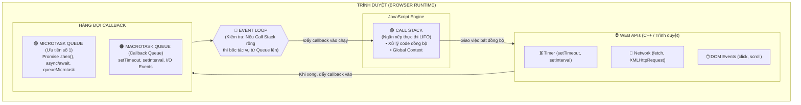

# Tổng Hợp Kiến Thức Trọng Tâm: JavaScript, TypeScript & Web Frontend

---

## Mục Lục
1. [DOM (Document Object Model)](#1-dom-document-object-model)
2. [DOM CSS (`element.style`)](#2-dom-css-elementstyle)
3. [DOM `classList`](#3-dom-classlist)
4. [Bất Đồng Bộ (Asynchronous)](#4-bất-đồng-bộ-asynchronous)
5. [Từ Khóa `this` & Arrow Function vs Regular Function](#5-từ-khóa-this--arrow-function-vs-regular-function)
6. [Phân Biệt `let`, `var`, `const`](#6-phân-biệt-let-var-const)
7. [Kiểu Dữ Liệu: Primitive vs Reference Type](#7-kiểu-dữ-liệu-primitive-vs-reference-type)
8. [Shallow Copy vs Deep Copy](#8-shallow-copy-vs-deep-copy)
9. [Phân Biệt `bind`, `call`, `apply`](#9-phân-biệt-bind-call-apply)
10. [Debounce vs Throttle](#10-debounce-vs-throttle)
11. [Overloading vs Overriding](#11-overloading-vs-overriding)
12. [Access Modifiers: `private`, `protected`, `default`, `public`](#12-access-modifiers-private-protected-default-public)
13. [Currying Function](#13-currying-function)
14. [Closure](#14-closure)
15. [Hoisting & Temporal Dead Zone (TDZ)](#15-hoisting--temporal-dead-zone-tdz)
16. [Higher-Order Functions (HOF)](#16-higher-order-functions-hof)
17. [LocalStorage, SessionStorage & Cookies](#17-localstorage-sessionstorage--cookies)
18. [Web API](#18-web-api)
19. [TypeScript: Utility Types](#19-typescript-utility-types)
20. [Tọa Độ & Kích Thước Cuộn (DOM Scrolling)](#20-tọa-độ--kích-thước-cuộn-dom-scrolling)
21. [Phân Biệt NPM và NPX](#21-phân-biệt-npm-và-npx)
22. [Quản Lý Dependencies trong `package.json`](#22-quản-lý-dependencies-trong-packagejson)
23. [Vai Trò của File `*.d.ts`](#23-vai-trò-của-file-dts)
24. [Cơ Chế Hoạt Động của Event Loop](#24-cơ-chế-hoạt-động-của-event-loop)
25. [Toán Tử Nullish (`??` và `??=`)](#25-toán-tử-nullish--và-)
26. [Các Nguyên Nhân Gây Memory Leak & Giải Pháp](#26-các-nguyên-nhân-gây-memory-leak--giải-pháp)

---

## 1. DOM (Document Object Model)

- Khi trang web được tải, trình duyệt phân tích mã HTML và tạo ra **DOM**. HTML DOM được cấu trúc dưới dạng một **cây đối tượng (Tree of Objects)**.
- Gồm 3 thành phần chính:
  - **Element:** Tìm kiếm và truy xuất phần tử qua id, class, tag hoặc CSS selector:
    - `document.getElementById('id')`
    - `document.getElementsByClassName('class')`
    - `document.getElementsByTagName('tag')`
    - `document.querySelector('selector')` *(trả về phần tử đầu tiên khớp)*
    - `document.querySelectorAll('selector')` *(trả về NodeList các phần tử khớp)*
  - **Attribute:** Thao tác với thuộc tính của element:
    ```javascript
    element.setAttribute("class", "democlass");
    const attr = element.getAttribute("class");
    ```
  - **Text:** Thao tác với nội dung văn bản:
    - `element.innerText`: Lấy/gán text hiển thị trên giao diện (chịu ảnh hưởng bởi CSS styling như `display: none`).
    - `element.textContent`: Lấy/gán toàn bộ text thuần bên trong node (bao gồm cả text bị ẩn bởi CSS).

---

## 2. DOM CSS (`element.style`)

Thay đổi style trực tiếp của phần tử (inline style) thông qua thuộc tính `style`:

```javascript
element.style.color = "red";
element.style.backgroundColor = "#fff";
```

---

## 3. DOM `classList`

Thao tác với danh sách class CSS của phần tử:
- `element.classList.add('className')`: Thêm class.
- `element.classList.remove('className')`: Xóa class.
- `element.classList.toggle('className')`: Thêm class nếu chưa có, xóa nếu đã có.
- `element.classList.contains('className')`: Kiểm tra class có tồn tại hay không (trả về `true`/`false`).

---

## 4. Bất Đồng Bộ (Asynchronous)

### 4.1. Callback & Callback Hell
- **Callback:** Một hàm được truyền vào làm tham số của một hàm khác và được gọi sau khi tác vụ nào đó hoàn thành.
- **Callback Hell:** Khi nhiều tác vụ bất đồng bộ phụ thuộc lồng nhau quá sâu, code trở nên hình tam giác/kim tự tháp (Pyramid of Doom), cực kỳ khó đọc và bảo trì.

### 4.2. Promise (ES6)
Giải quyết bài toán Callback Hell bằng chuỗi xử lý tuần tự qua `.then()` và `.catch()`.

- Khởi tạo qua `new Promise(executor)` với executor nhận 2 tham số:
  - `resolve(value)`: Được gọi khi xử lý thành công.
  - `reject(error)`: Được gọi khi xử lý thất bại.

```javascript
const myPromise = new Promise((resolve, reject) => {
  const isSuccess = true;
  if (isSuccess) {
    resolve("Successfully");
  } else {
    reject("Fail");
  }
});

myPromise
  .then((status) => console.log(status))  // "Successfully"
  .catch((err) => console.error(err));    // "Fail"
```

### 4.3. Async / Await (ES2017)
Cú pháp bọc ngoài Promise giúp viết code bất đồng bộ trông giống như mã đồng bộ:

```javascript
async function fetchData() {
  try {
    const res = await myPromise;
    console.log(res);
  } catch (err) {
    console.error(err);
  }
}
```

### 4.4. Observable (RxJS)
Xử lý dòng dữ liệu liên tục theo thời gian (Stream of data), hỗ trợ nhiều giá trị (multi-value), có khả năng hủy bỏ (`unsubscribe`), và cung cấp hệ thống toán tử đa dạng (`map`, `filter`, `switchMap`, `debounceTime`...).

---

## 5. Từ Khóa `this` & Arrow Function vs Regular Function

### 5.1. Bản chất của `this` (Context Pointer)
`this` đóng vai trò như một con trỏ ngữ cảnh, giá trị phụ thuộc vào **cách hàm được gọi**:
- **Trong phương thức của object:** `this` trỏ về chính object gọi phương thức đó.
- **Trong hàm thông thường (non-strict mode):** `this` trỏ về `window` (trình duyệt) hoặc `global` (Node.js). Nếu ở `strict mode`, `this` là `undefined`.
- **Trong Arrow function:** Không có `this` riêng, `this` được kế thừa từ ngữ cảnh bao ngoài lúc khai báo (**Lexical Scope**).

```javascript
const course = {
  name: 'Javascript',
  getName: function() { 
    return this.name;
  }
};
console.log(course.getName()); // "Javascript" -> this trỏ về course
```

### 5.2. So sánh Arrow Function và Regular Function

| Tiêu chí | Regular Function | Arrow Function |
| :--- | :--- | :--- |
| **Cú pháp** | Dùng từ khóa `function` | Cú pháp mũi tên ngắn gọn `() => {}` |
| **Từ khóa `this`** | Động (Dynamic Scope, xác định lúc gọi hàm) | Tĩnh (Lexical Scope, lấy từ scope cha bao quanh) |
| **Constructor (`new`)** | Có thể dùng làm hàm khởi tạo | **Không** có constructor, dùng `new` sẽ báo lỗi |
| **Đối tượng `arguments`** | Có sẵn | **Không có** (thay bằng `...rest parameters`) |
| **Phương thức `bind/call/apply`** | Có tác dụng gán ngữ cảnh `this` | Không thể thay đổi `this` bằng `bind/call/apply` |
| **Làm method cho object** | Rất phù hợp | **Không nên** dùng làm method của object |

---

## 6. Phân Biệt `let`, `var`, `const`

| Tiêu chí | `var` | `let` | `const` |
| :--- | :---: | :---: | :---: |
| **Hoisting** | Có (khởi tạo `undefined`) | Có (nằm trong TDZ) | Có (nằm trong TDZ) |
| **Phạm vi (Scope)** | Function Scope / Global | Block Scope `{}` | Block Scope `{}` |
| **Gán lại giá trị** | Có | Có | Không (báo `TypeError`) |
| **Khai báo lại trong cùng scope** | Có | Không (báo `SyntaxError`) | Không (báo `SyntaxError`) |

---

## 7. Kiểu Dữ Liệu: Primitive vs Reference Type

### 7.1. Primitive Types (Kiểu nguyên thủy)
- `string`, `number`, `boolean`, `undefined`, `null`, `symbol`, `bigint`.
- Lưu trữ trực tiếp giá trị trong vùng nhớ **Stack**.
- Khi gán biến này cho biến khác, JavaScript sao chép giá trị thực tế sang ô nhớ mới độc lập.

```javascript
let a = 1;
let b = a;
a = 2;
console.log(b); // 1 (không bị thay đổi)
```

### 7.2. Reference Types (Kiểu tham chiếu)
- `Object`, `Array`, `Function`.
- Dữ liệu thực tế được lưu trong vùng nhớ **Heap**. Biến ở **Stack** chỉ lưu **địa chỉ con trỏ (reference/pointer)** trỏ tới vùng nhớ Heap đó.
- Khi gán, chỉ có địa chỉ tham chiếu được copy, cả 2 biến cùng trỏ về một vùng nhớ.

```javascript
const a = { name: 'Toyota' }; 
const b = a;
a.name = 'BMW';

console.log(b.name); // 'BMW' (vì cùng trỏ đến 1 vùng nhớ)

// Gán lại cả object tạo vùng nhớ mới:
let c = { name: 'Toyota' };
c = { name: 'BMW', model: 'i8' }; // c trỏ đến địa chỉ mới trên Heap
```

---

## 8. Shallow Copy vs Deep Copy

```javascript
const person1 = {
  name: "Phu",
  age: 20,
  network: { facebook: "facebook.com/congphu" }
};
```

### 8.1. Shallow Copy (Sao chép nông)
Chỉ sao chép tầng ngoài cùng; các object/mảng lồng nhau bên trong vẫn dùng chung tham chiếu.
- **Cách thực hiện:**
  - Spread Operator: `{ ...person1 }` hoặc `[ ...arr ]`
  - `Object.assign({}, person1)`
  - Phương thức mảng: `slice()`, `concat()`, `Array.from()`

### 8.2. Deep Copy (Sao chép sâu)
Sao chép đệ quy toàn bộ các tầng lồng nhau, tạo ra bản sao độc lập 100%.
- **Cách thực hiện:**
  - `structuredClone(person1)` *(chuẩn web hiện đại, hỗ trợ Date, Map, Set)*
  - `JSON.parse(JSON.stringify(person1))` *(hạn chế: mất Function, undefined, Date bị biến thành string)*
  - Dùng thư viện: `lodash.cloneDeep()`

---

## 9. Phân Biệt `bind`, `call`, `apply`

Cả 3 phương thức dùng để thiết lập ngữ cảnh `this` cho hàm:

- **`bind(thisArg, arg1, arg2, ...)`**: **Không** thực thi hàm ngay; trả về một hàm mới với `this` đã được ràng buộc cố định.
- **`call(thisArg, arg1, arg2, ...)`**: Thực thi hàm **ngay lập tức**, các đối số truyền vào phân cách bằng dấu phẩy.
- **`apply(thisArg, [argsArray])`**: Thực thi hàm **ngay lập tức**, các đối số được gom trong một **mảng**.

```javascript
function greet(greeting, punctuation) {
  console.log(`${greeting}, tôi là ${this.firstName} ${this.lastName}${punctuation}`);
}

const person = { firstName: "Tran Cong", lastName: "Phu" };

// call:
greet.call(person, "Xin chào", "!");

// apply:
greet.apply(person, ["Hello", "."]);

// bind:
const boundGreet = greet.bind(person, "Chào bạn");
boundGreet(" :)");
```

---

## 10. Debounce vs Throttle

| Tiêu chí | Debounce | Throttle |
| :--- | :--- | :--- |
| **Cơ chế** | Đợi sau một khoảng thời gian `X` tính từ lần kích hoạt **cuối cùng** mới chạy hàm. Nếu có kích hoạt mới, timer được reset lại từ đầu. | Đảm bảo hàm chỉ được chạy tối đa **1 lần duy nhất** trong mỗi chu kỳ thời gian `X`. |
| **Ứng dụng tiêu biểu** | Ô tìm kiếm (Search autocomplete), Auto-save bài viết, Resize window khi kết thúc kéo. | Scroll lắng nghe vị trí trang, Drag and drop, Game loop, Bắn súng liên thanh. |

---

## 11. Overloading vs Overriding

| Tiêu chí | Method Overloading (Nạp chồng) | Method Overriding (Ghi đè) |
| :--- | :--- | :--- |
| **Bản chất** | Định nghĩa nhiều phương thức cùng tên nhưng khác tham số | Lớp con định nghĩa lại phương thức đã có ở lớp cha |
| **Thời điểm thể hiện** | Đa hình lúc biên dịch (**Compile-time**) | Đa hình lúc chạy (**Runtime**) |
| **Phạm vi** | Xảy ra trong **cùng một class** | Xảy ra giữa **2 class có quan hệ kế thừa** |
| **Chữ ký (Signature)** | Khác số lượng hoặc kiểu tham số | Giữ nguyên tên và danh sách tham số |

> **Lưu ý:** JavaScript thuần không hỗ trợ trực tiếp method overloading như Java hay C#. TypeScript hỗ trợ compile-time overloading thông qua multiple function signatures.

---

## 12. Access Modifiers: `private`, `protected`, `default`, `public`

| Modifier | Cùng Class | Lớp con (Subclass) | Cùng Package | Bên ngoài (World) |
| :--- | :---: | :---: | :---: | :---: |
| **`private`** (hoặc `#` trong JS) |  | ❌ | ❌ | ❌ |
| **`protected`** |  |  |  | ❌ |
| **`default`** (Java) |  | ❌ |  | ❌ |
| **`public`** (mặc định trong TS) |  |  |  |  |

---

## 13. Currying Function

Kỹ thuật chuyển đổi một hàm nhận nhiều đối số thành một chuỗi các hàm lồng nhau, mỗi hàm chỉ nhận **một đối số duy nhất**:

```javascript
// Thay vì: function multiply(a, b, c) { return a * b * c; }

const multiply = (a) => (b) => (c) => a * b * c;

console.log(multiply(1)(2)(3)); // 6
```

---

## 14. Closure

- **Định nghĩa:** Closure là một hàm có khả năng ghi nhớ và truy cập vào các biến thuộc phạm vi cha (lexical scope) của nó, ngay cả khi hàm cha đã thực thi xong và rời khỏi Call Stack.
- **Ứng dụng:**
  - Đóng gói dữ liệu, tạo biến `private` trong lập trình hướng đối tượng.
  - Viết các hàm cấu hình trước (Function Factory / Partial application).

```javascript
function createLogger(namespace) {
  return function logger(message) {
    console.log(`[${namespace}]: ${message}`);
  };
}

const infoLogger = createLogger("INFO");
infoLogger("Bắt đầu gửi email"); // "[INFO]: Bắt đầu gửi email"
```

---

## 15. Hoisting & Temporal Dead Zone (TDZ)

**Hoisting** là hành vi của JavaScript Engine trong giai đoạn biên dịch (compile phase), khi các khai báo biến, hàm hoặc lớp được đưa vào bộ nhớ trước khi mã thực thi.

- **Với `var`:** Được hoisted và khởi tạo mặc định là `undefined`.
- **Với `let` & `const`:** Vẫn được hoisted nhưng **không** được khởi tạo. Vùng code từ đầu block đến dòng khai báo gọi là **Temporal Dead Zone (TDZ)**; truy cập biến trong TDZ sẽ ném ra lỗi `ReferenceError`.
- **Function Declaration vs Expression:**
  - `function foo() {}`: Hoisted toàn bộ thân hàm (gọi trước khi khai báo vẫn chạy được).
  - `var foo = () => {}`: Chỉ hoisted biến `foo` với giá trị `undefined` (gọi hàm trước dòng gán sẽ bắn lỗi `TypeError: foo is not a function`).

| Khai báo | Có bị Hoisted? | Giá trị khởi tạo | Truy cập trước khai báo |
| :--- | :---: | :---: | :--- |
| `var` | Có | `undefined` | Trả về `undefined` |
| `let` / `const` | Có | Không khởi tạo (nằm trong TDZ) | Báo lỗi `ReferenceError` |
| `function foo() {}` | Có | Toàn bộ thân hàm | Chạy bình thường |
| `var foo = () => {}` | Có (dưới dạng biến `var`) | `undefined` | Báo lỗi `TypeError` |
| `class Foo {}` | Có | Không khởi tạo (nằm trong TDZ) | Báo lỗi `ReferenceError` |

---

## 16. Higher-Order Functions (HOF)

Higher-Order Function là hàm thỏa mãn ít nhất một trong hai điều kiện:
1. Nhận một hoặc nhiều hàm khác làm đối số (callbacks).
2. Trả về một hàm khác làm kết quả.

Các ví dụ tích hợp sẵn trong JavaScript: `Array.prototype.map()`, `filter()`, `reduce()`, `some()`, `every()`.

---

## 17. LocalStorage, SessionStorage & Cookies

| Tiêu chí | LocalStorage | SessionStorage | Cookies |
| :--- | :--- | :--- | :--- |
| **Dung lượng** | ~5MB | ~5MB | ~4KB |
| **Thời gian sống** | Vĩnh viễn (cho đến khi chủ động xóa) | Mất khi đóng tab/trình duyệt | Tùy chỉnh qua thuộc tính `Expires` hoặc `Max-Age` |
| **Gửi kèm HTTP** | Không | Không | **Tự động gửi** kèm mỗi HTTP request lên server |
| **Phạm vi truy cập** | Cùng Origin (Same Domain + Protocol + Port) | Cùng Tab + Cùng Origin | Cùng Domain / Path |

---

## 18. Web API

Giao diện lập trình ứng dụng trên nền Web cho phép các hệ thống, ứng dụng khác nhau giao tiếp và trao đổi dữ liệu (thường dưới định dạng JSON hoặc XML) thông qua giao thức HTTP/HTTPS.

---

## 19. TypeScript: Utility Types

- `keyof T`: Lấy danh sách các key của type/interface dưới dạng Union Type.
- `typeof val`: Lấy kiểu dữ liệu từ một biến/giá trị có sẵn.
- `Partial<T>`: Biến tất cả thuộc tính của `T` thành **tùy chọn (optional `?`)**.
- `Required<T>`: Biến tất cả thuộc tính của `T` thành **bắt buộc**.
- `Readonly<T>`: Biến tất cả thuộc tính của `T` thành **chỉ đọc (`readonly`)**.
- `Pick<T, K>`: Trích xuất một tập hợp các thuộc tính `K` từ type `T`.
- `Omit<T, K>`: Loại bỏ các thuộc tính `K` ra khỏi type `T`.
- `Record<K, T>`: Tạo một kiểu object với tập hợp các key `K` và giá trị thuộc type `T`.

---

## 20. Tọa Độ & Kích Thước Cuộn (DOM Scrolling)

- `scrollTop` / `scrollLeft`: Số pixel phần nội dung đã được cuộn từ đỉnh / từ bên trái.
- `clientWidth` / `clientHeight`: Kích thước vùng hiển thị bên trong (bao gồm `padding`, **không** bao gồm `border` và thanh cuộn).
- `offsetWidth` / `offsetHeight`: Kích thước toàn phần của phần tử (bao gồm `padding`, `border` và thanh cuộn).
- `scrollWidth` / `scrollHeight`: Toàn bộ kích thước nội dung của phần tử, bao gồm cả phần bị ẩn cuộn tràn ra ngoài.

### Kiểm tra điểm chạm scroll:
```typescript
const reachTop: boolean = element.scrollTop === 0;
const reachLeft: boolean = element.scrollLeft === 0;
const reachBottom: boolean = Math.ceil(element.clientHeight + element.scrollTop) >= element.scrollHeight;
const reachRight: boolean = Math.ceil(element.clientWidth + element.scrollLeft) >= element.scrollWidth;
```

---

## 21. Phân Biệt NPM và NPX

- **NPM (Node Package Manager):** Công cụ quản lý và cài đặt các thư viện gói JavaScript (`npm install <package>`).
- **NPX (Node Package Execute):** Tiện ích đi kèm NPM 5.2+ cho phép thực thi trực tiếp các binary package mà không cần cài đặt vĩnh viễn vào máy (`npx <package>`).

---

## 22. Quản Lý Dependencies trong `package.json`

- **`dependencies`:** Các thư viện cần thiết để ứng dụng chạy được trên môi trường **Production** (ví dụ: `react`, `express`, `lodash`).
- **`devDependencies`:** Các công cụ chỉ phục vụ quá trình phát triển, build hoặc viết unit test (ví dụ: `typescript`, `webpack`, `eslint`, `jest`).

---

## 23. Vai Trò của File `*.d.ts`

File `*.d.ts` chỉ chứa các định nghĩa kiểu dữ liệu (Interfaces, Types) mà không chứa code thực thi:
- Cung cấp **IntelliSense** (gợi ý cú pháp, tự hoàn thành code) trên IDE.
- Hỗ trợ TypeScript kiểm tra kiểu (**Type Checking**) cho các thư viện viết bằng JavaScript thuần.
- Tách biệt rõ ràng giữa đặc tả (Signature) và cài đặt cụ thể (Implementation).

---

## 24. Cơ Chế Hoạt Động của Event Loop

JavaScript là ngôn ngữ **đơn luồng (single-threaded)** nhưng vẫn xử lý đồng thời hàng nghìn tác vụ bất đồng bộ (`setTimeout`, `Promise`, `fetch`, DOM events) mà không làm đơ giao diện. Bí mật nằm ở kiến trúc điều phối của **Event Loop**.

---

### 24.1. Sơ Đồ Kiến Trúc Tổng Thể



---

### 24.2. Minh Họa Từng Bước (Step-by-Step) Theo Đoạn Code Thực Tế

Xét đoạn code ví dụ kinh điển (tương tự video minh họa):

```javascript
console.log("số 1");

const age = 12;

setTimeout(function callback() {
  console.log("số 2");
}, 2000);

console.log("số 3");
```

---

#### 🟢 BƯỚC 1: Khởi tạo chương trình & Chạy `console.log("số 1")`
* Trình duyệt tạo **Global Execution Context** đưa vào đáy Call Stack.
* `console.log("số 1")` được đẩy vào đỉnh Call Stack và thực thi ngay lập tức.
* **Màn hình Console in ra:** `số 1`. Sau đó `console.log` được giải phóng khỏi Call Stack.

```text
┌───────────────────────────────┐     ┌───────────────────────────────┐
│     🟢 CALL STACK (LIFO)      │     │         🌐 WEB APIs           │
├───────────────────────────────┤     ├───────────────────────────────┤
│ ⏩ console.log("số 1") [RUN]  │     │          (Trống)              │
│ ───────────────────────────── │     └───────────────────────────────┘
│   Global Execution Context    │     ┌───────────────────────────────┐
└───────────────────────────────┘     │       🟠 CALLBACK QUEUE       │
                                      ├───────────────────────────────┤
  🖥️ CONSOLE OUTPUT:                  │          (Trống)              │
  > số 1                              └───────────────────────────────┘
```

---

#### 🟢 BƯỚC 2: Khai báo biến `const age = 12`
* `const age = 12` được ghi nhận vào bộ nhớ (Memory Heap / Lexical Environment). Tác vụ này chạy tức thời và kết thúc.

---

#### 🟢 BƯỚC 3: Gặp `setTimeout(...)` ➔ Chuyển giao cho Web API
* `setTimeout(callback, 2000)` được đẩy vào Call Stack.
* JavaScript nhận diện đây là API của trình duyệt (Web API) ➔ **Lập tức giao timer 2000ms cho Web APIs đếm ngược**.
* `setTimeout` hoàn thành nhiệm vụ bàn giao và **lập tức rời khỏi Call Stack** (không hề đứng chờ 2 giây, không block luồng chính).

```text
┌───────────────────────────────┐     ┌───────────────────────────────┐
│     🟢 CALL STACK (LIFO)      │     │         🌐 WEB APIs           │
├───────────────────────────────┤     ├───────────────────────────────┤
│ ⏩ setTimeout(..., 2000) [OUT]│ ──► │ ⏱️ Timer: 2000ms              │
│ ───────────────────────────── │     │    function callback() { ... }│
│   Global Execution Context    │     └───────────────────────────────┘
└───────────────────────────────┘     ┌───────────────────────────────┐
                                      │       🟠 CALLBACK QUEUE       │
  🖥️ CONSOLE OUTPUT:                  ├───────────────────────────────┤
  > số 1                              │          (Trống)              │
                                      └───────────────────────────────┘
```

---

#### 🟢 BƯỚC 4: Chạy `console.log("số 3")` trong khi Web API đang đếm giờ
* `console.log("số 3")` được đẩy vào Call Stack và thực thi.
* **Màn hình Console in ra:** `số 3`. Sau đó rời khỏi Call Stack.
* Toàn bộ mã đồng bộ hoàn tất ➔ `Global Execution Context` cũng rời khỏi Call Stack.
* **Lúc này: Call Stack hoàn toàn RỖNG!**

```text
┌───────────────────────────────┐     ┌───────────────────────────────┐
│     🟢 CALL STACK (LIFO)      │     │         🌐 WEB APIs           │
├───────────────────────────────┤     ├───────────────────────────────┤
│ ⏩ console.log("số 3") [DONE] │     │ ⏱️ Timer: đang đếm... (1200ms)│
│ ───────────────────────────── │     │    function callback() { ... }│
│   Global Execution Context    │     └───────────────────────────────┘
└───────────────────────────────┘     ┌───────────────────────────────┐
                                      │       🟠 CALLBACK QUEUE       │
  🖥️ CONSOLE OUTPUT:                  ├───────────────────────────────┤
  > số 1                              │          (Trống)              │
  > số 3                              └───────────────────────────────┘
```

---

#### 🟢 BƯỚC 5: Hết 2000ms, Web API đẩy callback vào Callback Queue
* Bộ đếm 2000ms kết thúc. Web APIs đưa hàm `callback()` vào xếp hàng tại **Callback Queue (Macrotask Queue)**.
* Hàm lúc này chỉ **đang chờ**, chưa được thực thi ngay.

```text
┌───────────────────────────────┐     ┌───────────────────────────────┐
│     🟢 CALL STACK (LIFO)      │     │         🌐 WEB APIs           │
├───────────────────────────────┤     ├───────────────────────────────┤
│           (RỖNG)              │     │  ✅ Đã đếm xong 2000ms        │
└───────────────────────────────┘     └───────────────┬───────────────┘
                                                      │ (Đẩy vào queue)
                                                      ▼
                                      ┌───────────────────────────────┐
                                      │       🟠 CALLBACK QUEUE       │
  🖥️ CONSOLE OUTPUT:                  ├───────────────────────────────┤
  > số 1                              │ ⏳ callback()                 │
  > số 3                              └───────────────────────────────┘
```

---

#### 🟢 BƯỚC 6: Event Loop phát hiện Call Stack rỗng ➔ Đẩy callback lên Stack
* **Event Loop** hoạt động như một người giám sát không ngừng nghỉ:
  1. Nhìn sang **Call Stack**: *"Đã rỗng chưa?"* ➔ **ĐÃ RỖNG**.
  2. Nhìn sang **Callback Queue**: *"Có hàm nào đang đợi không?"* ➔ **CÓ `callback()`**.
* Event Loop nhấc hàm `callback()` khỏi hàng đợi và đẩy vào **Call Stack** để thực thi.

```text
┌───────────────────────────────┐              🔄 EVENT LOOP
│     🟢 CALL STACK (LIFO)      │    "Call Stack rỗng + Queue có việc"
├───────────────────────────────┤       ═══► Bốc callback() lên Stack
│ ⏩ callback() [BẮT ĐẦU CHẠY]  │ ◄────────────────────────┐
└───────────────────────────────┘                          │
                                      ┌────────────────────┴──────────┐
                                      │       🟠 CALLBACK QUEUE       │
                                      ├───────────────────────────────┤
                                      │           (RỖNG)              │
                                      └───────────────────────────────┘
```

---

#### 🟢 BƯỚC 7: Thực thi bên trong `callback()` ➔ In ra `số 2`
* Trong thân `callback()`, gọi lệnh `console.log("số 2")`.
* Lệnh này được đẩy lên đỉnh Stack và chạy.
* **Màn hình Console in ra:** `số 2`.
* `console.log("số 2")` xong ➔ thoát. Hàm `callback()` kết thúc ➔ thoát khỏi Call Stack.
* Chương trình hoàn tất toàn bộ tiến trình!

```text
┌───────────────────────────────┐     ┌───────────────────────────────┐
│     🟢 CALL STACK (LIFO)      │     │         🌐 WEB APIs           │
├───────────────────────────────┤     ├───────────────────────────────┤
│ ⏩ console.log("số 2") [DONE] │     │           (Trống)             │
│ ───────────────────────────── │     └───────────────────────────────┘
│   callback()                  │     ┌───────────────────────────────┐
└───────────────────────────────┘     │       🟠 CALLBACK QUEUE       │
                                      ├───────────────────────────────┤
  🖥️ KẾT QUẢ CUỐI CÙNG:               │           (Trống)             │
  > số 1                              └───────────────────────────────┘
  > số 3
  > số 2
```

---

### 24.3. Bảng Phân Cấp Ưu Tiên: Microtask vs Macrotask

Khi có thêm `Promise` hoặc `async/await`, Event Loop luôn ưu tiên dọn sạch **Microtask Queue** trước khi lấy một tác vụ từ **Macrotask Queue**:

| Độ Ưu Tiên | Hàng Đợi | Nguồn Phát Sinh | Quy Tắc Thực Thi Của Event Loop |
| :---: | :--- | :--- | :--- |
| **0** | **Call Stack** | Toàn bộ mã đồng bộ (`console.log`, gán biến, vòng lặp `for`) | Chạy ngay lập tức cho đến khi ngăn xếp trống rỗng |
| **1** | **Microtask Queue** | `Promise.then()`, `.catch()`, `.finally()`, `async/await`, `queueMicrotask` | Khi Call Stack rỗng, Event Loop sẽ **chạy sạch toàn bộ** các Microtask có trong hàng đợi |
| **2** | **Render / Paint** | `requestAnimationFrame`, cập nhật giao diện màn hình | Thực hiện khi trình duyệt đến chu kỳ vẽ lại (60Hz / 120Hz) |
| **3** | **Macrotask Queue** | `setTimeout`, `setInterval`, sự kiện DOM (`click`, `scroll`), I/O | Sau khi Microtasks đã hết, chỉ lấy **đúng 1 Macrotask** lên chạy, rồi quay lại kiểm tra Microtask |

---

## 25. Toán Tử Nullish (`??` và `??=`)

### 25.1. Toán tử `??` (Nullish Coalescing)
Chỉ lấy vế phải khi và chỉ khi vế trái là `null` hoặc `undefined` (khác với toán tử `||` coi `0`, `""`, `false`, `NaN` là falsy):

```javascript
const count = 0;
const res1 = count || 10; // 10 (coi 0 là falsy)
const res2 = count ?? 10; // 0  (chỉ kiểm tra null/undefined)
```

### 25.2. Toán tử `??=` (Logical Nullish Assignment)
Chỉ gán giá trị mới cho biến nếu biến đó hiện tại đang là `null` hoặc `undefined`:

```javascript
let user = { name: "An" };
user.name ??= "Khách"; // Giữ nguyên "An"
user.age ??= 18;       // Gán bằng 18 vì user.age là undefined
```

---

## 26. Các Nguyên Nhân Gây Memory Leak & Giải Pháp

| Nguyên nhân | Nguồn gốc phổ biến | Giải pháp xử lý |
| :--- | :--- | :--- |
| **Global Variables** | Quên từ khóa khai báo, gắn trực tiếp vào `window` | Bật `'use strict'`, dùng ESLint |
| **Timers (`setInterval`, `setTimeout`)** | Không clear sau khi hoàn tất hoặc khi unmount component | Dùng `clearInterval()` / `clearTimeout()` trong cleanup/destroy hook |
| **Event Listeners** | Gắn vào `window`, `document` trong ứng dụng SPA | Gọi `removeEventListener()` hoặc dùng `AbortController` khi component bị hủy |
| **Closures** | Hàm con giữ ngữ cảnh hàm cha chứa biến/object nặng | Gán biến về `null` khi dùng xong, thu hẹp scope |
| **Detached DOM** | Element đã xóa khỏi DOM nhưng biến JS vẫn giữ tham chiếu | Gán biến trỏ tới DOM element về `null` |
| **Unbounded Cache** | Lưu object vào `Map`/`Set` vĩnh viễn không dọn dẹp | Dùng `WeakMap`/`WeakSet`, đặt TTL hoặc thuật toán LRU Cache |
