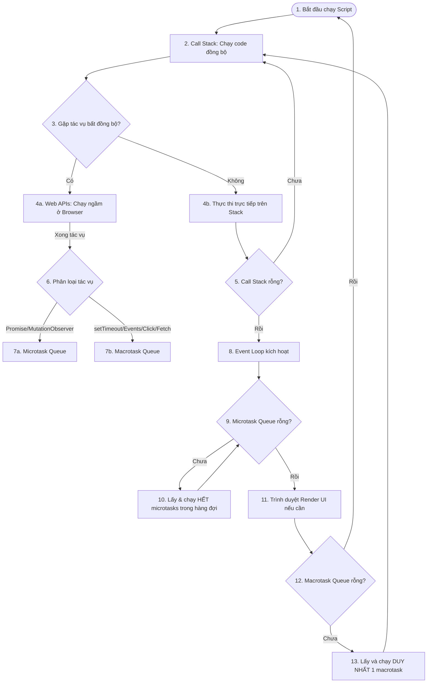

# Cẩm Nang Ôn Tập Phỏng Vấn: JavaScript, DOM & Web APIs (Lọc trùng & Sắp xếp)

Tài liệu này hệ thống lại toàn bộ các câu hỏi ôn tập của bạn, loại bỏ trùng lặp, sắp xếp lại theo các chủ đề khoa học và cung cấp lời giải thích ngắn gọn, đi thẳng vào bản chất kỹ thuật để chuẩn bị phỏng vấn.

---

## MỤC LỤC
1. [Chủ đề 1: Biến, Scope, Hoisting & Kiểu dữ liệu](#chu-de-1-bien-scope-hoisting--kieu-du-lieu)
2. [Chủ đề 2: Hàm, Context (this), Closure & OOP](#chu-de-2-ham-context-this-closure--oop)
3. [Chủ đề 3: Đối tượng, Mảng & Cấu trúc dữ liệu nâng cao](#chu-de-3-doi-tuong-mang--cau-truc-du-lieu-nang-cao)
4. [Chủ đề 4: Bất đồng bộ & Promise](#chu-de-4-bat-dong-bo--promise)
5. [Chủ đề 5: DOM, BOM & Event Flow](#chu-de-5-dom-bom--event-flow)
6. [Chủ đề 6: Web Workers, Service Workers & Web Storage](#chu-de-6-web-workers-service-workers--web-storage)
7. [Chủ đề 7: Các tính năng ES6+ & TypeScript](#chu-de-7-cac-tinh-nang-es6--typescript)
8. [Chủ đề 8: V8 Engine, Performance & Lỗi thường gặp](#chu-de-8-v8-engine-performance--loi-thuong-gap)
9. [Chủ đề 9: Event Loop & Asynchronous Engine](#chu-de-9-event-loop--asynchronous-engine)

---

## CHỦ ĐỀ 1: BIẾN, SCOPE, HOISTING & KIỂU DỮ LIỆU

#### Q1. Phân biệt kiểu dữ liệu Primitive (Tham trị) và Non-primitive / Reference (Tham chiếu)?
*   **Primitive (Tham trị)**: `String`, `Number`, `Boolean`, `Undefined`, `Null`, `Symbol`, `BigInt`. Được lưu trên **Stack**. Sao chép bằng cách copy trực tiếp giá trị.
*   **Reference (Tham chiếu)**: `Object`, `Array`, `Function`. Stack chỉ lưu địa chỉ (con trỏ), dữ liệu thực tế nằm ở **Heap**. Sao chép bằng cách copy địa chỉ tham chiếu (cùng trỏ vào 1 vùng nhớ).

#### Q2. Phân biệt `==` và `===`?
*   `==` (Loose equality): So sánh giá trị sau khi ép kiểu ngầm định (type coercion). Ví dụ: `1 == '1'` trả về `true`.
*   `===` (Strict equality): So sánh cả giá trị và kiểu dữ liệu mà không ép kiểu. Ví dụ: `1 === '1'` trả về `false`.

#### Q3. Phân biệt `null` và `undefined`?
*   `undefined`: Biến đã được khai báo nhưng chưa được gán giá trị, hoặc hàm không return gì.
*   `null`: Giá trị đại diện cho sự trống rỗng có chủ ý (biến đã gán giá trị trống).
*   *Lưu ý:* `typeof undefined` là `"undefined"`, còn `typeof null` là `"object"` (lỗi lịch sử của JS).

#### Q4. Hoisting là gì? Sự khác nhau giữa `var`, `let`, `const` khi Hoisting?
*   **Hoisting**: Là cơ chế của JS Engine đưa khai báo biến và hàm lên đầu scope trước khi thực thi code.
*   `var`: Được hoist lên đầu scope và khởi tạo với giá trị `undefined`.
*   `let` và `const`: Có hoisting nhưng không được khởi tạo giá trị. Chúng nằm ở **Temporal Dead Zone (TDZ)** cho đến khi gặp dòng khai báo thực tế. Truy cập trước khai báo sẽ gây lỗi `ReferenceError`.

#### Q5. Lợi ích của việc khai báo biến ở đầu scope và khởi tạo chúng?
*   Tránh các lỗi logic khó hiểu do Hoisting gây ra (đọc biến trước khi khai báo).
*   Tăng tính sạch sẽ, dễ đọc, và giúp JS Engine tối ưu hóa code dễ hơn.

#### Q6. Làm thế nào để khai báo lại biến trùng tên trong một khối `switch` mà không bị lỗi?
Bọc code của từng `case` trong cặp ngoặc nhọn `{}` để tạo ra một block scope riêng:
```javascript
switch(value) {
  case 1: {
    let x = 10;
    break;
  }
  case 2: {
    let x = 20; // Hợp lệ, không bị lỗi redeclaration
    break;
  }
}
```

#### Q7. Toán tử phủ định kép `!!` (Double Exclamation) dùng để làm gì?
Dùng để ép kiểu bất kỳ giá trị nào về kiểu Boolean (`true`/`false`). Ví dụ: `!!"hello"` $\rightarrow$ `true`, `!!0` $\rightarrow$ `false`.

#### Q8. Toán tử `typeof` và thuộc tính `undefined` dùng để làm gì?
*   `typeof`: Trả về kiểu dữ liệu của toán hạng dưới dạng chuỗi (ví dụ: `"string"`, `"object"`).
*   `undefined`: Là giá trị mặc định của một biến chưa được khởi tạo.

#### Q9. Biến toàn cục (Global Variables) là gì? Tại sao nên tránh dùng chúng?
*   Là các biến được khai báo bên ngoài mọi hàm hoặc gắn trực tiếp vào đối tượng toàn cục (`window` hoặc `globalThis`).
*   *Tác hại:* Gây xung đột tên biến (namespace pollution), khó debug, dễ bị thay đổi ngoài ý muốn ở bất cứ đâu trong dự án và làm tăng rác bộ nhớ do không được Garbage Collector dọn dẹp.

#### Q10. `NaN` là gì? Phân biệt `isNaN()` và `Number.isNaN()`?
*   `NaN` (Not a Number): Giá trị đại diện cho một phép toán số học không hợp lệ (ví dụ: `0 / 0` hoặc `'abc' * 2`).
*   `isNaN(val)`: Ép kiểu `val` về dạng Number trước rồi kiểm tra. Ví dụ: `isNaN('abc')` $\rightarrow$ `true` (vì `'abc'` ép kiểu thành `NaN`).
*   `Number.isNaN(val)`: Chỉ trả về `true` nếu `val` thực sự là kiểu `Number` và mang giá trị `NaN` (không tự ép kiểu). Ví dụ: `Number.isNaN('abc')` $\rightarrow$ `false`.

#### Q11. Hàm `isFinite()` dùng để làm gì?
Kiểm tra xem một số có phải số hữu hạn hay không (trả về `false` đối với `Infinity`, `-Infinity`, hoặc `NaN`).

#### Q12. Toán tử `void 0` dùng để làm gì?
Trả về giá trị `undefined` trong mọi trường hợp. Thường dùng để thay thế cho biến `undefined` vì biến `undefined` có thể bị ghi đè giá trị ở các phiên bản JS cũ.

#### Q13. JavaScript là ngôn ngữ biên dịch (Compiled) hay thông dịch (Interpreted)?
JavaScript là ngôn ngữ **thông dịch có biên dịch Just-In-Time (JIT)**. Trình duyệt không chỉ thông dịch từng dòng mà V8 Engine sẽ biên dịch code sang mã máy trước khi chạy để tối ưu hóa hiệu năng.

#### Q14. Quan hệ giữa Java và JavaScript?
Hoàn toàn **không có mối liên hệ** nào về mặt cấu trúc và công nghệ. Tên gọi JavaScript được đặt theo chiến lược marketing ăn theo sự nổi tiếng của Java vào năm 1995.

---

## CHỦ ĐỀ 2: HÀM, CONTEXT (THIS), CLOSURE & OOP

#### Q15. Các cách tạo đối tượng (Object) trong JavaScript?
1.  Object Literal: `const obj = { name: "A" };`
2.  Constructor Function: `function Person() {}; const p = new Person();`
3.  `Object.create(prototype)`: Tạo đối tượng với prototype chỉ định.
4.  ES6 Class: `class Person {}; const p = new Person();`

#### Q16. Prototype Chain (Chuỗi nguyên mẫu) là gì?
Khi truy cập một thuộc tính của object, JS sẽ tìm trong chính object đó. Nếu không thấy, nó sẽ lần theo thuộc tính ẩn `__proto__` để tìm trong prototype của nó, tiếp tục đi lên cho đến khi gặp `null`. Chuỗi liên kết này gọi là **Prototype Chain**.

#### Q17. Phân biệt `__proto__` và `prototype`?
*   `prototype`: Là thuộc tính chỉ có trên các **Constructor Function** hoặc **Class**. Nó định nghĩa các thuộc tính/phương thức mà các instance được tạo ra sau đó sẽ thừa hưởng.
*   `__proto__`: Là thuộc tính ẩn có trên **mọi đối tượng**, trỏ trực tiếp đến prototype của Constructor tạo ra đối tượng đó.

#### Q18. Phân biệt Call, Apply và Bind?
*   `call()`: Thực thi hàm ngay lập tức, truyền danh sách đối số cách nhau bằng dấu phẩy.
*   `apply()`: Thực thi hàm ngay lập tức, truyền danh sách đối số dưới dạng **mảng (array)**.
*   `bind()`: Không thực thi hàm ngay. Trả về một **hàm mới** được bind cứng với ngữ cảnh `this` truyền vào.

#### Q19. Thế nào là Lambda Expressions / Arrow Function?
Là cú pháp viết hàm ngắn gọn bằng dấu mũi tên `=>`. Arrow function không có `this` riêng (kế thừa lexical scope), không dùng được làm Constructor, và không chứa đối tượng `arguments`.

#### Q20. Định nghĩa First-class, First-order, Higher-order và Unary Function?
*   **First-class Function**: Ngôn ngữ coi hàm như một biến (có thể gán cho biến, truyền làm đối số, return từ hàm khác).
*   **First-order Function**: Hàm không nhận hàm khác làm đối số và cũng không return về hàm.
*   **Higher-order Function**: Hàm nhận hàm khác làm đối số hoặc trả về một hàm.
*   **Unary Function**: Hàm chỉ nhận duy nhất **1 đối số**.

#### Q21. Currying Function là gì?
Kỹ thuật chuyển đổi hàm nhận nhiều tham số thành một chuỗi các hàm lồng nhau, mỗi hàm chỉ nhận duy nhất 1 tham số. Ví dụ: `f(a,b,c)` $\rightarrow$ `f(a)(b)(c)`.

#### Q22. Thế nào là Pure Function (Hàm thuần khiết)? Lợi ích của nó?
*   **Pure Function**: Với cùng một đầu vào luôn trả về một kết quả đầu ra duy nhất, và **không gây ra tác dụng phụ (no side-effects)** như thay đổi biến bên ngoài, call API, ghi file.
*   *Lợi ích:* Dễ viết unit test, dễ debug, hỗ trợ memoization (caching) và đảm bảo tính Referentially Transparent (minh bạch tham chiếu).

#### Q23. Closure là gì? Ứng dụng thực tế?
*   **Closure**: Là một hàm có khả năng nhớ và truy cập vào các biến thuộc scope chứa nó ngay cả khi nó được thực thi bên ngoài scope ban đầu.
*   *Ứng dụng:* Tạo biến private, viết các hàm factory, currying, memoization.

#### Q24. IIFE (Immediately Invoked Function Expression) là gì? Cách gọi không cần ngoặc bao ngoài?
*   IIFE là hàm được định nghĩa và thực thi ngay lập tức: `(function(){})()`.
*   Cách gọi không cần ngoặc bao ngoài: Sử dụng các toán tử đơn phân trước từ khóa function (ví dụ: `void function(){}()`, `!function(){}()`, `+function(){}()`).

#### Q25. Trình bày cơ chế Hoisting đối với Function?
*   **Function Declaration** (`function foo() {}`): Được hoist hoàn toàn cả khai báo và thân hàm, có thể gọi trước dòng định nghĩa.
*   **Function Expression** (`let foo = function() {}`): Hoisting tuân theo từ khóa khai báo (`let`/`var`/`const`), gọi trước sẽ báo lỗi.

#### Q26. Class trong ES6 là gì? Cách gọi Constructor của lớp cha?
*   Class là cú pháp nâng cấp (syntactic sugar) giúp viết OOP dễ dàng hơn, bản chất dưới nền vẫn hoạt động dựa trên prototype.
*   Dùng từ khóa **`super(...)`** trong hàm constructor của lớp con để gọi constructor của lớp cha.

#### Q27. Module là gì? Tại sao cần dùng Module?
*   Module là cách phân chia mã nguồn thành các file riêng biệt độc lập.
*   *Lợi ích:* Tránh xung đột biến toàn cục (namespacing), tái sử dụng code, quản lý dependencies dễ dàng hơn.

#### Q28. Memoization là gì?
Là kỹ thuật tối ưu hóa hiệu năng bằng cách lưu trữ (cache) kết quả của các phép tính nặng dựa trên tham số đầu vào. Nếu tham số trùng lặp ở lần gọi sau, hàm trả về kết quả từ cache ngay lập tức.

#### Q29. Thunk Function là gì?
Là một hàm được bọc lại để trì hoãn việc tính toán hoặc thực thi một tác vụ. Trong xử lý bất đồng bộ (ví dụ Redux Thunk), nó là hàm trả về một hàm khác nhận tham số `dispatch`.

#### Q30. Mixin là gì? Ví dụ?
Là một kỹ thuật trong OOP cho phép một class tích hợp các phương thức từ các đối tượng khác mà không cần kế thừa trực tiếp.
```javascript
const sayHiMixin = {
  sayHi() { console.log("Hi"); }
};
class User {}
Object.assign(User.prototype, sayHiMixin); // Tích hợp phương thức vào class
```

---

## CHỦ ĐỀ 3: ĐỐI TƯỢNG, MẢNG & CẤU TRÚC DỮ LIỆU NÂNG CAO

#### Q31. Phân biệt `slice` và `splice` của Array?
*   `slice(start, end)`: Trích xuất một phần của mảng và trả về mảng mới. **Không làm thay đổi** mảng gốc.
*   `splice(index, count, item1, ...)`: Thêm, xóa hoặc thay thế các phần tử trong mảng trực tiếp. **Làm thay đổi** mảng gốc.

#### Q32. So sánh Object và Map?
*   **Map**: Key có thể là bất kỳ kiểu dữ liệu nào (kể cả object), giữ nguyên thứ tự chèn, có thuộc tính `.size` trực tiếp, hiệu năng tìm kiếm/thêm xóa tốt hơn khi dữ liệu lớn.
*   **Object**: Key chỉ có thể là String hoặc Symbol, không đảm bảo thứ tự, phải dùng `Object.keys().length` để lấy kích thước.

#### Q33. Phân biệt Set và WeakSet? Map và WeakMap?
*   **WeakSet / WeakMap**: 
    *   Key/Value bắt buộc phải là **Object**.
    *   Tham chiếu lưu giữ là **yếu (weak reference)**, nghĩa là nếu đối tượng key không còn biến nào trỏ tới, Garbage Collector sẽ tự động giải phóng vùng nhớ của nó mà không bị giữ lại bởi WeakMap/WeakSet.
    *   Không thể lặp (non-enumerable), không có `.size`.

#### Q34. Phân biệt `Object.freeze()` và `Object.seal()`?
*   `Object.freeze(obj)`: Đóng băng hoàn toàn. Không thể thêm, xóa thuộc tính, không thể sửa đổi giá trị thuộc tính hiện tại.
*   `Object.seal(obj)`: Niêm phong. Không thể thêm, xóa thuộc tính, nhưng **có thể sửa đổi** giá trị của thuộc tính hiện tại.

#### Q35. Proxy Object dùng để làm gì?
Là đối tượng dùng để định nghĩa các hành vi tùy biến cho các thao tác cơ bản trên một đối tượng khác (ví dụ: get, set, delete property). Rất hữu ích cho việc validate dữ liệu, logging, hoặc xây dựng cơ chế data-binding.

#### Q36. Làm thế nào để kiểm tra một đối tượng có rỗng hay không?
*   Cách tốt nhất: `Object.keys(obj).length === 0 && obj.constructor === Object`

#### Q37. Đối tượng `arguments` là gì? Tại sao nên thay bằng Rest Parameter?
*   `arguments`: Là đối tượng dạng mảng (array-like) chứa tất cả tham số truyền vào hàm. Nó không phải array thật nên không có các method như `map`, `filter`.
*   Nên dùng **Rest Parameter** (`...args`) vì nó trả về một mảng thật sự và hoạt động tốt trong arrow function.

#### Q38. Làm thế nào để chuyển đổi nhanh một Array thành một Object?
Sử dụng toán tử spread: `const obj = { ...arr };` hoặc `Object.assign({}, arr)`.

#### Q39. Phân biệt mảng dày đặc (Dense) và mảng thưa thớt (Sparse)?
*   **Dense Array**: Các phần tử liên tục, có chỉ số đầy đủ (ví dụ: `[1, 2, 3]`).
*   **Sparse Array**: Mảng chứa các lỗ hổng không có dữ liệu (ví dụ: `const a = []; a[10] = 1;` $\rightarrow$ các vị trí từ 0-9 là các ô trống rỗng `empty`).

---

## CHỦ ĐỀ 4: BẤT ĐỒNG BỘ & PROMISE

#### Q40. Trình bày 3 trạng thái của Promise?
1.  **Pending**: Trạng thái ban đầu, đang chờ xử lý bất đồng bộ hoàn thành.
2.  **Fulfilled**: Tác vụ thành công, hàm `resolve()` được kích hoạt.
3.  **Rejected**: Tác vụ thất bại, hàm `reject()` được kích hoạt.

#### Q41. Phân biệt `Promise.all`, `Promise.allSettled`, `Promise.any`, `Promise.race`?
*   `Promise.all(iterable)`: Trả về kết quả khi **tất cả** hoàn thành. Nếu có 1 cái lỗi, lập tức reject cả cụm.
*   `Promise.allSettled(iterable)`: Đợi tất cả hoàn thành hoặc lỗi, trả về mảng chi tiết trạng thái của từng cái.
*   `Promise.any(iterable)`: Trả về kết quả của Promise **thành công đầu tiên**. Chỉ reject nếu tất cả đều lỗi.
*   `Promise.race(iterable)`: Trả về kết quả của Promise **hoàn thành đầu tiên** (bất kể thành công hay thất bại).

#### Q43. Làm thế nào để huỷ một Fetch request?
Sử dụng **`AbortController`**:
```javascript
const controller = new AbortController();
const signal = controller.signal;

fetch('/api', { signal })
  .catch(err => { if (err.name === 'AbortError') console.log('Đã huỷ request') });

controller.abort(); // Gọi hàm này để huỷ request
```

---

## CHỦ ĐỀ 5: DOM, BOM & EVENT FLOW

#### Q45. Phân biệt `window` và `document`?
*   `window`: Đại diện cho cửa sổ trình duyệt (BOM - Browser Object Model), là đối tượng toàn cục cao nhất chứa các hàm như `alert`, `setTimeout`, `location`.
*   `document`: Đại diện cho cây DOM (HTML Document) bên trong cửa sổ trình duyệt, dùng để thao tác với các thẻ HTML.

#### Q46. Phân biệt `DOMContentLoaded` và `load` event?
*   `DOMContentLoaded`: Kích hoạt khi cây DOM đã được dựng xong hoàn toàn, không cần đợi các tài nguyên bên ngoài như ảnh, CSS load xong.
*   `load`: Kích hoạt khi toàn bộ trang web bao gồm DOM, CSS, JS, ảnh và iframe tải xong hoàn toàn.

#### Q47. Event Flow (Luồng sự kiện) gồm những giai đoạn nào?
Gồm 3 giai đoạn chính:
1.  **Event Capturing (Bắt sự kiện)**: Sự kiện đi từ thẻ `window` đi xuống dưới qua các thẻ cha đến thẻ đích (`target`).
2.  **Target Phase**: Sự kiện kích hoạt tại chính thẻ xảy ra sự kiện.
3.  **Event Bubbling (Nổi bọt)**: Sự kiện đi ngược từ thẻ đích lên trên các thẻ cha cho tới `window`.

#### Q48. Event Delegation (Ủy quyền sự kiện) là gì?
Là kỹ thuật lắng nghe sự kiện tại **thẻ cha** thay vì gắn event listener cho từng thẻ con. Khi thẻ con bị click, sự kiện sẽ nổi bọt (bubble) lên cha, cha kiểm tra `event.target` xem thẻ con nào vừa click để xử lý. Giúp tiết kiệm bộ nhớ và hoạt động tốt với các thẻ con được thêm động vào DOM.

#### Q49. Làm thế nào để đổi URL trình duyệt mà không làm reload trang?
Sử dụng HTML5 History API: `history.pushState(state, title, url)` hoặc `history.replaceState(state, title, url)`.

#### Q50. Phân biệt Reflow và Repaint trên trình duyệt?
*   **Reflow (Layout)**: Trình duyệt tính toán lại kích thước và vị trí của các element trên trang (xảy ra khi thay đổi width, height, chèn thêm phần tử DOM). Rất tốn hiệu năng.
*   **Repaint (Paint)**: Trình duyệt vẽ lại giao diện khi có thay đổi về mặt hiển thị mà không làm thay đổi cấu trúc vị trí (xảy ra khi đổi color, background-color, visibility).

---

## CHỦ ĐỀ 6: WEB WORKERS, SERVICE WORKERS & WEB STORAGE

#### Q51. Web Worker là gì? Có truy cập được DOM không?
*   Web Worker cho phép chạy code JS ở một thread ngầm riêng biệt song song với main thread, giúp xử lý các tác vụ tính toán nặng mà không làm đơ giao diện.
*   **Không** truy cập được DOM. Giao tiếp với main thread thông qua phương thức `postMessage()` và sự kiện `onmessage`.

#### Q52. Service Worker là gì? Ứng dụng trong PWA?
*   Service Worker là một proxy script nằm giữa trình duyệt và mạng Internet, chạy ngầm dưới dạng background thread.
*   *Ứng dụng:* Cho phép lập trình tính năng chạy ngoại tuyến (offline), cache tài nguyên hệ thống, nhận thông báo đẩy (Push Notifications) và quản lý tải trang mượt mà trong ứng dụng PWA (Progressive Web Apps).

#### Q53. Web Storage là gì? Phân biệt LocalStorage, SessionStorage và Cookie?

| Tiêu chí | LocalStorage | SessionStorage | Cookie |
| :--- | :--- | :--- | :--- |
| **Dung lượng** | ~5MB - 10MB | ~5MB | ~4KB |
| **Hạn sử dụng** | Vô hạn (chỉ mất khi clear cache) | Mất khi đóng Tab/Trình duyệt | Đặt thời gian hết hạn cụ thể |
| **Gửi lên Server** | Không | Không | Tự động gửi kèm theo mọi Request |

#### Q54. IndexedDB là gì? Khi nào nên dùng?
Là cơ sở dữ liệu phi quan hệ (NoSQL) lưu trữ dữ liệu dạng key-value dung lượng lớn ngay trên trình duyệt (có thể lên tới hàng trăm MB hoặc GB). Nên dùng khi ứng dụng PWA cần chạy offline hoàn toàn với lượng dữ liệu phức tạp.

---

## CHỦ ĐỀ 7: CÁC TÍNH NĂNG ES6+ & TYPESCRIPT

#### Q55. Destructuring, Rest Parameter và Spread Operator?
*   **Destructuring**: Phân tách giá trị của Object/Array thành các biến riêng biệt: `const { name } = user;`.
*   **Rest Parameter**: Gom các tham số còn lại thành 1 mảng: `function sum(first, ...others) {}`.
*   **Spread Operator**: Trải các phần tử của Object/Array ra ngoài: `const newArr = [...arr1, ...arr2];`.

#### Q56. Template Literals là gì?
Cú pháp khai báo chuỗi sử dụng ký tự backtick ` ` `, cho phép viết chuỗi trên nhiều dòng và nhúng trực tiếp giá trị biến bằng cú pháp `${variable}`.

#### Q57. Tree Shaking là gì? Tại sao cần nó?
Là kỹ thuật tối ưu hóa gói bundler (Webpack, Rollup, Vite) giúp loại bỏ những đoạn code thừa không bao giờ được sử dụng (dead code) ra khỏi bundle file cuối cùng thông qua việc phân tích cú pháp tĩnh `import`/`export` (ES Modules).

#### Q58. Polyfill và Shim khác nhau như thế nào?
*   **Polyfill**: Là đoạn code giúp giả lập lại các API hiện đại trên các trình duyệt cũ chưa hỗ trợ API đó (ví dụ: tạo lại `Array.prototype.includes` bằng JS thuần trên IE).
*   **Shim**: Là một thư viện nhỏ giúp chuyển đổi cách gọi hàm cũ sang một giao diện API mới để tương thích hệ thống.

#### Q59. TypeScript khác gì JavaScript? Lợi ích của nó?
*   TypeScript là một superset (siêu tập hợp) của JavaScript, bổ sung thêm tính năng kiểm tra kiểu tĩnh (Static Type Checking) trong quá trình compile code.
*   *Lợi ích:* Phát hiện lỗi sớm ngay khi viết code, hỗ trợ IntelliSense cực tốt, dễ refactor các dự án lớn và tự động sinh mã tương thích với các phiên bản JS cũ.

---

## CHỦ ĐỀ 8: V8 ENGINE, PERFORMANCE & LỖI THƯỜNG GẶP

#### Q60. Strict Mode là gì? Tại sao nên dùng?
Là chế độ nghiêm ngặt của JavaScript được kích hoạt bằng cách viết `"use strict";` ở đầu file.
*   *Tác dụng:* Ngăn chặn sử dụng các cú pháp lỗi thời hoặc không an toàn (ví dụ: báo lỗi khi gán giá trị cho biến chưa khai báo, ngăn chặn trùng lặp tham số hàm, cấm dùng `eval`).

#### Q61. Tại sao không nên sử dụng hàm `eval()`?
Hàm `eval()` biên dịch và thực thi một chuỗi ký tự dưới dạng code JS. Nên tránh dùng vì cực kỳ không an toàn (dễ bị tấn công XSS - code injection), làm giảm hiệu năng hệ thống do trình duyệt không thể tối ưu hóa code trước.

#### Q62. Nguyên nhân phổ biến gây ra rò rỉ bộ nhớ (Memory Leaks)?
1.  Biến toàn cục không chủ đích (gán giá trị cho biến mà quên viết `let`/`var`/`const`).
2.  Quên dọn dẹp các sự kiện lắng nghe DOM (`addEventListener`) hoặc Timer (`setInterval`, `setTimeout`).
3.  Sử dụng closures giữ tham chiếu đến các biến lớn không cần thiết.
4.  Tham chiếu đến các DOM Element đã bị xóa khỏi cây HTML nhưng vẫn được lưu trữ trong một biến JS (Detached DOM Elements).

---

## CHỦ ĐỀ 9: EVENT LOOP & ASYNCHRONOUS ENGINE

#### Q63. Trình bày cơ chế hoạt động của Event Loop trên Browser? (Call Stack, Heap, Event Table, Microtask vs Macrotask Queue)
JavaScript là ngôn ngữ đơn luồng (single-threaded) hoạt động nhờ mô hình không chặn (non-blocking execution model) thông qua Event Loop:
1.  **Call Stack**: Thực thi code đồng bộ tuần tự (LIFO). Khi gặp các API bất đồng bộ (như `setTimeout`, `fetch`), JS Engine chuyển chúng cho Browser Web APIs xử lý rồi chạy tiếp code bên dưới.
2.  **Heap**: Vùng nhớ lưu trữ các đối tượng phức tạp.
3.  **Event Table**: Theo dõi các sự kiện bất đồng bộ và đăng ký callback tương ứng.
4.  **Microtask Queue**: Chứa các callback của Promise (`.then`, `.catch`), `queueMicrotask`, `MutationObserver`. Có độ ưu tiên cao nhất.
5.  **Macrotask Queue (Callback/Event Queue)**: Chứa callback của `setTimeout`, `setInterval`, DOM events, I/O.
6.  **Event Loop**: Hoạt động liên tục. Khi **Call Stack trống**, nó sẽ quét sạch **Microtask Queue** trước, sau đó mới lấy từng task một từ **Macrotask Queue** đẩy lên Call Stack để thực thi.

**Sơ đồ luồng hoạt động (Event Loop Flowchart):**


#### Q64. Node.js Event Loop khác gì Browser Event Loop?
*   **Browser Event Loop**: Chỉ có Call Stack, Microtask Queue và Macrotask Queue, tập trung vào UI render mượt mà.
*   **Node.js Event Loop**: Được xây dựng trên thư viện **libuv**, có cấu trúc phân chia theo 6 phase (giai đoạn) chạy tuần tự liên tục:
    1.  *Timers*: Xử lý callback của `setTimeout` và `setInterval`.
    2.  *Pending Callbacks*: Xử lý I/O callbacks bị hoãn từ vòng lặp trước.
    3.  *Idle, Prepare*: Dùng nội bộ cho hệ thống Node.js.
    4.  *Poll*: Lấy các sự kiện I/O mới (file, network) và thực thi callback tương ứng.
    5.  *Check*: Thực thi callback của `setImmediate`.
    6.  *Close Callbacks*: Xử lý các sự kiện đóng (ví dụ: `socket.on('close', ...)`).

#### Q65. Phân biệt `setTimeout`, `setImmediate` và `process.nextTick` trong Node.js?
*   **`process.nextTick()`**: Không thuộc Event Loop. Nó chạy ngay sau khi block code đồng bộ hiện tại kết thúc, trước khi Event Loop chuyển sang phase tiếp theo (độ ưu tiên tối cao).
*   **`setImmediate()`**: Được thiết kế để chạy ở phase *Check* của Event Loop ngay sau phase *Poll* (I/O).
*   **`setTimeout(fn, 0)`**: Sẽ chạy ở phase *Timers* tiếp theo sau khi thời gian tối thiểu (thường là 1-4ms trên thực tế) trôi qua.
*   *Quy tắc:* `process.nextTick()` $\rightarrow$ `setTimeout` $\rightarrow$ `setImmediate` (tùy thuộc vào thời điểm gọi và I/O context).

#### Q66. Hàm `queueMicrotask()` dùng để làm gì?
Dùng để đẩy một callback vào Microtask Queue thủ công, giúp callback đó chạy ngay lập tức sau khi Call Stack trống, trước khi bất kỳ tác vụ UI render hay Macrotask nào khác được thực thi.

#### Q67. Node.js có thực sự hoàn toàn đơn luồng (Single-threaded) không?
**Không**. Node.js chỉ chạy mã nguồn JavaScript trên **một luồng chính (Main Thread)**. Tuy nhiên, các tác vụ nặng về I/O (ghi file, crypto, dns lookup, nén zip) được Node.js đẩy xuống **Thread Pool của thư viện Libuv** (mặc định có 4 thread chạy ngầm hệ thống) để chạy song song đa luồng thực thụ.
