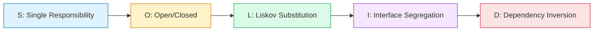
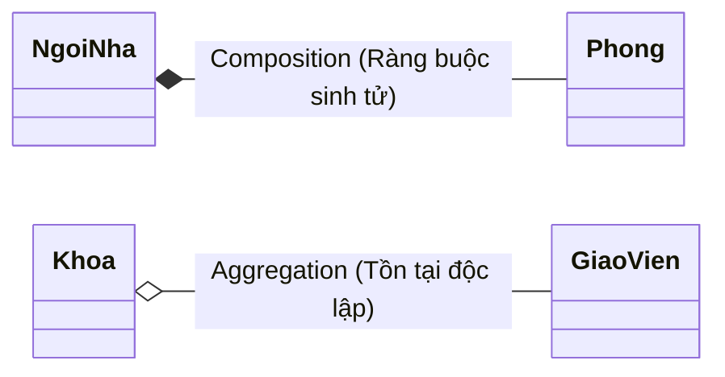

# Tài Liệu Ôn Tập: Lập Trình Hướng Đối Tượng (OOP) & SOLID (Kèm Ví Dụ Code Chi Tiết)

> **Mục tiêu tài liệu:** Tổng hợp toàn bộ câu hỏi và trả lời ôn tập cốt lõi về **Lập trình hướng đối tượng (OOP)**, nguyên lý **SOLID**, nguyên tắc **DRY**, so sánh giữa **Abstract Class** và **Interface**, kèm theo các ví dụ code minh họa thực tế dễ hiểu phục vụ cho phỏng vấn và thiết kế hệ thống.

---

## MỤC LỤC
1. [Khái niệm cơ bản & 4 Tính chất của OOP](#1-khái-niệm-cơ-bản--4-tính-chất-của-oop)
2. [Tính đóng gói (Encapsulation) & Access Modifiers](#2-tính-đóng-gói-encapsulation--access-modifiers)
3. [Tính kế thừa (Inheritance) & Khởi tạo Constructor](#3-tính-kế-thừa-inheritance--khởi-tạo-constructor)
4. [Tính đa hình (Polymorphism) & Từ khóa Static, Final](#4-tính-đa-hình-polymorphism--từ-khóa-static-final)
5. [Tính trừu tượng (Abstraction): Abstract Class vs Interface](#5-tính-trừu-tượng-abstraction-abstract-class-vs-interface)
6. [5 Nguyên lý SOLID (Kèm Ví Dụ Code So Sánh Vi Phạm vs Đúng Chuẩn)](#6-5-nguyên-lý-solid-kèm-ví-dụ-code-so-sánh-vi-phạm-vs-đúng-chuẩn)
7. [Nguyên tắc DRY (Don't Repeat Yourself)](#7-nguyên-tắc-dry-dont-repeat-yourself)
8. [Các câu hỏi nâng cao thường gặp khi Phỏng Vấn (Advanced OOP Interview Q&A)](#8-các-câu-hỏi-nâng-cao-thường-gặp-khi-phỏng-vấn-advanced-oop-interview-qa)

---

## 1. Khái niệm cơ bản & 4 Tính chất của OOP

#### Q1. Thế nào là lập trình hướng đối tượng (OOP)?
Lập trình hướng đối tượng là phương pháp lập trình dựa trên khái niệm về **Class** (Lớp) và **Object** (Đối tượng). OOP tập trung vào các đối tượng dữ liệu cần thao tác hơn là các bước logic để thực thi nó, giúp mã nguồn dễ quản lý, tăng khả năng tái sử dụng và dễ dàng bảo trì.

#### Q2. Các tính chất của OOP là gì?
OOP gồm 4 tính chất cốt lõi:
1.  **Tính đóng gói (Encapsulation)**: Che giấu dữ liệu nội bộ và chỉ cho phép truy cập qua các phương thức công khai.
2.  **Tính kế thừa (Inheritance)**: Lớp con thừa hưởng các thuộc tính và phương thức từ lớp cha.
3.  **Tính trừu tượng (Abstraction)**: Ẩn đi chi tiết triển khai phức tạp, chỉ hiển thị giao diện cần thiết.
4.  **Tính đa hình (Polymorphism)**: Cùng một hành động nhưng các đối tượng khác nhau có thể thực hiện theo nhiều cách khác nhau.

#### Q3. Thế nào là lớp (Class)?
Lớp (Class) đại diện cho một loại đối tượng. Nó được hiểu là một bản thiết kế (blueprint), định nghĩa các thuộc tính (fields/attributes) và hành vi (methods) chung của một loại đối tượng. Class không chiếm bộ nhớ vật lý.

#### Q4. Thế nào là đối tượng (Object)?
Đối tượng (Object) là một thể hiện cụ thể (instance) được sinh ra từ Class. Object chiếm vùng nhớ thực tế trên RAM (Heap), mang giá trị dữ liệu cụ thể và bao gồm các thuộc tính cùng phương thức của riêng nó.

```typescript
// Ví dụ minh họa Class và Object:
class BankAccount {
  constructor(public accountNumber: string, public balance: number) {}
}

// Khởi tạo các Objects cụ thể:
const acc1 = new BankAccount("101", 500000); // Object 1 chiếm vùng nhớ Heap riêng
const acc2 = new BankAccount("102", 1200000); // Object 2 chiếm vùng nhớ Heap riêng
```

---

## 2. Tính đóng gói (Encapsulation) & Access Modifiers

#### Q5. Thế nào là tính đóng gói?
Tính đóng gói là việc che giấu các thông tin chi tiết và quan trọng bên trong của một lớp, ngăn chặn việc truy cập hoặc sửa đổi trực tiếp từ bên ngoài.
*   **Cách thể hiện**: Khai báo thuộc tính ở dạng `private` và cung cấp các hàm `getter`/`setter` ở dạng `public` kết hợp với kiểm tra logic hợp lệ.

```typescript
// Ví dụ minh họa Tính Đóng Gói:
export class Employee {
  // 1. Thuộc tính được bảo vệ (private), không thể sửa trực tiếp từ ngoài
  private _salary: number = 0;

  constructor(public name: string, salary: number) {
    this.salary = salary; // Đi qua setter để validate
  }

  // 2. Cung cấp getter để đọc giá trị an toàn
  public get salary(): number {
    return this._salary;
  }

  // 3. Cung cấp setter để kiểm soát logic gán dữ liệu
  public set salary(value: number) {
    if (value < 0) {
      throw new Error("Lương không thể là số âm!");
    }
    this._salary = value;
  }
}

const emp = new Employee("Nguyen Van A", 15000000);
// emp._salary = -500; // ❌ Báo lỗi: Property '_salary' is private
emp.salary = 20000000; // ✅ Hợp lệ
```

#### Q6. Phân biệt các loại Access Modifiers?
Trong các ngôn ngữ OOP (Java, TypeScript, C#), Access Modifiers quy định phạm vi truy cập:

| Access Modifier | Cùng Class | Cùng Package / Module | Lớp con (Subclass) | Ngoài Class (Public) |
| :--- | :---: | :---: | :---: | :---: |
| **`private`** | ✅ | ❌ | ❌ | ❌ |
| **`protected`** | ✅ | ✅ | ✅ (qua kế thừa) | ❌ |
| **`public`** | ✅ | ✅ | ✅ | ✅ |

---

## 3. Tính kế thừa (Inheritance) & Khởi tạo Constructor

#### Q7. Thế nào là tính kế thừa?
Là khả năng lớp con tái sử dụng lại các thuộc tính và phương thức từ lớp cha thông qua từ khóa `extends`.

#### Q8. Có thể sử dụng constructor của lớp cha để trực tiếp tạo đối tượng cho lớp con không?
**Không**. Lớp con không kế thừa constructor của lớp cha, do đó bạn phải cài đặt lại constructor trên lớp con. Tuy nhiên, bạn có thể sử dụng từ khóa **`super(...)`** ở dòng đầu tiên của constructor lớp con để gọi lại constructor tương ứng của lớp cha.

#### Q9. Có bắt buộc phải khai báo constructor trong lớp không?
**Không**. Nếu không khai báo bất kỳ constructor nào, class sẽ tự động sử dụng **default constructor** không tham số do compiler sinh ra. Nếu bạn đã khai báo ít nhất một constructor tùy biến, compiler sẽ không tự sinh default constructor nữa.

```typescript
// Ví dụ minh họa Kế Thừa và từ khóa super:
export class Vehicle {
  constructor(public brand: string, public maxSpeed: number) {}

  public move(): void {
    console.log(`${this.brand} đang di chuyển với tốc độ tối đa ${this.maxSpeed} km/h`);
  }
}

export class ElectricCar extends Vehicle {
  public batteryCapacity: number;

  constructor(brand: string, maxSpeed: number, batteryCapacity: number) {
    // Bắt buộc gọi super() trước khi dùng 'this'
    super(brand, maxSpeed);
    this.batteryCapacity = batteryCapacity;
  }

  // Bổ sung phương thức riêng của lớp con
  public charge(): void {
    console.log(`Đang sạc pin dung lượng ${this.batteryCapacity} kWh...`);
  }
}

const tesla = new ElectricCar("Tesla", 250, 100);
tesla.move();   // Kế thừa từ Vehicle
tesla.charge(); // Phương thức của ElectricCar
```

---

## 4. Tính đa hình (Polymorphism) & Từ khóa Static, Final

#### Q10. Thế nào là tính đa hình?
Tính đa hình là khi một hành động có thể được thực hiện theo nhiều cách khác nhau tùy thuộc vào đối tượng đang gọi nó. Đa hình trong OOP được thể hiện qua **Ghi đè (Override)** và **Nạp chồng (Overload)**.

#### Q11. Phân biệt Override và Overload?

| Đặc điểm | Ghi đè (Override) | Nạp chồng (Overload) |
| :--- | :--- | :--- |
| **Định nghĩa** | Lớp con viết lại phương thức đã có ở lớp cha. | Viết nhiều phương thức cùng tên nhưng khác danh sách tham số truyền vào trong cùng một lớp. |
| **Chữ ký hàm** | Giữ nguyên hoàn toàn (tên hàm, tham số, kiểu trả về). | Khác danh sách tham số (số lượng, kiểu dữ liệu hoặc thứ tự). |
| **Thời điểm quyết định** | **Runtime** (Đa hình động). | **Compile-time** (Đa hình tĩnh). |
| **Môi trường** | Giữa lớp cha và lớp con. | Trong cùng một Class. |

```typescript
// Ví dụ minh họa Đa hình qua Override (Đa hình động lúc Runtime):
abstract class Animal {
  abstract makeSound(): void;
}

class Dog extends Animal {
  makeSound(): void {
    console.log("Gâu gâu 🐶");
  }
}

class Cat extends Animal {
  makeSound(): void {
    console.log("Meo meo 🐱");
  }
}

// Hàm nhận kiểu cha Animal nhưng lúc runtime xử lý linh hoạt theo từng con:
function playSound(animal: Animal) {
  animal.makeSound(); // Tính đa hình: Tự biết gọi Dog hay Cat lúc chạy
}

playSound(new Dog()); // Gâu gâu 🐶
playSound(new Cat()); // Meo meo 🐱
```

#### Q12. Có thể override một static method không?
**Không**. Phương thức `static` thuộc về Class chứ không thuộc về instance của đối tượng. Viết một phương thức static giống hệt ở lớp con được gọi là **Method Hiding** (che giấu phương thức) chứ không phải `Override`. Hệ thống sẽ quyết định gọi hàm dựa trên kiểu dữ liệu của Class lúc khai báo chứ không phải kiểu của Object thực tế ở runtime.

#### Q13. Ý nghĩa của từ khóa `static` là gì?
Những thuộc tính, phương thức có từ khóa `static` thuộc về lớp (Class) chứ không thuộc về đối tượng cụ thể. Bạn có thể truy cập chúng trực tiếp thông qua tên Class mà không cần phải khởi tạo thực thể đối tượng bằng `new`.

#### Q14. Ý nghĩa của từ khóa `final` (hoặc `readonly` trong TypeScript) là gì?
*   **Thuộc tính `final`**: Biến hằng số, giá trị không thể thay đổi sau khi gán.
*   **Phương thức `final`**: Lớp con kế thừa không thể ghi đè (`override`) phương thức này.
*   **Lớp `final`**: Lớp này bị khóa, không cho phép lớp khác kế thừa (`extends`).

---

## 5. Tính trừu tượng (Abstraction): Abstract Class vs Interface

#### Q15. Thế nào là tính trừu tượng?
Tính trừu tượng là che giấu các chi tiết triển khai bên trong và chỉ hiển thị các tính năng cốt lõi cho người dùng sử dụng. Nó cho phép loại bỏ sự phức tạp không cần thiết, giúp nhà lập trình tập trung vào bộ khung thiết kế của đối tượng. Trừu tượng được thể hiện qua **Interface** và **Abstract Class**.

#### Bảng so sánh chi tiết giữa Abstract Class và Interface:

| Tiêu chí | Abstract Class (Lớp trừu tượng) | Interface (Giao diện) |
| :--- | :--- | :--- |
| **Bản chất** | Là một **Lớp** chưa hoàn chỉnh (Quan hệ **Is-A**). | Là một **Khuôn mẫu hành vi / Hợp đồng** (Quan hệ **Can-Do**). |
| **Kế thừa** | Chỉ hỗ trợ **Đơn kế thừa** (chỉ `extends` 1 class). | Hỗ trợ **Đa kế thừa** (1 class `implements` nhiều interfaces). |
| **Phương thức** | Chứa cả phương thức trừu tượng (abstract) và phương thức thông thường có thân hàm. | Chủ yếu là chữ ký hàm trừu tượng (từ Java 8 hỗ trợ thêm `default` method). |
| **Thuộc tính** | Có thể có thuộc tính với mọi access modifier (`private`, `protected`, `public`). | Thuộc tính mặc định là hằng số `public static final`. |
| **Constructor** | **Có constructor** (được gọi qua `super(...)` từ lớp con). | **Không có constructor**, không thể khởi tạo. |
| **Tốc độ** | Nhanh hơn một chút do không phải tra cứu bảng dispatch của interface. | Chậm hơn một chút xíu do tra cứu giao diện động. |

```typescript
// Ví dụ minh họa Abstract Class vs Interface:

// 1. Interface: Định nghĩa hợp đồng hành vi (Bay được)
interface Flyable {
  fly(): void;
}

// 2. Abstract Class: Định nghĩa lớp gốc dùng chung
abstract class Bird {
  constructor(public species: string) {}

  // Phương thức chung có sẵn thân hàm
  eat(): void {
    console.log(`${this.species} đang ăn hạt.`);
  }

  // Phương thức trừu tượng bắt buộc lớp con phải định nghĩa
  abstract makeSound(): void;
}

// 3. Lớp cụ thể kế thừa Abstract Class Bird VÀ triển khai Interface Flyable
class Sparrow extends Bird implements Flyable {
  constructor() {
    super("Chim sẻ");
  }

  makeSound(): void {
    console.log("Chích chích 🐦");
  }

  fly(): void {
    console.log("Chim sẻ đang bay lượn trên bầu trời.");
  }
}
```

---

## 6. 5 Nguyên lý SOLID (Kèm Ví Dụ Code So Sánh Vi Phạm vs Đúng Chuẩn)

SOLID là 5 nguyên lý thiết kế phần mềm cốt lõi giúp mã nguồn linh hoạt, dễ đọc, dễ kiểm thử và mở rộng:



---

### 6.1. S - Single Responsibility Principle (Nguyên lý Đơn trách nhiệm)
> *"Một class chỉ nên chịu trách nhiệm về một nhiệm vụ duy nhất, và chỉ nên có một lý do duy nhất để thay đổi."*

#### ❌ Vi phạm SRP:
Class `UserManager` vừa quản lý thông tin User, vừa tự lưu vào Database, vừa tự gửi email:
```typescript
class UserManager {
  createUser(user: any) {
    // 1. Tạo user
    // 2. Lưu xuống database: db.insert(user)
    // 3. Gửi email thông báo: emailClient.send(user.email, "Welcome")
  }
}
```

#### ✅ Tuân thủ SRP:
Tách thành 3 class độc lập, mỗi class chỉ chịu đúng 1 trách nhiệm:
```typescript
// 1. Chỉ chịu trách nhiệm về nghiệp vụ User
class UserService {
  constructor(private userRepo: UserRepository, private mailer: EmailService) {}

  createUser(user: any) {
    this.userRepo.save(user);
    this.mailer.sendWelcomeEmail(user.email);
  }
}

// 2. Chỉ chịu trách nhiệm về Database
class UserRepository {
  save(user: any) {
    console.log("Lưu user vào database:", user);
  }
}

// 3. Chỉ chịu trách nhiệm về Gửi Mail
class EmailService {
  sendWelcomeEmail(email: string) {
    console.log("Gửi email chào mừng tới:", email);
  }
}
```

---

### 6.2. O - Open/Closed Principle (Nguyên lý Đóng / Mở)
> *"Class nên thoải mái mở rộng thêm tính năng mới (Open for extension), nhưng cấm sửa đổi code bên trong class đã có (Closed for modification)."*

#### ❌ Vi phạm OCP:
Mỗi khi có phương thức thanh toán mới (ví dụ Crypto), ta phải nhảy vào sửa `if/else` trong class `PaymentService`:
```typescript
class PaymentService {
  pay(type: string, amount: number) {
    if (type === 'credit_card') { /* xử lý thẻ */ }
    else if (type === 'momo') { /* xử lý momo */ }
    else if (type === 'crypto') { /* LẠI PHẢI SỬA VÀO ĐÂY */ }
  }
}
```

#### ✅ Tuân thủ OCP (Sử dụng đa hình qua Interface):
```typescript
// 1. Tạo Interface chung
interface PaymentMethod {
  pay(amount: number): void;
}

// 2. Các hình thức thanh toán mở rộng thoải mái mà không cần sửa code cũ
class CreditCardPayment implements PaymentMethod {
  pay(amount: number): void { console.log(`Thanh toán ${amount} qua Thẻ.`); }
}

class MomoPayment implements PaymentMethod {
  pay(amount: number): void { console.log(`Thanh toán ${amount} qua MoMo.`); }
}

class CryptoPayment implements PaymentMethod { // Thêm mới thoải mái!
  pay(amount: number): void { console.log(`Thanh toán ${amount} bằng Bitcoin.`); }
}

// 3. PaymentProcessor đóng hoàn toàn với việc sửa đổi
class PaymentProcessor {
  process(payment: PaymentMethod, amount: number) {
    payment.pay(amount); // Chạy trơn tru với bất kỳ phương thức nào trong tương lai
  }
}
```

---

### 6.3. L - Liskov Substitution Principle (Nguyên lý Thay thế Liskov)
> *"Các đối tượng của lớp con phải có thể thay thế hoàn toàn cho lớp cha mà không làm thay đổi tính đúng đắn của chương trình."*

#### ❌ Vi phạm LSP (Ví dụ kinh điển Hình vuông & Hình chữ nhật):
Trong toán học, Hình vuông là Hình chữ nhật. Nhưng trong OOP, cho `Square` kế thừa `Rectangle` sẽ phá vỡ logic toán học:
```typescript
class Rectangle {
  constructor(protected width: number, protected height: number) {}
  setWidth(w: number) { this.width = w; }
  setHeight(h: number) { this.height = h; }
  getArea() { return this.width * this.height; }
}

class Square extends Rectangle {
  setWidth(w: number) { this.width = w; this.height = w; }
  setHeight(h: number) { this.width = h; this.height = h; }
}

// Hàm kiểm thử kỳ vọng hành vi của Rectangle:
function testArea(rect: Rectangle) {
  rect.setWidth(5);
  rect.setHeight(4);
  // Với Rectangle: 5 * 4 = 20.
  // Nhưng nếu truyền Square vào: diện tích bị thành 4 * 4 = 16! => VI PHẠM LISKOV!
}
```

#### ✅ Tuân thủ LSP:
Tách thành một Interface chung `Shape`:
```typescript
interface Shape {
  getArea(): number;
}

class Rectangle implements Shape {
  constructor(private width: number, private height: number) {}
  getArea(): number { return this.width * this.height; }
}

class Square implements Shape {
  constructor(private side: number) {}
  getArea(): number { return this.side * this.side; }
}
```

---

### 6.4. I - Interface Segregation Principle (Nguyên lý Phân tách Giao diện)
> *"Không nên ép buộc một client phải phụ thuộc vào những interface chứa các phương thức mà nó không sử dụng."*

#### ❌ Vi phạm ISP:
Interface `Worker` bắt cả Robot phải ngủ và ăn:
```typescript
interface Worker {
  work(): void;
  eat(): void;
  sleep(): void;
}

class Robot implements Worker {
  work() { console.log("Robot đang làm việc"); }
  eat() { throw new Error("Robot không biết ăn!"); } // Bị ép implement hàm vô nghĩa
  sleep() { throw new Error("Robot không biết ngủ!"); }
}
```

#### ✅ Tuân thủ ISP:
Chia nhỏ các interface theo đúng hành vi cụ thể:
```typescript
interface Workable {
  work(): void;
}

interface Eatable {
  eat(): void;
}

interface Sleepable {
  sleep(): void;
}

// Con người cần cả 3
class Human implements Workable, Eatable, Sleepable {
  work() { console.log("Làm việc"); }
  eat() { console.log("Ăn trưa"); }
  sleep() { console.log("Nghỉ ngơi"); }
}

// Robot CHỈ cần Workable
class RobotWorker implements Workable {
  work() { console.log("Robot làm việc 24/7 không cần ăn ngủ."); }
}
```

---

### 6.5. D - Dependency Inversion Principle (Nguyên lý Đảo ngược Phụ thuộc)
> *"1. Các module cấp cao không nên phụ thuộc trực tiếp vào các module cấp thấp. Cả hai nên cùng phụ thuộc vào Abstraction (Interface/Abstract Class).  
> 2. Abstraction không nên phụ thuộc vào chi tiết cài đặt. Chi tiết cài đặt phải phụ thuộc vào Abstraction."*

#### ❌ Vi phạm DIP (Tight Coupling):
Class cấp cao `OrderService` gắn chặt trực tiếp với class cấp thấp `MySQLDatabase`:
```typescript
class MySQLDatabase {
  saveOrder(order: any) { console.log("Ghi vào MySQL"); }
}

class OrderService {
  private db = new MySQLDatabase(); // ❌ Dính chặt vào MySQL, muốn đổi sang MongoDB phải sửa lại toàn bộ OrderService!
  createOrder(order: any) {
    this.db.saveOrder(order);
  }
}
```

#### ✅ Tuân thủ DIP (Loose Coupling qua Interface & Dependency Injection):
```typescript
// 1. Định nghĩa Abstraction chung
interface Database {
  save(data: any): void;
}

// 2. Các module cấp thấp triển khai Abstraction
class MySQLDatabase implements Database {
  save(data: any) { console.log("Ghi dữ liệu vào MySQL"); }
}

class MongoDatabase implements Database {
  save(data: any) { console.log("Ghi dữ liệu vào MongoDB"); }
}

// 3. Module cấp cao OrderService CHỈ phụ thuộc vào Interface Database
class OrderService {
  constructor(private db: Database) {} // Nhúng dependency từ ngoài vào (DI)

  createOrder(order: any) {
    this.db.save(order);
  }
}

// Khi sử dụng: Dễ dàng tráo đổi database mà không cần sửa 1 dòng code nào của OrderService
const orderServiceWithMongo = new OrderService(new MongoDatabase());
orderServiceWithMongo.createOrder({ id: 1, total: 500000 });
```

---

## 7. Nguyên tắc DRY (Don't Repeat Yourself)

*   **Định nghĩa**: Không lặp lại bất kỳ đoạn code/logic nào. Nếu một đoạn logic xuất hiện từ 2 lần trở lên, nó cần được đóng gói lại thành các hàm dùng chung, class cha kế thừa (`extends`), Helper/Utility class hoặc Generic service.
*   **Tác hại khi vi phạm DRY**: Khi nghiệp vụ thay đổi hoặc có bug, bạn phải tìm và sửa ở hàng chục file khác nhau. Rất dễ sót lỗi và khó bảo trì.

```typescript
// Ví dụ áp dụng DRY: Tái sử dụng logic format tiền tệ
export class CurrencyFormatter {
  public static toVND(amount: number): string {
    return new Intl.NumberFormat('vi-VN', { style: 'currency', currency: 'VND' }).format(amount);
  }
}

// Dùng chung ở khắp nơi trong hệ thống thay vì tự format lặp đi lặp lại:
console.log(CurrencyFormatter.toVND(1500000)); // 1.500.000 ₫
```

---

## 8. Các câu hỏi nâng cao thường gặp khi Phỏng Vấn (Advanced OOP Interview Q&A)

#### Q22. Phân biệt Association, Aggregation và Composition?
Đây là 3 khái niệm thể hiện mối quan hệ **"Has-A"** (có một) giữa các đối tượng:
*   **Association (Liên kết)**: Mối quan hệ lỏng lẻo nhất giữa 2 class độc lập. Không ai sở hữu ai. Ví dụ: `SinhVien` và `GiaoVien` (sinh viên có liên kết với giáo viên và ngược lại, nhưng cả hai tồn tại độc lập).
*   **Aggregation (Thu gom)**: Mối quan hệ một chiều sở hữu yếu. Đối tượng con có thể tồn tại độc lập với đối tượng cha. Ví dụ: `Khoa` và `GiaoVien` (khoa có các giáo viên, nếu khoa bị giải thể, giáo viên vẫn tồn tại bình thường).
*   **Composition (Cấu thành)**: Mối quan hệ sở hữu mạnh nhất. Đối tượng con không thể tồn tại độc lập và vòng đời của nó bị ràng buộc hoàn toàn bởi đối tượng cha. Ví dụ: `NgoiNha` và `Phong` (ngôi nhà có các phòng, nếu ngôi nhà bị phá hủy hoàn toàn, các phòng cũng biến mất theo).



#### Q23. Tại sao đa số chuyên gia khuyên dùng "Composition over Inheritance" (Ưu tiên Composition hơn Kế thừa)?
Kế thừa (`Inheritance` - quan hệ **Is-A**) tạo ra sự ràng buộc rất chặt chẽ giữa lớp cha và lớp con (*Tight Coupling*). Lớp con thừa hưởng toàn bộ method của cha, dẫn đến việc nếu lớp cha thay đổi signature, lớp con có thể bị vỡ (*Fragile Base Class problem*).
*   **Composition** (quan hệ **Has-A**) kết hợp các đối tượng bằng cách nhúng instance của đối tượng khác vào class.
*   **Ưu điểm**:
    *   Giúp giảm sự liên kết chặt chẽ (Loose Coupling).
    *   Có thể thay đổi hành vi động ở runtime bằng cách thay đổi instance được nhúng vào (*Dependency Injection*).
    *   Dễ dàng viết unit test nhờ cơ chế Mocking.

#### Q24. Phân biệt Shallow Copy và Deep Copy?
*   **Shallow Copy (Sao chép nông)**: Chỉ sao chép các giá trị của primitive fields và sao chép **tham chiếu** (reference) của các đối tượng con. Nghĩa là object mới tạo ra vẫn dùng chung vùng nhớ của các đối tượng con với object cũ. Nếu thay đổi đối tượng con ở object mới, object cũ cũng bị thay đổi.
*   **Deep Copy (Sao chép sâu)**: Sao chép hoàn toàn mới tất cả thuộc tính, bao gồm việc tạo vùng nhớ mới và clone toàn bộ đối tượng con bên trong. Hai đối tượng hoàn toàn tách biệt độc lập trên bộ nhớ Heap.

```typescript
const original = { name: "Phú", address: { city: "HCM" } };

// 1. Shallow Copy (dùng Spread)
const shallow = { ...original };
shallow.address.city = "Hà Nội";
console.log(original.address.city); // BỊ ĐỔI THÀNH "Hà Nội" do chung tham chiếu con!

// 2. Deep Copy (dùng structuredClone)
const deep = structuredClone(original);
deep.address.city = "Đà Nẵng";
console.log(original.address.city); // VẪN LÀ "Hà Nội", không bị ảnh hưởng!
```

#### Q25. Trình bày lỗi "Diamond Problem" (Lỗi đa kế thừa) và cách Java / TypeScript giải quyết?
*   **Diamond Problem**: Xảy ra khi một Class C kế thừa đồng thời từ 2 Class A và B. Nếu cả A và B đều chứa phương thức `show()` được định nghĩa khác nhau, Class C sẽ không biết phải thực thi phương thức `show()` của cha nào $\rightarrow$ Trình biên dịch báo lỗi mập mờ (ambiguity).
*   **Cách giải quyết**:
    *   Java và TypeScript **không cho phép đa kế thừa đối với Class** (chỉ cho phép `extends` tối đa 1 class).
    *   Hỗ trợ đa kế thừa thông qua `implements` nhiều **Interface**. Nếu 2 Interface có cùng tên hàm, lớp con bắt buộc phải tự viết lại (override) phương thức đó để chỉ rõ cách thực thi cụ thể của nó.

#### Q26. Phân biệt Upcasting và Downcasting?
*   **Upcasting**: Ép kiểu đối tượng từ lớp con lên lớp cha (luôn luôn an toàn và được thực hiện tự động). Ví dụ: `Animal animal = new Dog();`.
*   **Downcasting**: Ép kiểu đối tượng từ lớp cha xuống lớp con (không an toàn và có thể gây lỗi `ClassCastException` ở runtime). Cần phải kiểm tra bằng từ khóa `instanceof` trước khi thực hiện.
    ```typescript
    const animal: Animal = new Dog(); // Upcasting an toàn

    if (animal instanceof Dog) {
      const dog = animal as Dog; // Downcasting an toàn sau khi đã kiểm tra
      dog.bark();
    }
    ```

#### Q27. Giải thích khái niệm "Early Binding" (Static Binding) và "Late Binding" (Dynamic Binding)?
*   **Early Binding**: Trình biên dịch xác định phương thức nào sẽ được gọi ngay tại thời điểm biên dịch (Compile-time). Thường áp dụng cho các phương thức có từ khóa `private`, `final`, `static` hoặc nạp chồng (`overload`).
*   **Late Binding**: Trình biên dịch chỉ quyết định gọi phương thức nào dựa trên kiểu thực tế của đối tượng tại thời điểm ứng dụng chạy (Runtime). Đây chính là cơ chế để thực hiện **tính đa hình thông qua Override**.

#### Q28. Ý nghĩa của nguyên lý "High Cohesion, Loose Coupling" (Gắn kết cao, Liên kết lỏng) là gì?
Đây là tiêu chí vàng trong thiết kế kiến trúc phần mềm OOP:
*   **Loose Coupling (Liên kết lỏng)**: Các thành phần (class, module) ít phụ thuộc vào nhau nhất có thể. Khi một thành phần thay đổi, các thành phần khác ít bị ảnh hưởng nhất $\rightarrow$ Giúp dễ dàng thay thế, nâng cấp.
*   **High Cohesion (Gắn kết cao)**: Mỗi class hay module chỉ thực hiện một việc và thực hiện nó một cách tập trung nhất (liên quan mật thiết đến nguyên lý Single Responsibility). Giúp code dễ đọc, dễ hiểu và dễ test.
