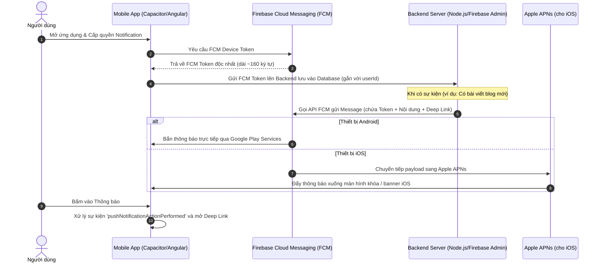

# 🔔 Hướng Dẫn Tích Hợp Push Notification Bằng Firebase Cloud Messaging (FCM) Cho Mobile App

> 📚 **Tài liệu liên quan trong hệ thống:**
> - [🌐 Thiết Lập & Hoạt Động Của Deep Link](DEEP_LINK_SETUP.md)
> - [📱 Tự Động Build APK & Phân Phối Firebase App Distribution](CI_CD_FIREBASE_APK.md)
> - [🍎 Tự Động Build IPA & Upload TestFlight / App Store](CI_CD_APP_STORE.md)

---

## 📌 Mục Lục
1. [Tổng quan về Firebase Cloud Messaging (FCM)](#1-tổng-quan-về-firebase-cloud-messaging-fcm)
2. [Kiến trúc & Cơ chế hoạt động của Push Notification](#2-kiến-trúc--cơ-chế-hoạt-động-của-push-notification)
3. [Phân biệt Notification Payload vs Data Payload](#3-phân-biệt-notification-payload-vs-data-payload)
4. [Bước 1: Thiết lập trên Firebase Console](#4-bước-1-thiết-lập-trên-firebase-console)
5. [Bước 2: Cấu hình Native trên Android](#5-bước-2-cấu-hình-native-trên-android)
6. [Bước 3: Cấu hình Native trên iOS (APNs & Certificates)](#6-bước-3-cấu-hình-native-trên-ios-apns--certificates)
7. [Bước 4: Cài đặt & Code trong Angular (Capacitor Push Notifications)](#7-bước-4-cài-đặt--code-trong-angular-capacitor-push-notifications)
8. [Bước 5: Kết hợp Push Notification với Deep Link để điều hướng](#8-bước-5-kết-hợp-push-notification-với-deep-link-để-điều-hướng)
9. [Bước 6: Gửi Push Notification thử nghiệm từ Backend (Node.js / cURL)](#9-bước-6-gửi-push-notification-thử-nghiệm-từ-backend-nodejs--curl)
10. [Các lỗi thực tế kinh điển & Cách xử lý triệt để](#10-các-lỗi-thực-tế-kinh-điển--cách-xử-lý-triệt-để)

---

## 1. Tổng quan về Firebase Cloud Messaging (FCM)

**Firebase Cloud Messaging (FCM)** là giải pháp nhắn tin đa nền tảng miễn phí từ Google, cho phép bạn gửi tin nhắn và thông báo đáng tin cậy đến các thiết bị di động (Android, iOS) và Web.

### 🌟 Ưu điểm nổi bật:
- **Miễn phí 100%**: Không giới hạn số lượng thiết bị hay số tin nhắn gửi đi.
- **Hỗ trợ đa nền tảng**: Cầu nối duy nhất gửi cho cả Android (thông qua Google Play Services) và iOS (thông qua Apple Push Notification service - APNs).
- **Phân nhóm đối tượng linh hoạt**: Gửi theo từng thiết bị đơn lẻ (Device Token), theo chủ đề (Topics), hoặc theo phân khúc người dùng (User Segments).

---

## 2. Kiến trúc & Cơ chế hoạt động của Push Notification

Dưới đây là sơ đồ luồng hoạt động từ lúc Client đăng ký nhận Token cho đến khi App nhận thông báo:



---

## 3. Phân biệt Notification Payload vs Data Payload

Rất nhiều lập trình viên gặp lỗi thông báo không hiển thị hoặc không kích hoạt code khi app ở chế độ Background. Nguyên nhân xuất phát từ việc hiểu sai 2 loại payload:

| Loại Payload | Ví dụ cấu trúc | Hành vi khi App ở Background | Hành vi khi App ở Foreground |
| :--- | :--- | :--- | :--- |
| **Notification Message** | `{"notification": {"title": "Chào bạn", "body": "Nội dung"}}` | Hệ điều hành tự hiển thị Banner trên Notification Center, **KHÔNG** chạy code JS của app. | Không tự hiện banner, event nhận vào code app. |
| **Data Message** | `{"data": {"blogId": "123", "action": "open_blog"}}` | Giao lại toàn bộ cho app tự xử lý ngầm (Client-driven). | Code app nhận qua event `pushNotificationReceived`. |
| **Combined (Khuyên dùng)** | Bao gồm cả 2 khóa `notification` và `data` | Hệ thống hiển thị Banner. Khi người dùng **bấm vào banner**, toàn bộ `data` được truyền vào app để xử lý mở màn hình tương ứng. | App nhận đầy đủ nội dung để hiện popup hoặc update badge. |

> [!TIP]
> **Khuyến nghị chuẩn Production:** Luôn sử dụng **Combined Payload** (kết hợp cả `notification` để hệ điều hành lo việc hiển thị banner, và `data` để lưu trữ URL deep link phục vụ điều hướng khi bấm).

---

## 4. Bước 1: Thiết lập trên Firebase Console

1. Truy cập [Firebase Console](https://console.firebase.google.com/) và chọn Project của bạn (`blog-dev-33836`).
2. **Đối với Android**:
   - Thêm ứng dụng Android với Package Name (ví dụ: `io.ionic.starter` hoặc `com.devblog.client`).
   - Tải file `google-services.json` về máy.
   - Di chuyển file vào thư mục: `android/app/google-services.json`.
3. **Đối với iOS**:
   - Thêm ứng dụng iOS với Bundle ID tương ứng (ví dụ: `com.devblog.client`).
   - Tải file `GoogleService-Info.plist` về máy.
   - Kéo file vào thư mục `ios/App/App/GoogleService-Info.plist` thông qua Xcode.

---

## 5. Bước 2: Cấu hình Native trên Android

### 5.1. Khai báo dependencies tại `android/build.gradle` & `android/app/build.gradle`

- Trong `android/build.gradle`:
```groovy
buildscript {
    dependencies {
        classpath 'com.google.gms:google-services:4.4.2'
    }
}
```

- Trong `android/app/build.gradle`:
```groovy
apply plugin: 'com.android.application'
apply plugin: 'com.google.gms.google-services' // Đặt ở dòng cuối cùng
```

### 5.2. Tùy chỉnh icon và màu sắc thông báo trong `AndroidManifest.xml`

Thêm vào bên trong thẻ `<application>`:
```xml
<!-- Đổi icon mặc định của Push Notification -->
<meta-data
    android:name="com.google.firebase.messaging.default_notification_icon"
    android:resource="@mipmap/ic_launcher" />

<!-- Đổi màu sắc điểm nhấn của Notification -->
<meta-data
    android:name="com.google.firebase.messaging.default_notification_color"
    android:resource="@color/colorPrimary" />

<!-- Kênh thông báo mặc định cho Android 8.0 (Oreo) trở lên -->
<meta-data
    android:name="com.google.firebase.messaging.default_notification_channel_id"
    android:value="dev_blog_general_channel" />
```

---

## 6. Bước 3: Cấu hình Native trên iOS (APNs & Certificates)

Để iOS nhận được Push Notification từ Firebase, bạn phải kết nối APNs (Apple Push Notification service) với Firebase:

1. **Bật Capability trong Xcode**:
   - Mở dự án bằng `npx cap open ios`.
   - Chọn **App Target** ➡️ tab **Signing & Capabilities**.
   - Bấm `+ Capability` ➡️ Thêm **Push Notifications**.
   - Bấm `+ Capability` ➡️ Thêm **Background Modes** ➡️ Tích chọn **Remote notifications**.
2. **Tạo APNs Key trên Apple Developer Portal**:
   - Vào mục **Certificates, Identifiers & Profiles** ➡️ **Keys**.
   - Tạo một Key mới, tích chọn **Apple Push Notifications service (APNs)**.
   - Tải file Key `.p8` về máy (chỉ tải được 1 lần duy nhất). Lưu lại `Key ID` và `Team ID`.
3. **Upload Key .p8 lên Firebase**:
   - Mở **Firebase Console** ➡️ **Project Settings** ➡️ Tab **Cloud Messaging**.
   - Ở mục **Apple app configuration**, nhấn **Upload** APNs Authentication Key (.p8).

---

## 7. Bước 4: Cài đặt & Code trong Angular (Capacitor Push Notifications)

### 7.1. Cài đặt plugin Capacitor
```bash
npm install @capacitor/push-notifications
npx cap sync
```

### 7.2. Xây dựng `PushNotificationService` trong Angular

Tạo service quản lý nhận diện và xử lý thông báo (`push-notification.service.ts`):

```typescript
import { Injectable, inject, NgZone } from '@angular/core';
import { Router } from '@angular/router';
import { PushNotifications, Token, ActionPerformed, PushNotificationSchema } from '@capacitor/push-notifications';
import { Capacitor } from '@capacitor/core';

@Injectable({
  providedIn: 'root'
})
export class PushNotificationService {
  private router = inject(Router);
  private zone = inject(NgZone);

  async initPushNotifications(): Promise<void> {
    // Chỉ chạy Push Notification trên thiết bị Native (Android / iOS)
    if (!Capacitor.isNativePlatform()) {
      console.log('🌐 Web platform: Bỏ qua khởi tạo Push Notifications Native');
      return;
    }

    // 1. Kiểm tra và yêu cầu quyền nhận thông báo
    let permission = await PushNotifications.checkPermissions();
    if (permission.receive === 'prompt') {
      permission = await PushNotifications.requestPermissions();
    }

    if (permission.receive !== 'granted') {
      console.warn('⚠️ Người dùng từ chối cấp quyền thông báo');
      return;
    }

    // 2. Đăng ký với hệ thống APNs / FCM
    await PushNotifications.register();

    // 3. Lắng nghe sự kiện nhận Registration Token
    PushNotifications.addListener('registration', (token: Token) => {
      console.log('✅ FCM Registration Token:', token.value);
      // Gửi token này lên backend của bạn qua API
      this.saveTokenToBackend(token.value);
    });

    // 4. Lỗi khi đăng ký token
    PushNotifications.addListener('registrationError', (error: any) => {
      console.error('❌ Lỗi đăng ký Push Notification:', error);
    });

    // 5. Nhận thông báo khi ứng dụng đang mở (Foreground)
    PushNotifications.addListener('pushNotificationReceived', (notification: PushNotificationSchema) => {
      console.log('📩 Nhận thông báo khi App đang mở:', notification);
    });

    // 6. Xử lý khi người dùng BẤM vào thông báo (Action Performed)
    PushNotifications.addListener('pushNotificationActionPerformed', (action: ActionPerformed) => {
      console.log('👆 Người dùng bấm vào thông báo:', action);
      const data = action.notification.data;

      // Xử lý Deep Link từ data payload
      if (data?.url || data?.link || data?.blogId) {
        this.handleNotificationNavigation(data);
      }
    });
  }

  private handleNotificationNavigation(data: any): void {
    this.zone.run(() => {
      if (data.url) {
        this.router.navigateByUrl(data.url);
      } else if (data.blogId) {
        this.router.navigate(['/blog', data.blogId]);
      }
    });
  }

  private async saveTokenToBackend(token: string): Promise<void> {
    // Gọi API Backend lưu token vào hồ sơ người dùng
  }
}
```

---

## 8. Bước 5: Kết hợp Push Notification với Deep Link để điều hướng

Một trong những trải nghiệm quan trọng nhất là: Khi người dùng bấm vào thông báo `"Có bài viết mới: Deep Link Setup"`, ứng dụng phải mở đúng trang chi tiết bài viết đó thay vì chỉ mở trang chủ.

Payload gửi đi từ server đính kèm đường dẫn điều hướng:
```json
{
  "notification": {
    "title": "🔥 Bài viết mới trên DevBlog!",
    "body": "Khám phá kỹ thuật cài đặt Deep Link trên iOS và Android"
  },
  "data": {
    "url": "/blog/123",
    "blogId": "123",
    "type": "NEW_BLOG_POST"
  }
}
```

Khi người dùng nhấn vào banner thông báo, listener `pushNotificationActionPerformed` sẽ trích xuất `data.url` và kích hoạt Angular Router:
```typescript
this.zone.run(() => {
  this.router.navigateByUrl(data.url); // Mở tức thì /blog/123
});
```

---

## 9. Bước 6: Gửi Push Notification thử nghiệm từ Backend (Node.js / cURL)

### Cách 1: Sử dụng Node.js & `firebase-admin` (Chuẩn Production)

```javascript
const admin = require('firebase-admin');
const serviceAccount = require('./serviceAccountKey.json');

admin.initializeApp({
  credential: admin.credential.cert(serviceAccount)
});

async function sendPushNotification(registrationToken) {
  const message = {
    token: registrationToken,
    notification: {
      title: 'DevBlog: Bài viết mới cập nhật',
      body: 'Hướng dẫn cài đặt Push Notification với Firebase hoàn tất!'
    },
    data: {
      url: '/blog/5',
      blogId: '5'
    },
    android: {
      priority: 'high',
      notification: {
        sound: 'default',
        channelId: 'dev_blog_general_channel'
      }
    },
    apns: {
      payload: {
        aps: {
          sound: 'default',
          badge: 1
        }
      }
    }
  };

  try {
    const response = await admin.messaging().send(message);
    console.log('✅ Gửi thông báo thành công. ID:', response);
  } catch (error) {
    console.error('❌ Lỗi khi gửi thông báo:', error);
  }
}
```

### Cách 2: Gửi nhanh từ Firebase Console (Không cần code backend)
1. Vào Firebase Console ➡️ **Messaging** (Cloud Messaging).
2. Bấm **New campaign** ➡️ **Notifications**.
3. Nhập **Notification title** và **Notification text**.
4. Bấm **Send test message** ➡️ Dán chuỗi `FCM Token` lấy từ console log của app vào để kiểm tra ngay lập tức.

---

## 10. Các lỗi thực tế kinh điển & Cách xử lý triệt để

### ❌ Lỗi 1: Android 13+ không hiển thị popup xin quyền thông báo
- **Nguyên nhân**: Từ Android 13 (API 33), Google bắt buộc xin quyền runtime `POST_NOTIFICATIONS`.
- **Khắc phục**: Khai báo quyền trong `AndroidManifest.xml`:
  ```xml
  <uses-permission android:name="android.permission.POST_NOTIFICATIONS"/>
  ```

### ❌ Lỗi 2: Bấm vào thông báo nhưng app không chuyển trang
- **Nguyên nhân**: Hàm chuyển trang `router.navigateByUrl` chạy ngoài `NgZone` của Angular nên View không được kích hoạt cập nhật.
- **Khắc phục**: Luôn bọc lệnh điều hướng bên trong `this.zone.run(() => { this.router.navigateByUrl(...); })`.

### ❌ Lỗi 3: iOS Simulator không nhận được thông báo
- **Nguyên nhân**: Trước Xcode 14, iOS Simulator không hỗ trợ APNs. Từ Xcode 14+, Simulator hỗ trợ test trên máy tính chip Apple Silicon với điều kiện có cấu hình đầy đủ.
- **Khắc phục**: Để có kết quả kiểm tra chính xác 100%, hãy ưu tiên test trên thiết bị iPhone thật.

---

> [!NOTE]
> Bài viết thuộc chuyên mục **Firebase & Mobile Development** trên DevBlog Client. Hãy lưu lại bài viết để làm tài liệu tra cứu khi phát triển tính năng thông báo thời gian thực!
